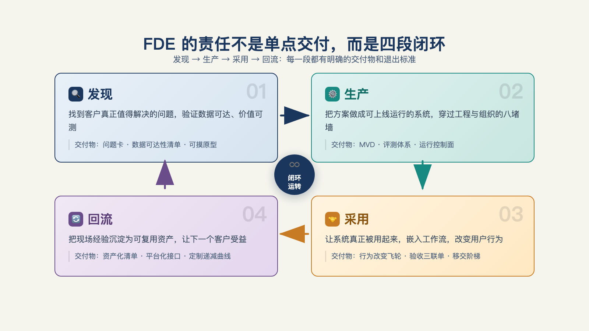

# 第 1 章 · FDE 到底是什么——他对什么结果负责？

> 伟大的代价是责任。
> The price of greatness is responsibility.
> ——温斯顿·丘吉尔，1943 年哈佛演讲

2026 年，有三个人的名片都写着 Forward Deployed Engineer（FDE，通常称"前线部署工程师"，或者"前沿部署工程师"），工作却相差很大。

第一个人每天把约 75% 的时间用在模型优化和工程代码上。第二个人同时服务十个客户，会议和开发各占一半，随时要处理线上问题。第三个人坐在客户办公室收集需求，当场用 AI 做出原型，确认后再交给后端团队。

同一个头衔，三种工作方式。

所以，判断一个岗位是不是 FDE，不能只看名片。要看他对什么结果负责，负责到什么程度。

## 一、先承认：头衔帮不上忙

用某家公司的招聘页来定义 FDE，得不到完整答案。

同叫 FDE，工作内容和要求可能完全不同。Baseten 把模型优化和基础设施工程列为核心工作[^b11]。一家欧洲公司 2026 年的远程 FDE 职位要求 Python、SQL 和 PoC 能力[^c15]。国内 Linux DO 社区的一位大厂 FDE 则描述自己的日常：去客户现场收集需求，用 AI 做出原型，确认后交给后端团队[^c21]。三家公司使用同一个头衔，实际做的却是三种不同的工作。

反过来，有些岗位不叫 FDE，却承担着完整的 FDE 工作。公司可能称它为"解决方案工程师""交付工程师""AI 应用架构师"，也可能只是客户成功团队里负责写代码的人。

这不只是命名混乱。FDE 先在具体公司里形成，再被不同组织按自己的方式使用，岗位形态自然会变化。但它们承担的核心责任，往往很接近。

## 二、一个浓缩的定义

要理解为什么会有 FDE，可以先看鲍勃·麦格鲁（Bob McGrew）的说法。他曾是 Palantir FDE 模式的亲历者，后来担任 OpenAI 首席研究官。他在 Y Combinator 的播客中把 FDE 概括为：**为单个客户交付许多能力**。传统软件工程师则是**为许多客户做单一能力**[^c06]。

产品工程师把一个能力做成通用产品，交给许多用户。FDE 面对一家具体客户，要在它的系统、权限、流程和协作关系中，把几项能力接上去、跑起来，并让客户持续使用。麦格鲁描述的流程包括：进入现场、快速做原型、持续迭代、接入生产环境。这些工作都围绕客户现场展开。

在 Palantir，相关人员又分成 Echo团队 和 Delta团队。Echo 是业务前线，由驻场分析师和客户经理组成，负责判断客户该解决什么问题；Delta 是技术前线，也就是狭义的部署工程师，负责把方案做成能运行的系统[^c06][^l01]。国内企业往往不把这两类工作分给两个小队，而是让同一个人或一个小组同时承担[^l01]。

这套分工不按职级、技术栈或是否懂机器学习来划分。它只区分一件事：谁负责判断该做什么，谁负责把它做出来。

最后补一句定义层面的澄清：FDE 既指角色，也指建制（组织形式）。它的完整形态不是一个人，而是一支客户现场的小队——Echo/Delta 与第 26 章的中国三人组，是同一支小队的不同编法；单人 FDE，是把建制裁剪后压进一个人。本书多数章节以个人视角展开，但那个"个人"的背后，始终站着一支可以拆开、也可以合并的团队。

## 三、FDE 的时间都花在哪了

职位说明未必反映真实工作，日程表往往更可靠。Baseten 的 FDE 赫特·特里维迪（Het Trivedi）曾公开拆解时间分配：约 75% 用于软件工程和模型优化，15% 用于技术咨询，10% 用于客户关系[^b11]。

这组数字能澄清两种常见误解。FDE 不是主要靠沟通成交的"会写代码的售前"，因为工程工作占了大头。FDE 也不等同于被派去写代码的外包工程师，因为他还要花时间理解问题、与客户协作。

这只是单个公司的岗位设计，不能当作行业平均[^b11]。但它说明了一个要点：FDE 以工程工作为主，同时必须在客户关系中完成工程工作。后文会不断看到这一点：一个人承担什么责任，时间就会花到哪里。

这只是美国样本。中国 FDE 可能投入更多时间梳理业务问题、维护客户关系。有从业者称，自己约 60% 的时间都在做这些事，技术占的反而不是大头——这笔中国时间账的完整展开见第 18 章。

## 四、责任四分法

国内开发者社区里，一位 FDE 曾把工作过程概括为："深入业务→流程优化方案与技术架构→开发→培训/灰度/调整业务流程→反馈/监控/修复/优化成本"[^c24]。

这段过程可以拆成 FDE 需要承担的四类责任。

一个完整的 FDE，要同时对四件事负责。

1. **问题发现**——判断客户的哪个场景值得做。不是客户说什么就做什么，而是替客户把"模糊的愿望"筛成"值得解决的问题"。（第 6 章展开）
2. **生产工程**——让它安全、稳定、可维护地跑在客户的真实环境里，而不是停在演示环境。（第三部展开）
3. **业务采用**——让真实用户真的在用，系统上线不等于有人使用。（第 15 章展开）
4. **产品回流**——把现场沉淀的经验带回产品，让下一个客户更快。（第 22 章展开）

回看这段表述："深入业务"属于问题发现，"开发"属于生产工程，"培训/灰度"属于业务采用，"流程优化沉淀"属于产品回流。它与四类责任基本一致（见图 1-1）。

*图 1-1：FDE 的责任不是单点交付，而是发现、生产、采用、回流四段闭环。*

同时承担四类责任，才是完整形态的 FDE。只承担其中一两类，也可能是 FDE 工作的一部分。这并不意味着高低之分。多数岗位本来就只承担一个部分，关键是知道自己承担的是哪一部分。

## 五、同一周里的三个 FDE

以下是一个经过脱敏的示例：用于演示四分法的用法。

**P，模型平台型 FDE。** 上午在排查客户模型推理的延迟毛刺，下午给客户的算法团队讲解批处理接口的取舍。他的责任重心在生产工程——发现问题靠平台同事，推动使用靠客户自己的团队，经验回流靠平台路线图。按四分法，他主要落在第二格。

**M，多客户并行型 FDE。** 十个活跃客户，每周五十小时，会议和构建对半。上午在 A 客户的联调会上拍板一个数据接口方案，中午处理 B 客户的生产告警，晚上给 C 客户写周报。四类责任他都要管，但每一类都分不到足够的时间——他的风险不在能力，而在精力被十个客户摊薄。

**W，驻场原型型 FDE。** 在客户办公楼里，上午跟业务部门过需求，中午用 AI 工具把确认下来的流程拼成可点击的原型，下午把原型移交公司的后端团队去实现生产版本。发现和原型归他，生产和回流在别处——按四分法，他只覆盖第一格的一部分。

三个人都叫 FDE。用四分法来看，他们承担的责任并不相同。

哪个才算"真的"FDE？三者都可以这样称呼。更有用的问题是：他们分别处在哪个位置。只有先看清位置，后面讨论考核、转型和商业模式才有基础。

## 六、最后

本章可以总结成三句话：

- FDE 不是固定工种，而是一种**责任结构**：对客户业务中真正运行、可维护、可衡量的结果负责。
- 判断时不看名片，先看四件事：**是否写生产代码、现场经验是否回到产品、是否对采用负责、对结果负责到什么程度**。
- 同一头衔下的岗位千差万别是常态；四分法量出的是位置，不是高下。

标准定好了，但一个新的问题立刻冒出来：这个责任结构，和售前、咨询、外包、客户成功这些"老邻居"的边界到底在哪里？这是第 2 章要讨论的事。

---

[^b11]: Baseten：我做前线部署工程师学到了什么（Het Trivedi）
[^c15]: 欧洲远程 FDE 职位说明（@afahmy_dev 转帖）
[^c21]: 有在做 FDE 这个工作的佬吗（linux.do 帖）
[^c24]: linux.do 帖 #2580046
[^c06]: Y Combinator：The FDE Playbook for AI Startups（Bob McGrew）
[^l01]: 腾讯研究院《FDE 模式行业观察与实践》、思二勋《FDE 交付范式革命》
