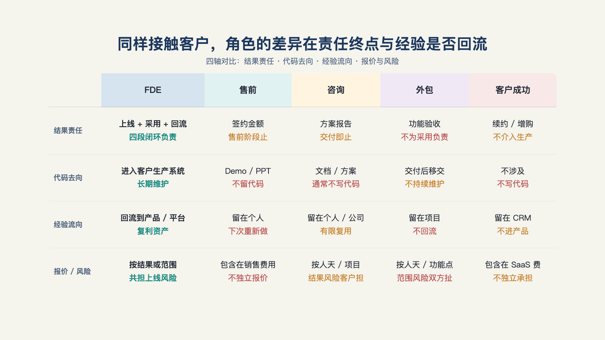

# 第 2 章 · FDE 和售前、咨询、外包、客户成功的区别，评判标准到底是什么？

> 名不正，则言不顺；言不顺，则事不成。
> ——《论语·子路》

"FDE 和售前、咨询有什么区别？"这个问题常被问起，答案却并不一致。有人说 FDE 更懂业务，有人说它更偏工程。

先看两个岗位。它们都要进入企业客户，部署一套能跑通业务的 AI 系统；都要写代码、接系统、盯效果。A 公司称这个岗位为"解决方案工程师"：他写演示代码，成交后离场，按人天报销差旅。B 公司把近似的工作称为"FDE"：代码要进生产环境，现场经验要回到团队，报价还和业务结果相连。

只看每天做什么，两份岗位描述几乎一样。再看合同与考核，两者承担的责任却不同。

这种情况很常见。不同公司的 FDE 本来就可能是不同角色；同一个人换一份合同，即使工作内容不变，角色也可能从 FDE 变成解决方案工程师。

既然名字不能定义角色，应该看什么？

## 一、岗位职责对比

最直觉的办法，是按"写不写代码、面向谁、什么时候离场"把相邻角色列一张表：

| 角色 | 写不写代码 | 面向谁 | 什么时候离场 |
| --- | --- | --- | --- |
| 软件工程师（SWE） | 写，产品代码 | 自己公司的产品 | 持续迭代，不离场 |
| 售前/解决方案工程师（SE） | 写，演示代码 | 潜在客户 | 成交即离场 |
| 咨询 | 基本不写，产出方案与规划文档 | 客户业务方 | 里程碑验收后离场 |
| 外包/驻场开发 | 写，客户指定的代码 | 客户项目 | 合同结束离场 |
| 客户成功（CSM） | 基本不写 | 已成交客户 | 持续服务，不离场 |

售前也可能写生产代码，咨询也可能驻场一年，外包团队也可能很懂业务。表格列的是角色通常做什么，而例外恰恰出在"通常"上。一旦例外变多，它就不能再用来判断，只能提醒人们不要想当然（见图 2-1）。

*图 2-1：同样接触客户，角色的差异在责任终点与经验是否回流。*

为什么这些例外如此常见？

Cresta 的 AI Agent FDE 负责人钟钱杰说过："任何你能教会客户的，就不是 FDE。"[^b21]他用传统 SAP 实施作对照。SAP 的规则明确，可以写进手册；客户学会后，内部团队能继续维护。这类工作可以完整交接，比较接近咨询或实施。

他所说的 AI Agent 不是这样。即使客户有数百名工程师，也未必能把幻觉率和响应延迟稳定控制住。问题不在于客户缺少资料，而在于判断会随模型和场景变化，无法一次写进手册。遇到这种情况，就需要有人持续在现场处理。

这句话揭示了表格的隐含前提：它假定"是否写代码""面向谁"等工作内容稳定不变。但工作复杂到难以交接时，角色边界会随项目变化。今天看似是解决方案工程师的工作，明天可能需要长期驻场；一项能完整交接的工作，无论叫什么，最后都会变成一次性的知识转移。

工作内容会变，因此不能只用内容判断角色。本章改看三项可观察的标准：代码是否进入生产环境、现场经验是否回到产品、收费按投入还是按结果计算。

## 二、评判标准一：代码的去向

第一问：**这个人写的代码，最后运行在哪里？**

售前写演示代码，是为了促成成交。演示结束后，这段代码通常也就结束使命。FDE 写生产代码，是为了让系统持续运行。代码要通过客户的审查，进入部署流程，并接受客户的运维要求。

同样一行代码，去向不同，责任也不同。演示代码出错，可能失去一笔订单；生产代码出错，可能影响客户的业务。

AI 编程工具扩大了 FDE 能直接改动的范围。过去，一个 FDE 很难同时处理多个客户项目的不同代码库。现在，只要他说得清想要的结果是什么，就可以借助 AI 修改 TypeScript、Swift 或数据库相关代码[^b21]。这使他不仅能把代码交付给客户，也更容易把现场发现的问题和可行解法落回公司的产品线[^b21]。

## 三、评判标准二：经验的流向

第二问：**项目结束后，现场学到的经验去了哪里？**

经验可能有三种去处，也对应三种角色。

第一种是回到产品。FDE 把定制中发现的需求、遇到的问题和可复用组件带回产品团队，变成下一位客户可以直接使用的能力。这是 FDE 应有的流向。

第二种是进入报告。经验写成结项文档和案例库，为下一次提案提供素材。这更接近项目制咨询。

第三种是留在人脑中。人员离开后，经验也随之消失。这是外包项目常见的情况。

长期研究这类商业结构的从业者巴克利克·帕特尔（Bhaulik Patel）曾提醒：不回流的 FDE 组织，本质上是 **"藏在软件公司内部的高成本专业服务组织"**[^c14]，不管名片上写什么。

用这条标准看国内常见的一种形态：FDE 到客户处收集需求，现场做原型，确认后交给后端团队。经验停在交接文档里，因此按第二条标准，它更接近**原型外包**，而不是完整 FDE[^c21]。这不代表它低级。在特定采购结构下，这可能是合理分工（第 18 章会展开）。标准的作用是帮助定位，不是给角色贴褒贬标签。

## 四、评判标准三：报价方式与责任

第三问：**这个岗位的报价方式，按投入算还是按结果算？**

按人天计费，客户购买的是时间；这段时间产出多少，由客户自己判断。按结果收费，客户购买的是某个结果的改善；供应商也要承担一部分结果没有改善的风险。

两种计费方式没有高下，却会引导不同的行为。按人天收费的组织会关心人员是否被充分使用。按结果收费的团队会更关心问题是否真的解决。一位 AI 交付合伙人说得很直接：按日计费，增效的上行收益与自己无关[^b01]。

报价方式是三项标准中最容易核实的一项，因为它写在合同和发票上。岗位可以宣称重视客户成功，但收费方式会说明它实际承担了什么责任。

## 五、同一个项目的三种不同方式

以下示例，仅用于展示三条标准的组合用法。

一家零售企业要上"智能补货 Agent"。同一件事，三种合同结构，长出三种角色——

- **结构一：按人天外包。** 乙方派两名工程师驻场六个月，按天计费。工程师写的代码进了生产，但经验流向个人；效果没人担保，工时就是交付物。三条标准：①生产代码 ✓ ②不回流 ✗ ③按投入 ✓——这是外包，驻场而已。
- **结构二：固定范围交付＋回流条款。** 同一批工程师，合同写明"定制过程中产生的可复用组件归乙方并回产品线"。经验开始回流，但效果责任仍在验收节点终止。三条标准：①✓ ②✓ ③混合——这是带产品责任的交付，已站在 FDE 门槛上。
- **结构三：结果分成。** 不达基线改善不收费，改善部分按比例分成。乙方主动砍掉伪需求、只做能测量的事。三条标准：①✓ ②✓ ③按结果 ✓——这是完整责任结构的 FDE。

这个演示说明，改变角色的不是工程师本人，也不是技术本身，而是合同结构和经验的去向。同一个工程师在三种安排里，承担的是三种责任。

## 六、三问定位卡

把三条标准收成一张可以自查、也可以在面试时反问雇主的卡片：

> **三问定位卡**
> 1. 这个岗位写的代码，上不上生产？（问工程负责人：上一个项目的代码现在还跑着吗？谁在维护？）
> 2. 项目结束后，现场经验去哪？（问面试官：上一个项目的定制组件，进产品线了吗？有没有"回流评审"这种机制？）
> 3. 我的考核指标是工时还是结果？（问 HR 与业务负责人：这个岗位背什么指标？采用率？留存？还是人天利用率？）

三问没有标准答案，关键看组织能不能答清楚。一个组织能明确回答三问，说明它的责任安排至少是清楚的，无论岗位是否叫 FDE。三个问题都说不清，头衔再新也无法说明责任由谁承担。

## 七、现实是骨感的

必须说实话：是否符合三条标准是"理想型"，不会非黑即白。

现实中的多数岗位都是混合体。有人七成时间写生产代码，三成时间支持售前；多数组织也只能做到部分经验回流。

因此，这些标准应该用来定位和规划。先看清自己或目标岗位在三条标准上处于哪里，再判断想往哪个方向调整，以及需要付出什么。

标准已经有了，它能把位置定出来。但位置定出来之后，新的问题跟着来了：这套责任结构，到底是新东西，还是老东西换了名字？

---

[^c14]: @deployengineer（Bhaulik Patel）系列长文
[^c21]: 有在做 FDE 这个工作的佬吗（linux.do 帖）
[^b01]: 十字路口 × Rolling AI：FDE 对谈
[^b21]: 腾讯研究院 AI 透镜圆桌 06：来自硅谷一线创业者的 FDE 非共识与落地指南
