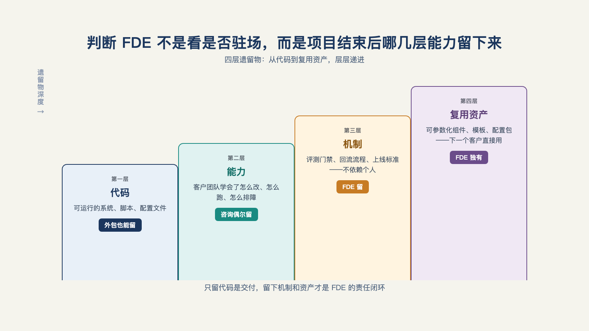

# 第 3 章 · FDE 是不是外包换皮、一阵风？

> 已有的事，后必再有；已行的事，后必再行。日光之下，并无新事。
> ——《圣经·传道书》1:9

一位从事 FDE 咨询的从业者直接承认："FDE 是新瓶装旧酒。"他把这门生意拆成"技术咨询顾问，加上 SaaS 驻场工程师"，"噱头里有真有假。"[^b17]

从业者自己这样说，本章似乎可以结束了。但这句话只说对了一半。本章要具体区分：哪些表现只是泡沫，哪些需求不会随着概念热度消失。先正面回应怀疑，才能把问题说清楚。

## 一、四层标准：项目结束后留下了什么

判断一个团队是不是 FDE，不必先看岗位名称。先看项目结束后留下了什么[^l01]。这个标准可以分成四层：

- **只给客户留下一个系统**：这是外包。系统交付后，合作结束。
- **带回一些经验，但下次无法复用**：这是项目制交付。经验变成结项文档，下一次提案时可以参考。
- **把经验做成 Skill、模板或产品能力**：这是 FDE。现场经验被整理成可复用的内容。
- **这些沉淀能明显降低下一位客户的成本**：这是可以规模化的 FDE。团队开始从过去的项目中持续受益。

这四层标准与第 2 章的第二项标准"经验的流向"一致，但多问了一步：经验回去以后，下一位客户是否因此做得更快。第 21 章会讨论定制如何递减，第 22 章会讨论经验如何回到产品；这里先不展开（见图 3-1）。

*图 3-1：判断 FDE 不是看是否驻场，而是项目结束后哪几层能力留下来。*

开发者社区里，"FDE 是不是咨询换皮"的讨论不断出现。一位从业者说得更尖锐：不少"FDE 培训"是在"把 AI 的信息差，卖给有闲钱又焦虑的小老板"[^c21]。

从业者承认它有旧的一面，媒体和培训市场又不断包装新概念。泡沫究竟在哪里？

## 二、泡沫的三种具体表现

把常见现象分开看，泡沫主要有三种表现：

**第一，头衔膨胀。** 把原有的实施岗、售前岗改名为 FDE，是最容易跟随热点的做法。最常见的情况，是把"会用 AI 编程工具写代码"包装成 FDE。中文开发者社区的一位用户说："不单纯在 cc 里 vibe coding 就能叫 FDE，这只是解决开发的问题。"[^c24]

**第二，培训收割。** 课程把概念名词和工具操作卖给焦虑的转型者，卖点是"再不转就晚了"。这并非 FDE 独有，每个新头衔都容易出现类似培训。FDE 的特殊之处在于，它的核心是承担真实交付责任；这种责任不能仅靠课程学会，必须在真实场景中练出来（第 25 章会展开）。

**第三，组织内耗。** 有些公司跟风设岗，却没有经验回流机制，也不按结果考核。FDE 最后只成了昂贵的驻场人力。有一些从业者提到的"藏在软件公司内部的高成本专业服务组织"，说的就是这种情况[^c14]。

这三种情况有一个共同点：它们都处在三项评判标准里弱的那一档——不写生产代码、不回流、按人天计费。泡沫不在"FDE"这个词，而在于人们如何使用这个词。

## 三、真实的那一半

再看另一半。判断一个需求是泡沫还是长期存在的需求，不能只看热度，要看支撑它的条件会不会消失。

"Prompt 工程师"可以作对照。ChatGPT 带动生成式 AI 普及后，这个头衔一度很热，随后很快降温。原因在于提示词技巧依赖模型当时的弱点；模型每进步一代，其中一部分技巧就会失去价值。Prompt 工程是一种会被工具进步改变的技能。

FDE 面对的不是一项可以单独练成的技能，而是一段持续的合作关系：客户有真实的生产环境，供应商要把系统交付进去。在这种关系中，总要有人负责接入系统、让它运行，并让客户持续使用。模型变强，也不会自动摆平客户的权限、流程和利益分配。Agent 越深入业务，系统集成反而可能越复杂[^c01]。

财务上还有一条旁证。一位在 Palantir 工作多年的工程师回忆，公司 2023 年的毛利率约为 80%，传统咨询巨头埃森哲约为 32%[^b18]。如果 FDE 只是换了名字的驻场外包，利润结构应更接近咨询公司；而它呈现出的特征更接近软件公司。差别来自哪里？来自现场经验被反复整理进产品。这正是四层标准的第四层，第 22 章会解释其中的机制。

## 四、结论：对一半，错一半

本章的结论分两半，各自成立：

- **需求是真的。**把 AI 安全接入客户生产环境，是长期存在的需求。生产环境复杂，组织之间也需要建立信任；这些条件短期内不会消失。
- **角色未必都叫 FDE。**FDE、能力升级后的咨询团队，或客户自己的内部团队，都可能承担这项工作。市场会改变头衔，概念热度会下降，但问题还在。

至于这个概念还能流行多久，哪些工作会被 AI 替代，头衔本身会不会消失，分别留给第 5 章和第 28 章回答。

这里还剩一个关于时间的问题：如果它不是一阵风，为什么偏偏在 2026 年刮成这样？第 4 章把 2026 年上半年发生的事展开。

---

[^b17]: 破局点 TURNING POINT 第 31 期：中国式 FDE
[^c21]: 有在做 FDE 这个工作的佬吗（linux.do 帖）
[^c24]: linux.do 帖 #2580046
[^c14]: @deployengineer（Bhaulik Patel）系列长文
[^b18]: Reflections on Palantir（Nabeel Qureshi）
[^c01]: a16z：Box CEO 谈 AI Agent 与企业为何跟不上
[^l01]: 腾讯研究院《FDE 模式行业观察与实践》、思二勋《FDE 交付范式革命》
