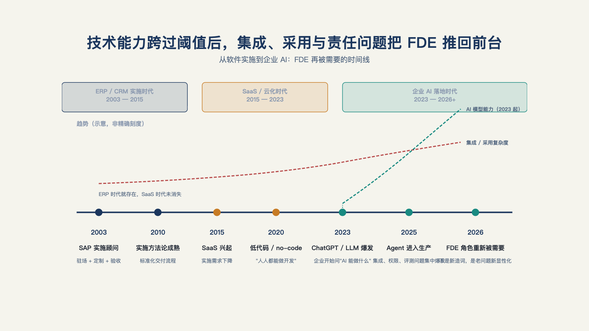

# 第 4 章 · 为什么 FDE 在 2026 年突然火起来？

> 人们总是高估未来两年的变化，而低估未来十年的变革。
> ——比尔·盖茨《未来之路》（1995）

2026 年 5 月，两个星期一之间发生了两件事。5 月 4 日，Anthropic 宣布与黑石、H&F、高盛组建交付合资公司[^a09]；5 月 11 日，OpenAI 成立控股子公司 DeployCo，据报初始资金逾 40 亿美元、首日即有约 150 名 FDE 到岗[^n01]。

这件事热度很大。让我们先用一条**事件时间线**，看清 2026 年的 FDE 到底为什么火。

## 一、时间线：2003 到 2026

| 时间 | 事件 |
| --- | --- |
| 2003 | Palantir 成立；2000 年代中期 FDE 实践成形 |
| 约 2007 | 早期员工首次进驻客户保密环境，驻场交付形态成形 |
| 2026-02 | 微软发布 Agent Factory 白皮书；富士通在投资人简报中披露 AI 驱动开发投入 |
| 2026-03-18 | 埃森哲×微软联合推出 FDE 实践服务，官方口径"数千名 AI 工程师"直接驻客户 |
| 2026-05-04 | Anthropic 组建交付合资公司（黑石/H&F/高盛参与） |
| 2026-05-11 | OpenAI 成立 DeployCo（控股子公司；据报逾 40 亿美元、收购约 150 名 FDE） |

把这张事件表拉成两条曲线看得更清楚：集成与采用的复杂度从 ERP 时代就存在、从未真正消失，AI 模型能力只是 2023 年之后才被画出来的新变量（见图 4-1）。

*图 4-1：技术能力跨过阈值后，集成、采用与责任问题把 FDE 推回前台。*

## 二、时间线解读

把时间线里的原始事实连起来看，能读出层层加码的解读。

这几层解读指向同一件事：咨询巨头、模型公司、云厂商、FDE 概念的原创者，这几类原本并无交集的组织，几乎在同一个窗口期，各自摸到了同一个市场痛点、找到了同一个切入点——这块地带已经大到没有谁能继续忽略。

**第一层：咨询巨头入场，FDE 从战术变成采购品类。** 当埃森哲把它做成主力服务线[^a21]，"前线部署"就不再是某家产品公司的独门打法，而成了企业采购目录里的一个标准条目——甲方可以像买标准品一样，走预算、走招标、走验收把它买进来。品类化抬高了门槛：后续进入者的起点也提高了。

**第二层：模型公司下场，是"只卖 API 是远远不够的"。** 能力最强的模型公司亲自组建交付组织，等于公开承认：光有模型能力，还是实现不了客户价值。交付是模型商业化的下半场——这恰好是前言那个"卡点存在"论点的企业级版本。

**第三层：云厂商同样下场，逻辑是"算力要落进生产环境才变成收入"。** 云计算厂商卖的是算力，但客户买算力的前提，是能把算力真正用进生产系统——一堆闲置的 GPU 配额换不来续费。这个动机与模型公司如出一辙：只卖底层能力不够，得有人把能力接进客户的实际业务，付费才能持续。

**第四层：FDE 概念的原创者，开始把它做成 AI 产品。** Palantir 的"AI FDE"智能体——自然语言操作、闭环执行、遵循用户现有权限[^a24]——意味着 FDE 概念开始自我迭代：真人 FDE 的执行工作，正在被装进产品里。

这几层叠起来，回答上面的问题：2026 年的密集下场不是舆论事件，而是一连串动作——市场正在把"交付能力"当作独立于"模型能力"的稀缺品来定价。

## 三、通用技术的生产率红利，为什么总是来得更晚

上面的解读回答了"谁在入场"；但一个扎心的问题绕不开：整个社会的资本开支已经这么大，为什么整体生产率数字还没有明显跳升？这种质疑不能只靠"AI 很重要"来反驳，放进更长的技术史里，反而看得更清楚。

经济史学者 Paul David 记录过工厂电气化的滞后：电力从 1880 年代进入美国工厂，到生产率明显释放，中间隔了大约四十年[^d90]。原因不是工厂不会用电，而是早期工厂只是把蒸汽机原地换成电动机，却保留了天轴、传动带、多层厂房这套围绕蒸汽机设计的旧结构。电的真正优势——分布式供能、工序独立调度、更灵活的厂房布局——要等到厂房本身按电力重新设计之后，才被释放出来。据该文献转引的历史统计，1899 年电动机在美国制造业驱动功率里的占比还不到 5%，1919 年前后就已升至半数以上，到 1929 年达到四分之三左右——设备换装本身并不慢，慢的是厂房与工序按电力重新设计[^d90]。

个人电脑经历过同一个阶段。经济学家罗伯特·索洛 1987 年那句被反复引用的书评——"计算机时代无处不在，唯独不在生产率统计里"——说的不是电脑没用，而是当时的企业把电脑当成更贵的打字机：在电脑上打字、打印、装订，再交给人归档，流程本身没有变[^s87]。

不同技术不能机械类比，但这段技术史给出一个可核验的提醒：通用技术往往先被采纳、再被塞进旧流程，最后才在组织被重新设计之后，显现为生产率的跃升。

今天 AI 容易被误读，正是因为模型能力的进步按月发生，看得见；组织重构的代价——部门边界、预算、权限、绩效怎么重新划——按季度甚至按年发生，看不见。

生产率数字暂时没有跳升，证明不了 AI 没有价值，而恰恰说明组织重构还没追上模型能力——这恰好呼应上一节的解读：各家不约而同选在这一年往"交付"上砸真金白银，正是在补组织重构这一课。

## 四、降温收尾

一批结构不同的组织——咨询巨头、模型公司、云厂商——在同一个时间窗口里，对"交付"做了真金白银的结构性投入。这类投入为什么必要，技术史上电力、个人电脑走过的路已经给出过先例。

岗位会不会长期存在、概念会不会退潮、今天入场的人会不会获益，是另一个问题——时间线证明的是投入，不是回报，回报要看第五部那本账，以及第 28 章那个终局问题。

时间线本身还留着一个伏笔，藏在第四层解读里：概念的原创者已经把 FDE 做成了 AI 产品。发明这个角色的人，正在用 AI 替代它的执行部分——这个角色还剩下什么，是本章事实摆完之后绕不开的下一个问题，第 5 章正面回答它。

---

[^a21]: 埃森哲推出微软前线部署工程实践
[^a09]: Anthropic 与黑石、H&F、高盛组建企业 AI 服务合资公司
[^n01]: Forward deployed engineer is AI's hottest job as OpenAI and Google race to hire
[^a24]: Palantir Foundry「AI FDE」产品文档
[^d90]: The Dynamo and the Computer: An Historical Perspective on the Modern Productivity Paradox
[^s87]: We'd Better Watch Out（书评）
