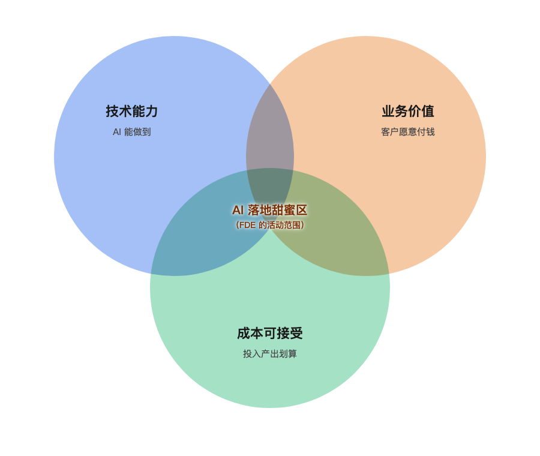
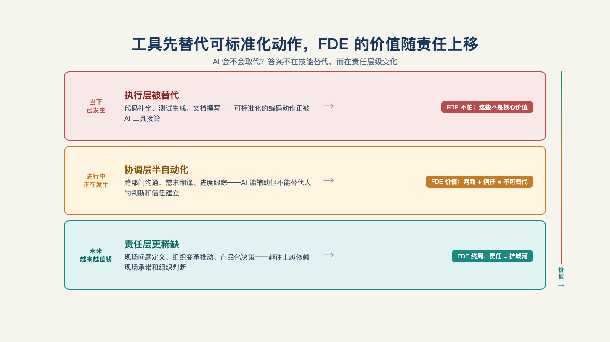

# 第 5 章 · FDE 会被 AI 取代吗？

> 计算机永远无法被追责，因此计算机永远不应该做管理决策。
> ——IBM，1979 年内部培训材料

把 FDE 这个概念带进世界的公司 Palantir，2026 年亲手把它做成了 AI 产品：Palantir 的"AI FDE"智能体，用自然语言操作 Foundry、自动执行、闭环运行，且所有操作遵循用户现有权限[^a24]。概念的原创者，率先把自己的执行工作 AI 化了。

这听起来像"FDE 已死"的讣告，其实是本章的第一份证据——它精确演示了 AI 吃掉的是什么（任务），吃不掉的是什么（责任）。把这两样东西分开，是本章讨论的前提。

FDE 之所以存在，本来就是因为它站在**技术能力、业务价值、成本可接受**三者的交叉地带——只有"AI 能做到""客户愿意为此付钱""投入产出划算"三个条件同时成立，才需要一个人去把它接进生产环境。模型能力每往前一步、推理成本每降一格，这块交叉地带就扩大一圈，AI 能独立覆盖的业务范围也跟着变大。理解这一点，才看得清"AI 会不会取代 FDE"这个问题问的到底是什么——不是这个角色会不会消失，是这块地带的边界，往哪个方向移动。

*图 5-1：技术能力、业务价值、成本可接受三个圆两两重叠不难，难的是三者同时重叠——这块交叉区域，就是 FDE 的活动范围。*

## 一、AI 会取代 FDE 吗？

AI 取代的从来不是岗位，是**任务**；而一个岗位是不是被取代，取决于它剩下的任务还够不够撑起一份责任。或者换一种问法：FDE 的工作里，哪些任务正在被吃掉，哪些吃不掉？

把 FDE 的工作分解成任务清单，逐层标注，得到三档：

| 档 | 任务 | 状态 |
| --- | --- | --- |
| 正在被 AI 化 | 写集成代码、样板对接、生成初版文档、演示材料、常规数据处理 | 大量被吃掉 |
| 部分被 AI 化 | 评测设计、失败判定、方案比选、数据契约起草 | AI 出草稿，人定稿 |
| 难以被 AI 化 | 责任承担、客户信任的建立与维护、权限担保、验收谈判、对采用负责 | 基本未动 |

第一档的清单还在变长，而且速度在加快——这不是在说威胁，是在说杠杆。真正的分界线在第三档，值得逐条问一句"为什么"。

## 二、责任层为什么难被替代

**第一，B 端采购的本质是风险转移。** 客户买外部团队的东西，买的不只是能力，是"出了事有人负责"。模型不能签合同，不能被追责，不能持有权限——这些不是技术限制，是法律与组织结构的限制。一个不能被告的主体，接不住"对结果负责"这个契约。

**第二，权限是人的属性，不是模型的属性。** 一线从业者反复观察到的现实是：Agent 只拥有其背后用户的原有权限，当进度卡在权限问题上，也不会像真人同事那样"找谁谁谁帮忙"绕过去，所以常常死在企业落地的第一步（具体将在第 10 章展开）[^c01]。权限体系信任的是"人＋身份"，AI 要继承这份信任，只能通过人。

**第三，判断力是人留在决策环上的前提。** 一位从业者的说法扎得准：服务商赚的是"审美判断的钱、搭建工程体系的钱"；他还补了一个观察——当人的能力不如 AI 时，人无法辨别 AI 输出的好坏，只能被 AI 压制，成为"AI 傀儡"[^b17]。反过来说，人要留在决策环上，前提就是判断力跑赢自己手里的工具。

**第四，有些信息只能靠人去现场采。** 硅谷一位从业者给过一个论据：他白天与客户开会、吃饭，把 AI 拿不到的隐性信息和默契捞回来；晚上把这些信息转化成 AI 的上下文；AI 能给出多套方案和一张利弊对比表，但最终选哪一套、并为这个选择承担后果，还得是人——"人是 AI 的触手"[^c25]。

四条合起来，正是题记那句话背后的完整逻辑：计算机永远无法被追责，所以责任结构必须落在一个能被追责的人身上。AI 越来越擅长**把事情做对**（执行层），但"**做对的事情**"（判断与担保层）这份责任，仍然需要一个可以被信任、被追责、持有权限的人来扛（见图 5-2）。

*图 5-2：工具先替代可标准化动作，FDE 的价值随现场责任与产品化能力上移。*

## 三、FDE 的三种做法

举个例子，看看不同阶段里 FDE 怎么工作——场景为演示性质，不对应具体公司的真实操作。

客户说："把这季度的销售数据补齐，下周一要用。"

**十年前的 FDE（人）**：飞到客户现场，找 IT 谈数据权限，写脚本从三个系统里抽数、清洗、对账，用 Excel 交给客户——一周。学到的是这家客户的数据长相与流程习惯，都在他脑子里。

**如果完全交给 AI（技术上限，按 Palantir 文档描述）**：收到自然语言指令，AI 理解意图后生成 Foundry 操作，按用户现有权限执行数据管道，全程留痕，异常时暂停等待澄清——同样的事，当天。它不知道也不需要知道这家客户的组织历史；它继承了用户的权限边界，也继承了权限的所有限制。

**今天的 FDE（人＋AI）**：人把指令拆成 AI 可执行的部分，盯住异常与审批节点；执行的部分，交给 AI 去放大。人的一天从"写脚本"变成"定义问题、审核动作、处理例外"——正是第二、三档任务。

对比这三种做法，结论落在人身上：组合形态里，人的单位产出被 AI 进一步放大了，但放大的前提是**人站在判断与担保层**。

站在执行层的人，会越来越没有位置。

## 四、结构的演进

先看两个尺度。

往小了看：第 1 章那位同时挂着十个客户的工程师，靠工具杠杆同时照看十个客户——这已经是"人＋AI"组合的雏形。下一步是 Agent 杠杆：人只做判断、担保、客户关系，Agent 把执行放大。他的"十"会变成更大的数字，但他的身价从来不押在这个数字上，押在他站的那一层。

往大了看：麦格鲁有个说法很妙——今天的 AI 初创公司，其实就是基础模型公司的 FDE：模型公司造能力，AI 公司把它装进具体行业[^c06]。这个结构会一层层往上递归：能力和应用之间永远有落差，只是落差不断被推到更高的地方——"把能力送到最后一公里"这件事不会消失，只会换个楼层重新出现。

那终局呢？不妨设想一下：如果到了那一天，模型已经发展到极限，不再进步、成本也降无可降，这块地带的扩张就会停下来。

那么，FDE 大概率会分流成两条路线：一条沉淀成行业 SaaS，卖标准化软件；一条沉淀成专业咨询，卖标准化服务。今天的 FDE 两头都不是——正因为地带还在扩张、标准化的时机还没到，它才必须留在中间，在技术和产品暂时够不到的地方打前站。这块中间地带能撑多久，就看模型还能进化多久。

## 五、最后

接下来两句话说给两种人听。

**已经在做 FDE 的人**：别把身家押在执行层——它正在被吃，不是风险预告，是进行时。把重心放到判断和担保层：评测的眼光、验收的设计、信任的经营、责任的胆量。怎么练，将在第 24 章里深入讨论。

**准备入场的人**：好消息是门槛在往下掉，坏消息是"会用工具"越来越不值钱。想清楚一件事：你要进来，是因为"我愿意担责任"，不是因为"我会用这些新玩具"。

但知道是什么和会不会做，是两回事——下一章开始进现场：客户说完"我们想要 AI"之后，第一件要命的事，是从一堆模糊的许愿清单里，挖出那个真正值得解决的问题。

---

[^a24]: Palantir Foundry「AI FDE」产品文档
[^c01]: a16z：Box CEO 谈 AI Agent 与企业为何跟不上
[^b17]: 破局点 TURNING POINT 第 31 期：中国式 FDE
[^c25]: 硅谷 101 E240：聊硅谷最火新职位 FDE
[^c06]: Y Combinator：The FDE Playbook for AI Startups（Bob McGrew）
