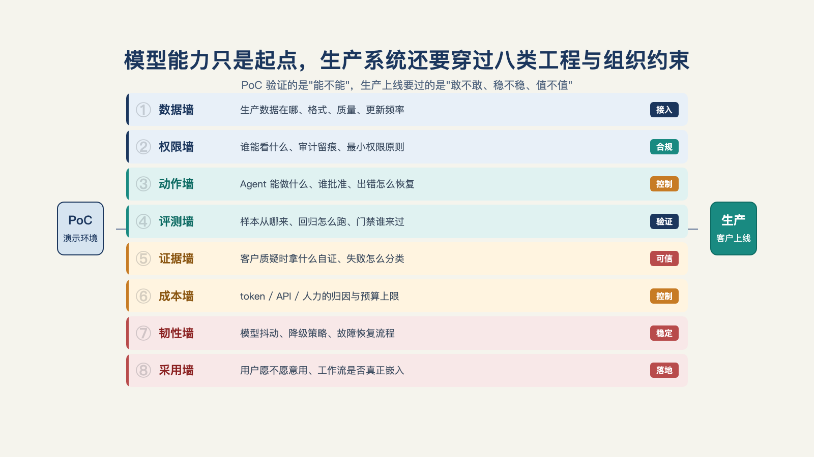

# 第 9 章 · 从 PoC 到生产，中间隔着哪几堵墙？

> 未战而庙算胜者，得算多也；未战而庙算不胜者，得算少也。
> ——《孙子兵法·计篇》

"PoC 一周能跑通，为什么生产上线还要再等大半年？"——这句话客户迟早会问出口，而多数 FDE 答得支支吾吾。

其实要回答也不难，因为真正卡住上线进度的，从来不是代码量。

## 一、从 PoC 到生产，隔着很多堵墙

先把"生产化"这个词拆开。它在不同人嘴里指的是完全不同的东西：有人指"加监控"，有人指"上更多机器"，有人指"过安全审计"。这些都没错，但都只是局部。

一套能在真实企业里干活的 AI 系统，分三层——**模型**、**接口**、**harness**。模型会推理，但不会行动；行动的能力全靠 harness 补上。一家保险公司AI落地系统的 harness 可能会有五样东西：**工具**（模型算不准保费，配计算器；读不了手写表单，配识别路由）、**集成**（对接各家保险公司千奇百怪的 API，没有 API 的就用程序驱动浏览器）、**文件系统**（一个持续多天的流程，状态得存下来，中断了才能接着干）、**任务编排**（简单分类给便宜的小模型，模糊条款给更强的模型，谁先谁后由任务图决定）、**监督机制**（低置信度进人工复核队列，不可逆动作等人批准，全程留审计记录）[^b16]。

这个划分的价值在于诚实：一线公司给"模型和生产之间那堆东西"起了名字，承认它是产品的一半，而不是"收尾工作"。一本企业 Agent 平台工程的开源书拆得更细——把生产级部署的交付对象列成了十几项能力，从运行时、工具契约、评测到成本治理，每项都有最小代码对照[^a08]。

本书沿用这个方向，把模型和生产之间的阻隔拆成**八堵墙**，把"生产化"这个词翻译成可以逐项验收的清单——这八堵墙，需要一一拆掉，才能完整交付。

## 二、八堵墙

**第一堵墙，数据与权限。** 现场问题：哪些表能读、结果谁能看、脱敏怎么做、例外走什么流程？客户的安全审查不是走过场，是有一张表要填的。翻墙产物：一份数据契约。这是第 10 章的主题。

**第二堵墙，集成。** 现场问题：Agent 要写回的那个系统，是客户用了二十年的老系统——没有 API，数据格式没人说得清。Box 的 CEO 说得直白：集成就是墙，Agent 不会替你修复集成问题，它只会撞上去[^c01]。翻墙产物：一条打通新旧系统的路。

**第三堵墙，工具边界。** 现场问题：Agent 能调用哪些工具？参数谁校验？一个能自己发邮件的 Agent，和一个只会草拟邮件的 Agent，是两种风险等级。翻墙产物：一份工具契约。这是第 11 章的主题。

**第四堵墙，运行可控。** 现场问题：半夜任务跑飞了算谁的？卡在人工审批那一步，第二天还能接着跑吗？翻墙产物：运行状态机和检查点。同样在第 11 章。

**第五堵墙，效果可证。** 现场问题：改了一版提示词，效果是升是降？答不上来，每次改动都是赌博。翻墙产物：评测集和回归门禁。这是第 12 章的主题。

**第六堵墙，结果可信。** 现场问题：客户指着屏幕问"这个数字哪来的、这个结论为什么信"，除了道歉和重跑，能拿出什么？翻墙产物：证据链。这是第 13 章的主题。

**第七堵墙，成本与稳定。** 现场问题：演示时一次调用几分钱，上线后月账单五位数；昨天还好好的，今天系统抽风。翻墙产物：成本归因和稳定性承诺。这是第 14 章的主题。

**第八堵墙，责任可移交。** 现场问题：出了事谁负责？FDE 撤场之后，系统交给谁？翻墙产物：责任交接表和运行手册——第 8 章已经立过这张表的雏形，第 17 章展开完整移交。

**一个具体的例子。** Cresta 的 AI Agent FDE 负责人钟钱杰分享过一个语音 AI Agent 的复杂度：背后可能同时跑二十个模型——ASR、打断判断、噪音隔离、检索、Tool Call、多模型并发 Guard Rail，再加上 PCI（支付卡行业）、HIPAA（美国医疗隐私法）合规审计动辄半年一年。花一周把端到端走通，然后要花一个月写几千几万个测试——这些不是传统 unit test，是用历史通话训练小模型去主动模拟真实场景的边界情况（手法的展开见第 12 章）[^b21]。

这个例子几乎把第四堵墙（运行可控——二十个模型谁先谁后、谁能打断谁）和第五堵墙（效果可证——几千几万个测试从哪来）同时有了具体的样子：PoC 阶段"一周端到端"的兴奋，和后面"一个月测试"的现实，是同一个项目的两副面孔。

八堵墙放在一起看，会发现它们性质各不相同：第一、第二堵墙是**地基**——不通就什么都别谈；第三、第四堵墙是**风险**——不通也能跑，但随时可能出事；第五到第八堵墙是**信任**——不通则永远停在"试用"。性质不同，解法不同，验收标准也不同（见图 9-1）。

*图 9-1：模型能力只是起点，生产系统还要穿过八类工程与组织约束。*

## 三、墙要在签合同的时候摸清，而不是等撞上了才头破血流

为什么要把墙摸清楚？因为墙的工程量必须进报价和排期。

两种不同做法的合同，结局也会完全不同。

摸清墙的合同里，每堵墙有工程量估算、有责任人、有验收标准——客户看到的报价单背后是一张地图，双方按里程碑推进，撞到墙也知道墙在计划内。

没摸清墙的合同里，"AI 能力交付"一笔打包——Demo 的掌声还在耳边，交付期就开始一堵一堵撞墙，每堵墙都变成"额外需求"，每堵墙都要重新谈钱重新排期，扯皮三个月后项目悄悄死掉。同一个项目，前者叫交付，后者叫烂尾，分岔点只在报价那天有没有摸清墙。

墙没摸清的代价还有一重，在乙方自己的账上。

行业里有一线经验的交付负责人曾警告过：一份 200 万美元的合同，如果没算清墙的工程量，配上 6 个工程师干 12 个月，算下来毛利可能是负的——账面在赚钱，实际在侵蚀企业价值[^c14]。这笔账的完整算法是第五部的事，这里先立一个警告：**墙没摸清，就是后续亏损的直接原因**。

坊间流行"AI 项目落地失败率高"的说法，听起来像在评价技术。把"失败"拆开看，大多数烂尾项目死于同一个原因：报价的时候，没把墙写进合同，也没写进价格。墙没被定价，不等于墙不存在——它只是会在项目最关键的时刻（交付过程中、客户注视下）逐渐显形。技术不背这个锅。

## 四、模型变强，墙会自己消失吗？

一个自然的疑问：模型一代比一代强，这八堵墙会不会自己消失？

会矮一半。前面四堵墙——数据接入、集成、工具生成、运行编排——属于"写代码能解决"的工程活，模型越强，这些活干得越快。有人把 FDE 的工作本身产品化成智能体，让 AI 接手前四堵墙里的重复劳动[^a24]，方向也是这个。

但后四堵墙很难变矮。

Databricks 联合创始人兼 CEO Ali Ghodsi 在斯坦福大学一次课程讲座上讲过的例子，把这条线划得很清楚：他们做一个能正式上线的应用连接器，原有流程约 9 个月——第一个季度做需求调研、产出几十页文档，之后才是开发、测试环境、安全验证、客户反馈。负责人自己用 AI 两天就写出了一个能跑的版本，但团队一致认为那只是 Demo：没经过完整测试，也无法向客户保证安全和稳定。更扎心的估算是：就算把 AI 直接嵌进原有流程，周期也只能从 9 个月缩到约 7 个半月——省下的时间被流程本身吃掉了。真正的转折不是换更强的模型，而是重写流程：需求阶段从一个季度压缩到一周，测试环境交给更擅长的团队并行搭建，协作方式从"一人守一个连接器"改成团队共同覆盖一组连接器——重构之后，一个季度交付了 7 个生产级连接器[^g01]。

两天写出 Demo 的 AI，吃掉的是前四堵墙的工程量；9 个月变 7 个半月，说明只换模型不动流程，后四堵墙一寸都不让；一个季度 7 个连接器，说明后四堵墙翻过去之后，前四堵墙的提速才能兑现成生产率。**测试、安全、协作方式、责任划分——这些墙的高度由组织和信任决定，与模型能力无关。** 这也是第 5 章那个判断的工程版：FDE 不会被 AI 取代的理由，就藏在这后四堵墙里。

## 五、把这张表带走

本章不给拆墙的具体方法——那是接下来五章的事。给的是一张对照表：拿任何一个"PoC 已通过、待生产化"的项目，都要问三个问题——**这堵墙拆了吗？产物是什么？谁验收？**

| 墙 | 现场问题 | 翻墙产物 | 详见 |
| --- | --- | --- | --- |
| 一 数据与权限 | 哪些表能读、结果谁能看 | 数据契约 | 第 10 章 |
| 二 集成 | 新系统怎么写回二十年老系统 | 打通的集成路径 | 第 10 章 |
| 三 工具边界 | Agent 能调什么、参数谁校验 | 工具契约 | 第 11 章 |
| 四 运行可控 | 跑飞了算谁的、卡住能否续跑 | 状态机与检查点 | 第 11 章 |
| 五 效果可证 | 改了提示词，效果升还是降 | 评测集与回归门禁 | 第 12 章 |
| 六 结果可信 | "这个数字哪来的"拿什么回答 | 证据链 | 第 13 章 |
| 七 成本与稳定 | 账单爆炸、系统抖动怎么办 | 成本归因与稳定性承诺 | 第 14 章 |
| 八 责任可移交 | 出事谁负责、撤场交给谁 | 责任交接表与运行手册 | 第 17 章 |

三个问题里有任何一个答不上，那堵墙就是排期上的洞——而且是最贵的洞。这张表的完整版是本书的附录 A——交付检查清单按发现、最小可行部署、生产化、上线与采用四个阶段编排，本章的八堵墙集中落在「生产化」那一段，按地基、风险、信任分组展开。

从下一章开始逐堵拆墙。先拆最早撞上的那堵：客户的数据和权限。

---

[^b16]: Inside an Applied AI company（Pace 长文）
[^a08]: enterprise_agent_platform（开源企业 Agent 平台工程）
[^c01]: a16z：Box CEO 谈 AI Agent 与企业为何跟不上
[^c14]: @deployengineer（Bhaulik Patel）系列长文
[^g01]: Ali Ghodsi 在斯坦福 MS&E 435 课程的客座讲座
[^a24]: Palantir Foundry「AI FDE」产品文档
[^b21]: 腾讯研究院 AI 透镜圆桌 06：来自硅谷一线创业者的 FDE 非共识与落地指南
