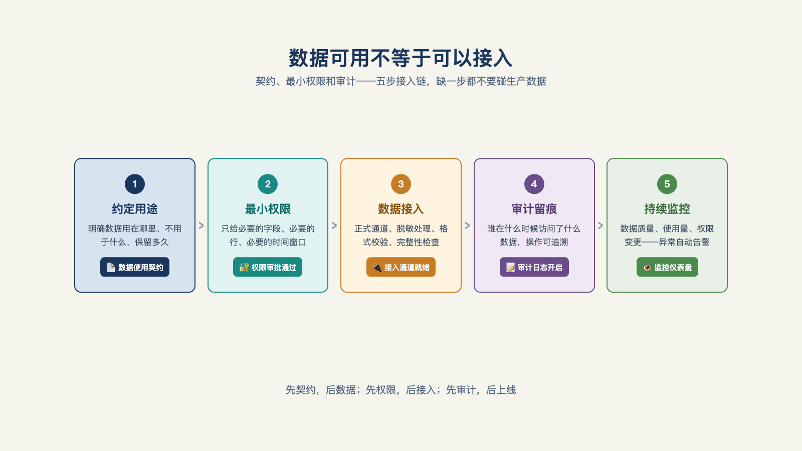

# 第 10 章 · 客户的数据和权限，怎么接才既用得上又守得住？

> Trust, but verify.
> 信任，但要核实。
> ——俄罗斯谚语，经罗纳德·里根（Ronald Reagan）总统在 1987 年《中导条约》（INF Treaty）签署场合反复引用而广为人知

FDE 进场第一天，问客户的第一句通常是"数据在哪"。最常见的回答是"都在系统里"。

在实际为新客户做 AI 落地过程中，合并 7 到 8 个分散的数据源是常有的事——邮件、表格、客户管理系统、ERP，结构化的和非结构化的混在一起；被私募收购整合过的企业更极端，可能同时跑着四套 ERP，客户自己都说不清数据长什么样[^c25]。所以"都在系统里"这句话的正确翻译就是——还不知道在哪儿。

数据接入的坑，从第一个问题就开始了——而比"在哪儿"更要命的，是"谁能看"。

## 一、进场第一天，先问五个问题

把数据接入变成可排期的工作，起点是五个问题：**数据在哪？谁拥有？谁能看？怎么脱敏？例外走什么流程？**

五个问题一个都不少。少了"谁拥有"，权限申请会递到错误的人手里，一轮来回就是一周；少了"谁能看"，Agent 跑出来的结果可能直接泄给不该看的人；少了"例外流程"，第一次数据出域就要停工等高层拍板。

这五问答不上来的项目，排期一律先加两周。不是惩罚，是现实：数据归拢经常是进场后最先撞上的墙，撞上它的时间，早于任何权限设计[^c25]。第 6 章在问题发现时曾问过一遍"数据能不能拿到"，本节是它在工程期的延续——发现期问的是"有没有"，这里问的是"怎么拿、拿多少、给谁看"。

数据在哪摸清之后，还有一道现实要接受：Agent 要写回的那个系统，大概率是客户用了十几年的老系统。第 7 章给过解法——读旧写新：数据从哪就从哪读，通过接口交互，代码绝不塞进旧系统。

## 二、先契约，后数据

五个问题问完，答案不能只记在 FDE 的笔记本里——要写成一份数据契约，再开始动数据（见图 10-1）。

*图 10-1：数据可用不等于可以接入，契约、最小权限和审计缺一不可。*

契约写四件事：**访问范围**（哪些表、哪些字段能读，精确到列）、**结果可见性**（Agent 产出的结果谁能看、能外发吗）、**留存与销毁**（客户数据在本方留存多久、项目结束后怎么销毁）、**审计要求**（每次访问的日志谁查、多久查一次）[^a08]。

这份契约有三个使用者。**客户的合规审查**用它：安全部门过审看的就是这张纸，没有它，项目在流程上就过不了关。**FDE 用它约束自己的实现**：契约写了只读三张表，代码里就只配三张表的连接——这是给工程师的边界，不是给客户的姿态。**事后的追责靠它**：真出了数据事件，双方按契约条款厘清责任，而不是互相甩锅。

顺序为什么不能反？因为没有契约的 PoC，等于在客户数仓里裸奔——出了事没有追责依据，没出事也过不了客户的安全审查。很多人觉得"先跑通再补契约"是灵活，其实是把两堵墙（数据与权限）的工程量推迟到了最贵的时刻。

## 三、Agent 的权限范围是继承来的

契约管数据，权限管动作。这里有一个行业里最常见的错误做法：给 Agent 申请一个大权限的服务账号——"方便，一次配好"。

正确做法应该是：**Agent 继承发起用户的权限，并全程留痕**。

产品层面已经有现成的例子。Palantir 把自家的 AI FDE 智能体做成了产品，文档里明确写到智能体执行的所有操作都遵循用户现有的权限——用户看不到的数据，派出去的智能体同样看不到[^a24]。

现实约束的另一面来自 Box CEO 的提醒：Agent 只有人的原有权限，它不会绕过权限墙——卡在权限上就是卡在权限上，这不随模型变强而改变[^c01]。

两条合起来是一个结论：Agent 的权限＝发起用户的权限＋全程留痕，绝不申请服务账号级的超集权限。超集权限的问题不是"可能被滥用"，是一定说不清——出事的那天，审计日志里那个万能账号的操作，你既不能证明是人干的，也不能证明是 Agent 干的。

## 四、权限配置的活，要和客户 IT 一起干

权限落到工程上，不止挡数据读取，还要管住**动作的后果**：谁能触发外发、谁能写生产表、谁能在生产环境跑带权限的动作。一线团队的做法是把工具调用按权限、角色、场景三层控制——同一个人，在测试环境里能做的和在生产环境里能做的不同；同一个工具，读数据的和写数据的权限不同[^b03]。

而这件事怎么做，需要单独强调一下：一位日本 AI 公司的新人 FDE 记录过自己的配置经历——和客户的管理员一起，逐项配置 M365 和 Entra ID 的生产权限[^b13]。注意这个画面：**FDE 和客户 IT 并排坐在同一块屏幕前**。权限配置不是供应商单方面交付的东西，是双方一起做的工作——因为权限的每一条边界，划走的都是客户组织里某个真实的人的便利。

这也回应了一个常见的抱怨："客户 IT 不配合。"换位想：一个外部团队要在你的权限体系里开洞，你的第一反应也是审。把权限配置做成共同工作，客户 IT 从把关人变成搭档，后面每一次变更都会快很多。

## 五、数据敏感度，决定部署形态

数据接入还有最后一个决策：模型跑在哪——云端 API、私有化部署，还是完全本地？

这个决策不取决于技术偏好，取决于数据的敏感等级。

把数据分成四级看：**公开**（宣传材料、已公开的报表）、**内部**（流程文档、非敏感经营数据）、**敏感**（客户个人信息、交易记录）、**管制**（受行业监管的数据，如医疗、金融核心记录）。每级对应不同的部署形态：公开和内部数据可以走云端 API，敏感数据倾向私有化或本地，管制数据往往只能本地。

有一个一线教训，把这条路从头到尾走了一遍：落地客服 Agent 项目，前两版都顺利，到要接真实客户数据做实验时暴露了数据安全问题——预算所限，团队只能选择本地部署一个小模型，效果随之打折[^b03]。这个案例的价值在于诚实：**数据敏感度决定架构，而不是反过来**。当敏感数据把部署形态压到本地，模型选择、效果上限都跟着受限——这不是工程的选择，是约束的传导。

所以敏感分级要在发现期就做——第 6 章第四关（数据可达）问的"需要哪些数据、权限归谁"，就包含这一问。发现期把敏感度摸清，报价里才能留出预算；发现期没摸清，生产期的"突然要本地部署"就是一次返工。

## 六、每一次访问，都留下证据

最后一块拼图：审计日志。

每一次数据访问——谁发起的、读了哪张表、什么时候、用于哪个任务——都记成日志。它的价值在平时看不出来，在合规问询的那一刻是唯一答案。客户的安全部门问"你们的 Agent 到底碰了我们的哪些数据"，两种回答的分量完全不同：一种是"我们没出过事"，另一种是把日志导出来——每次访问都有据可查。

前者是承诺，后者是证据。B 端的信任不吃承诺，只认证据——这也是第 13 章（结果可信）的主题，在数据层提前出现了一次：**录下来是架构决定，不是事后补写**。审计日志从第一天就开着，是数据契约里"审计要求"那一栏的工程落点。

数据与权限这堵墙翻过去的标志，可以列成一张验收单：数据契约签了字、权限继承模型跑通、与客户 IT 的共同配置完成、敏感分级定了部署形态、审计日志开了起来。五项齐了，才谈得上一件事：让 Agent 动手干活。而 Agent 一旦能动手，下一个问题立刻出现——它的每一个动作，边界在哪？

---

[^a08]: enterprise_agent_platform（开源企业 Agent 平台工程）
[^a24]: Palantir Foundry「AI FDE」产品文档
[^c01]: a16z：Box CEO 谈 AI Agent 与企业为何跟不上
[^b03]: AI 职觉：别再卷 Agent 了
[^b13]: 「以为 FDE 是在客户现场独自作战」——入职两个月看到的真实
[^c25]: 硅谷 101 E240：聊硅谷最火新职位 FDE
