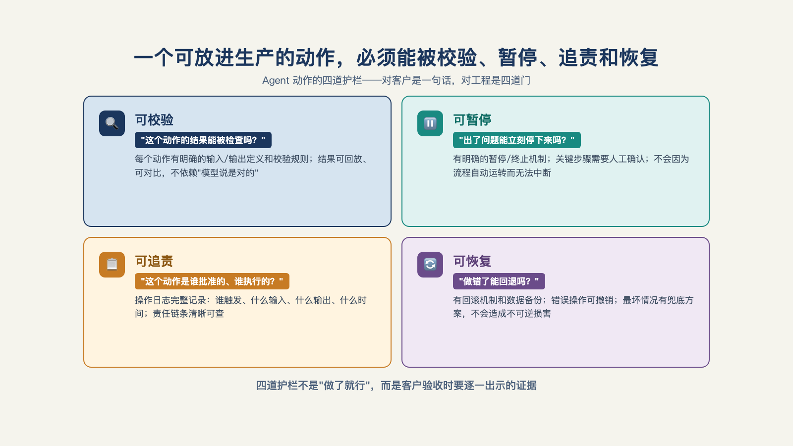

# 第 11 章 · Agent 的动作怎么约束，才敢放进客户生产系统？

> You must first enable the government to control the governed; and in the next place oblige it to control itself.
> 既要让它管得住被治理者，也要逼它管得住自己。
> ——詹姆斯·麦迪逊（James Madison），《联邦党人文集》第 51 篇，1788 年

"我们有人工审核环节。"——这句话在每个售前会上都会出现，但值得追问三句：审批的是**动作**还是**结果**？审批人是谁，**有记录吗**？驳回之后，流程要**从头重跑吗**？这三个问题答不上来，那个"人工审核"就是一句口号。

把口号变成工程，是这一章的事——也是 Demo Agent 与生产 Agent 的分水岭。

## 一、先把客户担心的事情具体化

客户 IT 对 Agent 的担心不是泛泛的"不安全"，每条都很具体：

**"它会不会乱传参数，打穿生产系统？"**——模型生成的参数没人校验，一个拼错的表名就可能写坏数据。

**"它会不会自己删数据、发邮件？"**——一个有删除权限和外发权限的 Agent，幻觉一次就是一次真实事故。

**"它半夜跑飞了，谁发现？"**——定时任务在凌晨两点陷入循环，早上九点上班时已经跑了几千次。

**"出了错，我们查得到是哪一步错了吗？"**——黑盒跑完只给一个结果，错了无法定位，只能整个重来。

注意：他们关心的不是"模型够不够聪明"，而是在问**动作有没有边界、过程有没有记录、出错有没有退路**。四条担忧，对应四个机制——本章的四节。

敢放进生产系统的 Agent，每个动作要过四个"可"：**可校验、可暂停、可恢复、可追责**。这些机制在开源工程社区已经有成熟的字段级设计[^a08]，这里讲清楚每一项"为什么需要、长什么样"。

## 二、可校验：参数过不了关，动作就出不了门

第一道闸门在工具的入口。

Agent 每调用一个工具，参数都要过一遍**结构校验**：这个工具叫什么名字、哪个版本、接受什么类型的参数、每个参数的合法范围是什么——写成一份明确的契约，调用先对照契约，对得上才执行，对不上直接拒绝并报错。

举个最小的例子：一个"查询订单"的工具，契约写明只接受两个参数——订单编号（字符串，固定格式）和查询原因（枚举值，三选一）。模型生成调用时多塞了一个"客户手机号"，校验不过，动作不执行。就这一道闸门，挡住的是"模型顺手多拿一点数据"这类最隐蔽的越界。

每个工具还要**明确写下调用边界**：只读、写入、外发，三选一起写明。只读工具出问题最多是读错，写入工具出问题会改状态，外发工具出问题会把数据送出边界——三类的风险等级完全不同，声明在先，后面的分级管控（第五节）才有依据。

现场自检时需要问一句："你们每个工具的参数校验，在哪一步发生？"答案如果模糊，这一关就是虚的。

## 三、可暂停、可追责：审批不是弹窗，是工单

高风险动作要等人批准——"加人工审核"这半句人人会说，工程在哪？在于把审批建模成一张**带字段的工单**，而不是一个界面上弹出的确认框。

一个合格的审批请求，至少带五个字段：**属于哪次运行**（不孤立地批一个动作，要知道它前后是什么）、**卡在第几步**（整个流程走到哪儿了）、**想做什么**（具体动作加参数，一目了然）、**谁审批**（指定到人，不是指定到"业务方"）、**批注写了什么**（批准和驳回的理由，留档）。

弹窗和工单的差别就是口号和工程的差别。弹窗关掉就没了；工单是**可归档、可审计的记录**——半年后客户问"当时这笔外发是谁同意的"，翻出工单：谁、何时、基于什么理由、批了什么。四个问题一张纸答完。这也是移交时的伏笔：客户接手运行的那天，审批工单上"谁审批"一栏，就是责任转移的落点（第 17 章再展开）。

## 四、可恢复：审批隔了一夜，不用从头再来

审批有一个天然属性：慢。审批人在开会、在休假、在另一个时区——一等一夜很正常。

如果流程不支持续跑，会发生什么？审批通过的第二天早上，系统从头重跑——前面已经跑过的十几个步骤、已经花掉的调用成本、已经消耗的几个小时，全部重来一遍。更糟的是行为扭曲：等不起的业务方会开始想办法绕过审批——要么逼着把动作改成免审，要么干脆不用这个流程。**等不起的审批，等于没有审批。**

解法是检查点：每跑完关键一步，把当前状态存一份快照；人工审批通过后，从卡住的那一步**续跑**，前面的进度原样保留。这套机制在开源的工程实现里叫状态机加检查点——每一次运行有编号、有生命周期（等待、规划、执行、等待人工、成功、失败），卡在"等待人工"这一步时，状态冻结、快照落地、随时可续[^a08]。

它顺手解决了第一节担心清单的第三条：半夜跑飞的任务，状态机里有超时和重试上限，循环到阈值自动挂起转人工——"凌晨两点跑几千次"变成"凌晨两点挂起，早上九点有人处理"。

## 五、分级放权：不是每个动作都要人批

四个"可"立起来之后，最容易走过场的是另一端：所有动作都等人批。审批是稀缺资源——每个动作都批，等于每个动作都不批（人会疲劳，会闭着眼睛点同意）。

正解是按风险分级：

| 动作级别 | 例子 | 处理 |
| --- | --- | --- |
| 只读 | 查询、检索、汇总 | 自动执行 |
| 可逆写 | 写入可回滚的中间结果 | 自动执行+事后抽检 |
| 不可逆写 | 写生产表、删除、覆盖 | 必须审批 |
| 外发 | 发邮件、调用第三方接口 | 必须审批 |

分级的依据就是第二节里每个工具**明确写下的调用边界**——契约在前，分级在后，一环扣一环。

分级之前其实还有更早要问的一层：**这一步压根该不该交给 Agent**。一个落地团队给过具体的切分参照：把一条工作流拆成约十个步骤，大致五步要做成确定性的硬编码——数学计算、合规校验这类不能出错的，根本不给模型发挥空间，更不允许犯错；三四步交给 Agent，允许弹性；两步留给人工审核。反面例子也直白：财务对账这类流程不该让 Agent 判断，它要的是确定性结果，不是聪明[^c25]。风险分级的第一问不是"要不要审批"，是"这一步要不要智能"。

下面我们用一次被拦下的灾难案例（已经过脱敏处理）把本章的机制串起来走一遍。

一个报销审核 Agent 执行到"反馈结果"一步时，生成的外发动作是：把本季度全部报销明细（含员工姓名和银行卡号）作为附件，发送到一个第三方邮箱——那个邮箱来自一封伪装成财务系统通知的邮件，被模型当成了合法配置。接下来发生的事，按秒排：**结构校验**先亮红灯——外发工具的契约写明"附件仅限汇总报表，禁止明细数据"，参数不合法，动作没有执行，流程停在原地；**风险分级**判定外发属必审动作，一张审批工单生成：属于哪次运行、卡在第几步、想发什么、发给谁；客户财务负责人看到工单，**驳回**，批注"该地址不在白名单"；系统按检查点**续跑**，改用站内通知，前面已完成的十一个步骤原样保留。整个过程没有数据离开边界，客户的 IT 部门在第二天的日志里看到了完整记录。灾难不是没发生——是被工程挡在了门外。

## 六、四个"可"，对客户是一句话

把四节收拢：**可校验**（参数过契约才执行）、**可暂停**（高风险动作等工单）、**可恢复**（审批后从断点续跑）、**可追责**（谁批的、批了什么有单据）（见图 11-1）。

*图 11-1：一个可放进生产的动作，必须能被校验、暂停、追责和恢复。*

这四个"可"加起来，就是一线公司说的 Harness 五要素里的最后一项——**监督机制**：低置信度进复核队列、不可逆动作等人批准、审计记录全程跟随[^b16]。叫法不一，实质相同：把"人盯着 Agent"变成"架构盯着 Agent"。一线团队把这套东西按权限、角色、场景做到工具层——同一个工具，不同人在不同环境里能触发的后果不同[^b03]。

而对客户，不用讲这些术语。就一句话：**它做的每个动作，有边界、有记录、有阻断。** 客户担心的事情，就全部解决了。

动作有了边界，只回答了"它能不能做"；改了提示词、换了模型、加了工具之后，另一个问题马上出现：它还做得对吗？如果每次变更都答不上，光有前面立好的边界，也守不住交付质量。下一章，我们把这个问题变成一套可复算的评测。

---

[^a08]: enterprise_agent_platform（开源企业 Agent 平台工程）
[^b16]: Inside an Applied AI company（Pace 长文）
[^b03]: AI 职觉：别再卷 Agent 了
[^c25]: 硅谷 101 E240：聊硅谷最火新职位 FDE
