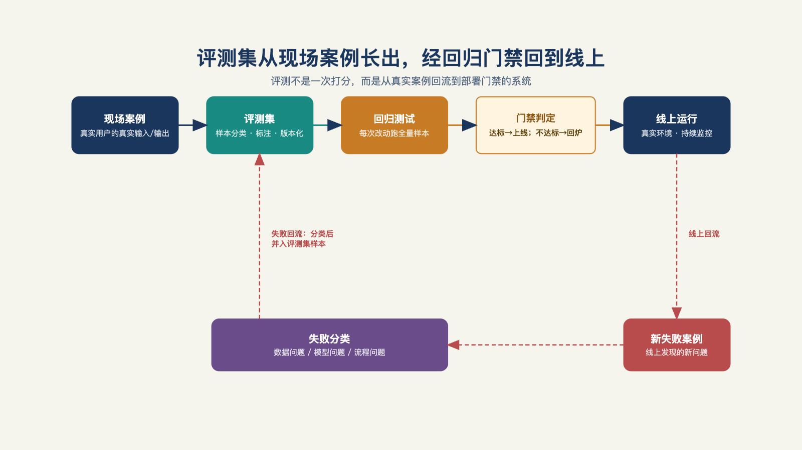

# 第 12 章 · 评测体系怎么从零建起来？

> What gets measured gets managed.
> 被衡量的，才被管理。
> ——管理学界流传箴言

系统在周一把一笔退款判为"可自动处理"。周二，工程师换了一句提示词，同样的订单却被转给人工。业务负责人问："到底是变好了，还是变差了？"如果昨天的样本没留下，好坏也说不清楚，团队只能靠感觉争论。

"改了提示词之后，效果有没有退化？"——这个问题答不上来的系统，不配进生产。

这话听起来很严重，拆开看全是常识：没有评测集，每次改动都是赌博——赌注押在工程师的直觉上；每次客户质疑都是罗生门——"变差了""没变，是你们变挑剔了"，谁也说服不了谁。评测不是上线前补的一个测试环节，是生产系统的底线。

这一章讲从零到生产怎么建——四步：**先建基准样本，再建回归集，然后自动判定，最后接进变更流程**。

## 一、从 70% 到 98%，怎么跨过去

第 7 章的那个案例：第一天真实环境跑分约 70%，合同承诺超过 98%。中间那 28 个百分点，靠什么补？

不是靠调提示词——调提示词是最后一步的微操。靠的是一个循环：**评测发现失败的模式，针对性修，回归验证，再发现**。那位保险行业从业者把它叫评估循环，质量标准就是第 8 章那条每周一千次、做对九百九十五次的可检验口径[^b16]。

同一条爬坡曲线在公开案例里也有完整的版本。一家客服软件公司的智能客服产品，第一代平均只能解决 23% 的会话；更换底层模型后升到 51%；再针对具体客户深度定制，最高做到 86%。它的提供商自己拿它做客服，从上线起持续调优两年，解决率升到约 79%，每月解决约 56 万次会话。

三个数字之间隔着的不是三次模型升级——51% 到 86% 那一段，全是对着评估集一轮一轮改出来的。同样的路，另一家软件公司把自己家的客服智能体调了整整一年，"答不上来"的比例才从三成压到一成以下。

评估为什么能驱动这一切？因为 AI 系统的质量是连续的、带随机性的、随场景而变的——同一个回答在演示里惊艳，在具体业务语境里可能是灾难；而"好"的定义权在业务方手里，不在工程方手里[^l03]。没有评测指标的迭代就是蒙眼狂奔：调了半个月，质量是升是降，没人说得清。评测体系就是把业务专家脑子里那句"什么叫好"，变成系统每天都能执行的打分标准。

## 二、第一步：基准样本——标准从真实案例里长出来

基准样本是一批**带着明确判定标准的真实案例**：输入是什么、正确输出是什么、为什么算对。它是整个评测体系的地基，来源只有两个：**最小可行部署（MVD）期间攒下的真实案例**（系统答过的、用户用过的），和**一线用户标注的争议案例**（答得可疑的、被投诉过的）。不能用工程师坐在办公室编出来的案例——因为编不出现场的混乱，也编不出业务专家在意的那根线。

冷启动需要多少条样本案例？一般而言，五十到一百条可用的，就能起步。追求一次建几百条是常见的弯路——条数多不如口径准。

比条数更关键的是**判定人**。同一条输出，一线用户判及格、FDE 判良好、客户业务负责人判不及格——三个口径都对，因为三个人看的东西不同：一线用户看顺不顺手，FDE 看技术上对不对，业务负责人看赔不赔得起。判定人要在建评测数据集的时候就定下来，并写进每一条样本：基准样本不是一堆题，是一堆**由具体角色判过标准的题**。这也是第 8 章验收单里"判定人"一栏的根——验收口径，在评测集建集那天就开始成形了。

讲冷启动的最佳例子来自一个金融场景：一家机构里几百条隐性业务规则——一笔贷款怎么批、哪个字段异常要上报——散在几位老员工的记忆里，文档上没有。做法是拉着老员工做几轮真实案例推演：拿一笔真实业务，让他边做边讲为什么这么判，同步记成规则条目，喂给模型当评测集；第一轮一定漏，补上再跑，循环几轮就好起来了；固化之后，老员工抽审系统判定，他点头才算数[^l02]。这段操作把评测集的本质说透了：**基准样本是从人脑子里长出来的标准**——把老师傅的隐性判断，显性化成一条条可执行的题。

## 三、第二步：回归集——只进不出的错题本

基准样本立起来之后，评测体系开始自我生长：**每一次真实失败，都变成一条新样本进集**。

系统答错了一个案例——进集；用户投诉了一个输出——进集；线上审计抽查发现问题——进集。集子随着运行越长越大，它其实就是错题记录本：每个都是一次真金白银的错误，记录的目的是让它永远不再发生。回归集只增不减——唯一的例外是口径变更（比如判定标准调整了，老样本按新口径重判，而不是直接扔掉）。

两条纪律防污染。**演示数据不入集**：演示环境的干净数据会让评测集对生产环境的混乱失去分辨力。**标注分歧的样本单独归档**：两个人判不到一起去的案例，不是烂样本，恰恰是最有信息量的样本——分歧本身就是口径没对齐的信号，单独放着，定期复盘口径。

到这里可以看清基准样本和回归集的分工：基准样本是**地基**（标准从这里定，量小而精），回归集是**防护网**（持续生长，量大而杂）。前者保证"好"有定义，后者保证"坏过的不重犯"。

要让回归集更"狠"，还有一个更有效的做法：拿历史数据训练一个专用模型，比如在语音Agent里，用历史通话数据去训练一个小模型，专门模拟真实场景会出现的说话方式——急躁的客户、说话吐字不清的患者[^b21]。这类"对抗性测试集"比标准问答集（QA）更贴近生产会撞见的边界情况，也是回归集从"记录已发生的错误"进化到"主动制造边界情况"的一种手法。

## 四、第三步：自动判定——三级判定，加一道人工校准

样本有了，每次改动后总不能全靠人重判一遍。自动判定分三级，按成本递进：

**第一级，精确匹配和规则**。答案能精确比对的（分类、提取、结构化输出），写规则判定——成本几乎为零，结果完全确定。能用规则判的，永远不用模型判。

**第二级，模型裁判**。开放性任务（摘要写得好不好、回复得体不得体）没有标准答案，用一个模型当裁判，按写在提示词里的评分标准打分。这是当前工程实践的主流做法，但有一条容易被忽略的纪律：**裁判的评分标准本身也是一次"提示词改动"**——它改了，判定口径就变了。所以裁判的评分标准也要进回归管理：改裁判和改系统，走同一道门禁。

**第三级，人工抽检**。定期抽一小批样本人工重判，对照模型裁判的结论——不是不信自动化，是自动化会**漂移**：裁判模型对某种表达风格系统性偏爱、对某类错误系统性失明，这类漂移只有人工抽检能发现。从不校准的裁判，等于自动地一路错下去。

成本意识贯穿三级：不是每条样本都要跑最贵的判定。规则能判的走规则，模型裁判只判开放性任务，人工只抽检——评测体系本身的运行成本，也是成本（第 14 章的账上要记这笔）。这些机制在开源工程实践里已经沉淀成了标准件——离线评测防退化、在线审计测真实、带成本感知的变更门禁[^a08]。

## 五、第四步：门禁——没过回归集的变更，不许部署

前三步攒下的家底，在这一步变现：**任何提示词变更、模型切换、工具改动，必须先过回归集，才能部署**。

这一条把"我觉得没退化"变成"回归通过率 99.2%"。别小看这个措辞变化——前者是感觉，进入不了任何决策；后者是数字，可以进验收会、进变更单、进客户的信任账户。第 7 章埋的那句话在这里兑现：MVD 唯一必须从第一天就建的东西就是评测集——因为它是变更的门禁，而变更是生产的常态。

门禁也是评测与第 8 章验收单的接口：上线验收的指标从哪来？从评测集的口径来。基线值是评测集跑出来的历史水位，目标值是双方在评测口径上约定的承诺——验收单上的每个数字，背后都站着一个可以复算的评测过程。两份文件对不上的项目，一定有一边是拍脑袋的。

## 六、在线与离线：闭环即评估循环

门禁管的是变更那一刻，运行中的系统还需要另一只眼。评测分两线：

**离线评测防退化**——变更前对着回归集跑，守住"不比原来差"。**在线评测测真实**——生产环境持续抽样审计，用户反馈（点赞、纠错、投诉）回流进回归集。两线合起来，就是本章开头那个循环的完整版：离线挡住退化的改动上线，在线发现新的失败模式，新的失败变成新的样本，样本让下一轮离线评测更严。转起来之后，它就是那位从业者说的评估循环[^b16]（见图 12-1）。

*图 12-1：评测集从现场案例长出，经回归门禁回到线上，再把新失败带回样本。*

这条方法论有一个公开实践里的完整对照，可以当本章的镜子。领先团队的做法固定成三步：**评估集从真实案例里长出来**（不能靠工程师编）、**让业务方当评委**（把评估做成业务专家能参与的形态——并排的输出对比、简单的优劣标注、定期评审会；评估集越来越准的同时，业务方看着系统在自家案例上一次比一次好，信任是亲眼看着攒起来的）、**把评估接到生产回路上**（上线不是终点，持续抽样、分数下滑立即告警）。本书的四步与这三步不冲突：那三步说的是方向（真实、业务方、闭环），本章的四步是冷启动的操作序（先基准样本、再回归、再判定、再门禁）。

评估先行的效果，最完整的公开样本在农业。一家农机制造商要解决除草剂浪费：传统喷药机整田覆盖，新技术用 36 个摄像头加机器视觉，在行进中只喷杂草。但农民要的不是技术，是可信的建议——AI 团队的工程师飞到农场，跟着农艺师下地，先和专家一起评审数百个真实作业案例、建起定制评估体系，再迭代模型，且必须赶上农时。最终化学品使用量最高减少七成，农户互动频率提升六倍[^l03]。先有评估体系定下的"好"，才有这两个数字。

## 七、评测集是 FDE 带得走的资产

最后算一笔账，把视角从单个项目拉到整个团队。

项目结束，代码可能会被抛弃，数据必须还给客户，集成方案下个客户不通用——那什么沉淀下来了？**评测集，和建评测集过程中长出来的流程认知**。有位从业者有句话说得透彻：数据是客户的护城河，所以它不可能同时成为供应商的护城河；真正可累积的，是每次部署沉淀的隐性知识与评估循环[^b16]。

下一次部署，模型可能又换了一代，集成方案重新做——但上一个客户那里攒下的失败模式、判定口径、裁判标准，直接搬进下一个项目的回归集起步。**评测体系是少数不会因模型升级而贬值的工程资产**——模型越换代，越需要一把不跟着换代的尺子。这笔复利怎么在组织层面变现，是第 22 章（现场经验沉淀为产品能力）的主题，这里先把资产本身建起来。

三个负面清单，对照自检：**先建评测平台、后建评测集**——顺序反了，平台是为评测集服务的，没有评测集的平台是空转的；**评测集只在上线前跑一次**——那不是评测体系，是上线仪式；**裁判从不校准**——自动化的漂移无人看守，自动化就成了自动化的错误放大器。

评测把"效果可证"立住了。但生产环境里还有一类时刻评测管不到：客户指着屏幕上昨天的一个结果问"这个数字哪来的、当时为什么这么判"——这要的不是分数，是证据。

---

[^b16]: Inside an Applied AI company（Pace 长文）
[^a08]: enterprise_agent_platform（开源企业 Agent 平台工程）
[^b21]: 腾讯研究院 AI 透镜圆桌 06：来自硅谷一线创业者的 FDE 非共识与落地指南

[^l02]: 《关于 FDE 的 100 个问题》
[^l03]: 范冰《前线部署工程师（FDE）》（XDash 开源书）