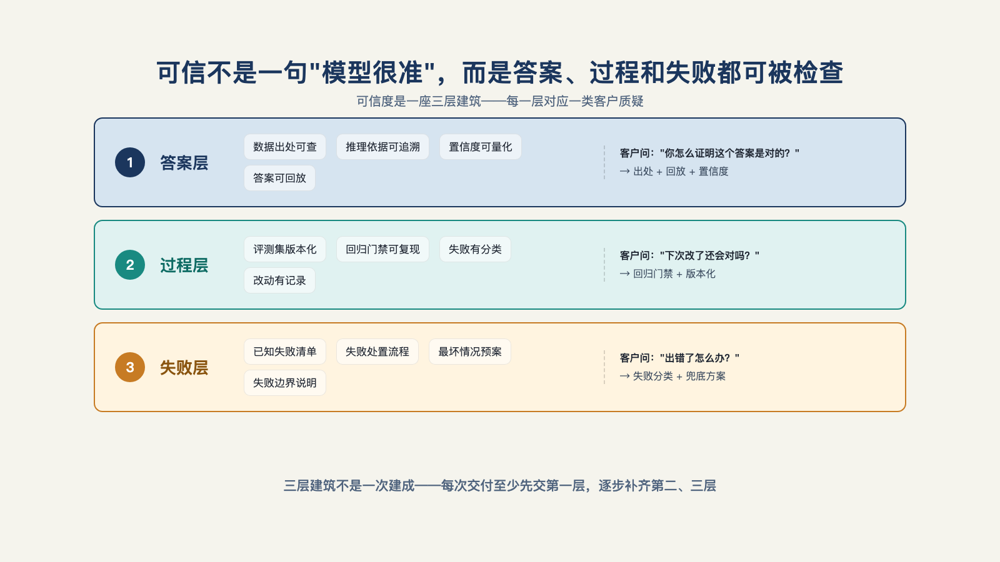

# 第 13 章 · 客户质疑结果时，拿什么自证？

> Res ipsa loquitur.
> 事实本身，即是证据。
> ——英美普通法侵权法古老法律格言（直译"事情本身会说话"），常见于过失责任认定

季度经营会上，客户方的财务总监指着屏幕上的一个数字问："这笔应付账款的分析结论，数字哪来的？"会议室安静下来。系统如果能调出来源文件和段落定位——发票、对账单、合同各是哪份、各在第几页——质疑当场就能核对；如果只能回答"我们回去重新查一下"，即使数字最终正确，信任也已经在等待里受了损。

**质疑时刻是信任的清算时刻，应对清算需要的不是态度，是证据。**

## 一、可信度是一座三层建筑

客户对"这个结果可信吗"的追问，拆开其实是三层：**这个答案的依据是什么？这个判断的过程是什么？这次出错的原因是什么？**——引用可回溯、决策可回放、异常可诊断（见图 13-1）。

*图 13-1：可信不是一句"模型很准"，而是答案、过程和失败都可被检查。*

这三层有一个共同的性质，也是本章最重要的一句话：**它们不是给客户看的汇报材料，是系统运行时自然留下的副产物**。证据链不是被质疑之后补写的材料包，是架构里预埋的记录能力——录下来是架构决定，不是事后补救。开源的企业级 Agent 工程实践已经把这三层做成了标准件，一线公司 Harness 五要素里的监督机制，同样要求审计记录跟着每个动作走——记下 Agent 做了什么、为什么做[^b16]。

## 二、第一层：每个答案，带着出处

最基础的一层：Agent 给出的每个结论性答案，都挂着**证据引用**——依据了哪份文档、定位到哪里、置信度多高[^a08]。

上一章结尾那个问题的完整版就在这里：客户问"这个数字哪来的"，答案分三段呈现——来源是什么（文件名、系统、时间）、定位在哪（段落、页码、字段）、把握多大（置信度）。三段齐了，客户可以顺着引用自己核——核一次，信一分。

这一层还藏着幻觉治理的另一半。大家都指望模型变强了就不胡说，但工程上的纪律更硬：**检索失败的答案，宁可说"没找到"，也不许编**。说"没找到"只是失败，不是欺骗；编一个看起来圆满的答案，是一次对信任的透支。所以架构上要约束：没有挂上证据引用的结论性输出，不允许直接发出去。检索质量不过关，引用链会先断，后面的推理与解释也无从谈起。

## 三、第二层：每步决策，都要可以回放

第二层往深一步：不只答案带出处，**做答案的过程全程可回放**。

工程上的形态叫运行轨迹：Agent 的每一次运行，逐事件记录——读了什么数据、调了什么工具、传了什么参数、拿到了什么结果、中间怎么判断的。一条时间线，从头到尾[^a08]。

回放的价值在三个场景里兑现。**客户质疑时**：不只能给"数字哪来的"，还能给"当时怎么一步步推到这个数字的"——第二节的证据引用是照片，运行轨迹是全程录像。**事故复盘时**：出了错，逐事件回放定位到具体是哪一步开始偏的——第 11 章的审批工单记录了"谁批的"，运行轨迹补上"批之前系统看到了什么"。**评测失败时**：回归集里挂掉的一条样本，打开轨迹看它挂在哪一步——这也接上了第 12 章的诊断，并引出本章最后一层。

## 四、第三层：失败要分类，混在一起就没法改

有了轨迹，异常就能诊断了。但诊断有个前提：**失败必须分类，因为不同类的失败修法完全不同**。

生产环境里的失败至少分四类：

- **检索失败**——没查到该查的。修法在数据上：补索引、调召回、改切分。系统再聪明，喂不到料也白搭。
- **推理失败**——查到了，用错了。修法在模型和评测上：改进提示、加判定规则、把这条案例进回归集。
- **工具失败**——调了工具，工具没成。修法在工程实现上：超时、重试、降级（第 14 章的韧性四件套）。
- **数据失败**——源头就是错的。修法在客户那边：上游数据质量治理，这可能要回到第 10 章的数据契约去谈。

四类失败，四个方向、四种责任归属。混在一起（最常见的混法是全部笼统叫"模型不行"），就不知道从哪儿改起——往检索失败上砸模型升级，往数据失败上砸提示词，钱花了不少，错照出。运行轨迹是分类的依据：回放到失败那一步，看它卡在取料、判断、执行还是源头，类就分出来了。

## 五、自证的章法：四步标准动作

架构给了三层能力，怎么用它们面对质疑？有一套四步的标准动作：

**第一步，质疑具体化**。不说"我们的系统总体是可靠的"，说"您指的是哪一个案例，我把它调出来"——把泛泛的质疑落到具体的单据上。

**第二步，证据上桌**。证据引用加运行轨迹，当场放出来——来源、定位、过程，三样摆在桌面上，而不是"我们回去查了给您答复"。

**第三步，归因分类**。如果确有问题，当场分类——是四类失败里的哪一类，责任边界在哪（数据源头的问题归客户那边治理，推理的问题归我方修复）。

**第四步，修复承诺**。这条失败案例进回归集（第 12 章的错题本），修复后过门禁再上线——给一个有验收标准的期限，不给一句"我们优化一下"。

这四步把"自证"从一场辩解，变成一次质量改进的现场演示。同样是"你们错了"的质问，走过四步的客户看到的不是一家公司在认错，而是一套系统在运转——很多长期合作关系里，一次处理漂亮的质疑，抵得上十次顺利的汇报。这套动作与第 8 章的责任交接表、第 17 章的移交清单前后呼应：责任表写了"出了事找谁"，这里回答"找到人之后，对方拿什么给你看"。

## 六、留痕的成本，与一次审计的回报

证据链不是免费的。逐事件的全量轨迹意味着可观的存储和记录开销——每个运行都存完整录像，账单会先于价值到来。所以记录要分级：**关键运行全录**（涉资金、涉审批、涉外发的），**常规运行抽样录**（抽检比例与评测抽检对齐）。

分级的依据与第 11 章的风险分级同一套——高风险的动作配高规格的留痕[^a08]。这笔存储账最终记进第 14 章的成本治理，这里先立住原则：留痕的规格跟着风险走，不跟着洁癖走。

最后用一个场景，看这堵墙翻过去的商业回报：
一家客户的审计部门例行抽查，随机抽了 20 个历史输出，要求逐条提供依据来源。供应商当天返回：20 条里 18 条证据链完整可溯——来源文件、定位、运行轨迹齐备；2 条因当月记录策略调整缺失，附了说明与补录方案。审计部门没有再问第二句。续约谈判桌上，这个 18/20 的成绩后来变成了供应商方案里的一页——**证据链完整率，成了续约的筹码**。

至此，八堵墙里最难量化的两堵——效果可证、结果可信——都立起来了。
第三部分的最后两组墙是同一枚硬币的两面：成本账单和稳定。这是下一章要讨论的。

---

[^a08]: enterprise_agent_platform（开源企业 Agent 平台工程）
[^b16]: Inside an Applied AI company（Pace 长文）
