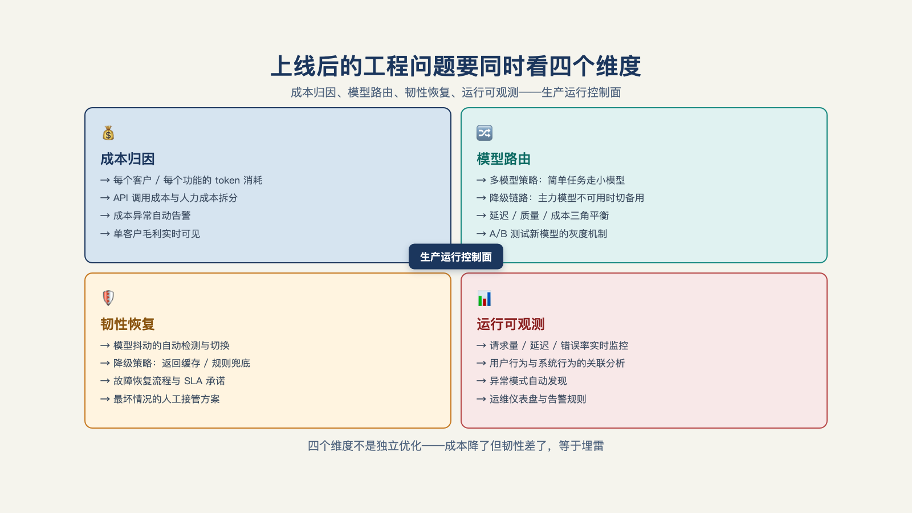

# 第 14 章 · 演示很便宜、上线账单爆炸、每天抖动，怎么办？

> 善战者之胜也，无智名，无勇功。
> ——《孙子兵法·形篇》

演示时一次调用几分钱，上线后月账单五位数；演示跑一百遍都顺，上线第三天系统抽风。这两件事经常被当成两个问题——一个归财务，一个归运维。

其实是一个病：**演示架构里没有成本和故障的位置**。演示环境天然短链路、低并发、干净数据、人工盯场——成本与故障还没有充分暴露。生产环境把这些保护撤走，病根才显形。解法是把成本和稳定性都变成**明确的工程对象**——成本按运行归因、可设预算熔断，稳定性按承诺管理、可降级回退。

## 一、账单解剖

月底账单到手，五位数。项目经理逐笔看过去，没有哪一笔是错的——每一笔都是系统在"正常干活"。成本失控从来不是偶发故障，是结构性的。

**病因一，上下文膨胀**。演示走的是单轮问答，生产走的是几十步的长链路——每一步都把前文带上，上下文越滚越大，而计费跟着上下文走。链路比演示长一个量级，账单自然也长一个量级。解法：任务链按步骤切分，每步只带必需的上下文，中间结论落盘而不是塞进对话。

**病因二，无缓存**。同一个问题，白天问了二十遍，每遍都全价重算。解法：高频问题的答案缓存复用，变更触发重算——省的是重复，不是质量。

**病因三，模型错配**。简单任务用最贵的旗舰模型，等于开着劳斯莱斯幻影送外卖。解法是第三节的主题：路由。分类、抽取、格式转换这类活，小模型又快又便宜，质量不差。

**病因四，重试风暴**。失败自动重试，没有上限——一个下游服务抖十分钟，重试把调用量放大几倍，最贵的那几分钟恰恰是故障的那几分钟。解法在第五节：重试要有限、要退避，还要有熔断兜底。

这四类病因构成账单爆炸最常见的结构性来源，但逐项看，没有一项是"浪费"：每一笔都合规、都必要、都在干活。

**成本问题的第一课：先归因，再谈优化——不知道钱花在哪，优化就是无头苍蝇。**

## 二、成本归因

归因的工程形态：每一分钱，落到**哪次运行、哪个租户、哪个工具**头上[^a08]。

按运行归因，账单从一串总额变成一张地图：这次账单涨上去，是哪类任务带来的？哪个客户的用量在爬坡？哪个工具的调用在膨胀？成本看板不是财务的报表，是运行手册的一部分——值班的工程师每天扫一眼，异常趋势当周处理，不等月底。

看板之上是刹车：**预算熔断**。单次运行的花费超过阈值，自动暂停、转人工确认——不是省钱的小气，是止损的保险丝：一个跑飞的任务链（第 11 章担忧清单的第三条），有熔断就是"暂停待确认"，没熔断就是"跑了一夜，账单见"。熔断复用的正是第 11 章的机制：超阈值触发审批工单，人工放行后从检查点续跑——用的是同一套机制，只是多了一个场景。

拿一组数字做账单会诊：月账单四万八，拆开看——上下文膨胀两万一（一条三十步的流程链每步全量带上下文）、无缓存九千（高频重复问题全价重算）、模型错配八千（抽取任务全走旗舰模型）、重试风暴一万（一次下游抖动被无上限重试放大）。四项各治各的：链路切步、高频缓存、任务路由、重试设限。若分别压住这些结构性来源，次月账单可降至一万三，功能不受影响。

**成本优化的空间在结构里，不在功能里。**

## 三、模型路由

错配的正面解法是模型路由：**按任务难度分级，把任务派给够用的模型**——分类和提取走小模型，模糊条款的复杂推理走大模型；涉及关键写回时，除了看能力和价格，还要切到经过验证的受控执行路径，先校验、后写入，必要时等待审批[^b16]。

在实际工作里，成本约束下的模型选择从来是常态。路由设计的关键是**进架构，而不是事后补救**——事后补救的路由是补丁摞补丁，架构期的路由是任务分解的自然产物。

这里与第 9 章的判断对上了：模型编排（哪个任务给哪个模型）本身就是第 9 章所说 Harness 的五要素之一[^b16]——它不是成本优化的技巧，是生产架构里优先级很高的一件事。

## 四、抖动的来源和解法

接着说稳定性。先把"抽风"的来源说清楚。

生产系统的抖动有四个来源：**依赖服务抖**（下游接口、模型服务超时）、**模型输出抖**（同一输入，两次输出不一致——概率系统的本性）、**数据源抖**（客户数据更新、字段漂移）、**负载抖**（并发峰值，月底结账时全公司一起用）。

四个来源，没有一个是"修好就不再发生"的——抖动是常态，承诺的方式才是工程。

这个领域的通行做法是给服务水平承诺（SLO，Service Level Objective），而 SLO 的正确写法是**三个维度分开承诺**[^a08]：

- **可用性**——多大比例的请求正常返回（99.9% 与 99% 是两种完全不同的系统）；
- **延迟**——多大比例的请求多快返回（平均快没有意义，要看长尾）；
- **质量**——多大比例的输出达到合格线。

第三条最容易被漏，也最要紧：**质量承诺的口径直接来自第 12 章的评测集**——"合格"不是形容词，是回归集定义的水位。三个维度分开写，是因为它们的成本曲线不同：可用性每加一个 9，冗余成本翻着涨；延迟压长尾，靠的是架构不是算力；质量的水位，靠的是评测循环。混成一句"系统稳定运行"的承诺，等于三个都没承诺。

## 五、韧性四件套：坏了怎么办

SLO 是承诺，韧性是兑现承诺的机制。四件套，件件针对一类死法：

**超时**——别等死。每个外部调用设时限，到了时限就算失败，交给下一步处理。无超时的系统里，一个卡住的服务能拖死整条链。

**重试**——有限、退避。重试要设上限（防风暴，第一节的病因四），两次之间要指数退避（给下游喘息），盲目立刻重试等于给着火的房子泼汽油。

**幂等**——重试不重复扣款。同一个操作重发一次，效果和发一次相同。没有幂等的重试是危险的：超时之后你不知道对面到底成没成功，再发一次可能就是两笔。

**降级**——预案分级。小毛病小模型顶替（路由降档），中等故障规则引擎顶替（退回确定性逻辑），最坏情况**回退人工和表格**。这也在第 8 章里提到过：敢写"退回人工"的方案才敢上线——降级路径不是失败的遮羞布，是设计出来的安全网。客户对这套分级的感受，恰恰是安全感的来源：系统坏了有去处，天塌不下来（见图 14-1）。

*图 14-1：上线后的工程问题要同时看成本归因、模型路由和故障时的可恢复性。*

## 六、一页纸运行手册

把本章所有内容收拢成给客户的一页纸——运行手册：告警谁看（第 8 章四问）、出了什么事故翻哪页（四类失败，第 13 章）、什么时候按回退按钮（降级三级）、成本看板在哪、熔断阈值是多少。**写给客户方值班的人看，不是写给工程师看**——手册只存在乙方电脑里，等于没有（第 8 章的纪律，这里再强调一次）。

最后是成本的一个追问：压完结构、写完承诺，客户还是嫌贵，怎么办？先看一个维修调度的算账场景：智能体每天的成本是两千美元，它替代的是"派哪位工程师去维修"的决策；如果派错人的损失远高于两千美元，账就不能只拿调用费和零比。这个场景要问的不是话术，而是成本的第一性问题：**和什么比**？与被替代的人工决策成本比，与出错的成本比——而不是与零比。

第三部的八堵墙到此拆完：数据与权限、集成、工具边界、运行可控、效果可证、结果可信、成本与稳定、责任可移交（最后一堵在第 17 章分析）。

回头望去，这八堵墙立着一条共同的原则——**生产系统的第一设计约束不是"更聪明"，是"坏了怎么办"**。可预期的小毛病，好过不可预期的聪明；善战者无赫赫之功，运维良好的系统没有救火事迹。

但工程底座垫好，只回答了"系统能不能站稳"。系统站稳之后，真正的考验才刚开始——没有人用，前面的一切都是成本。那是第四部要讨论的事。

---

[^a08]: enterprise_agent_platform（开源企业 Agent 平台工程）
[^b16]: Inside an Applied AI company（Pace 长文）
