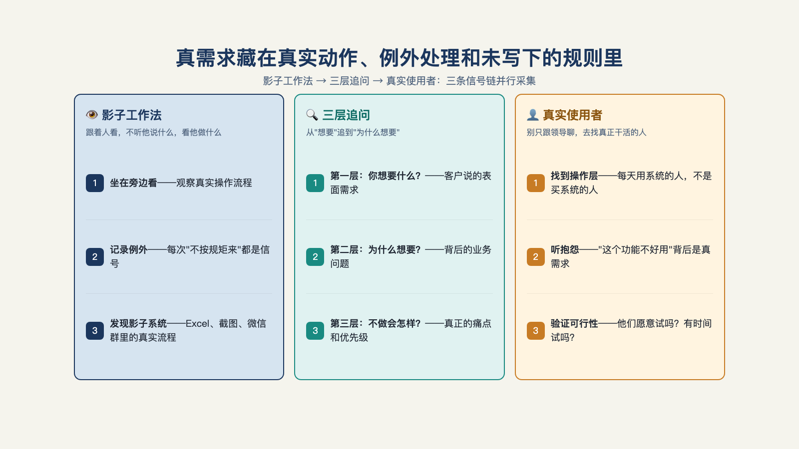
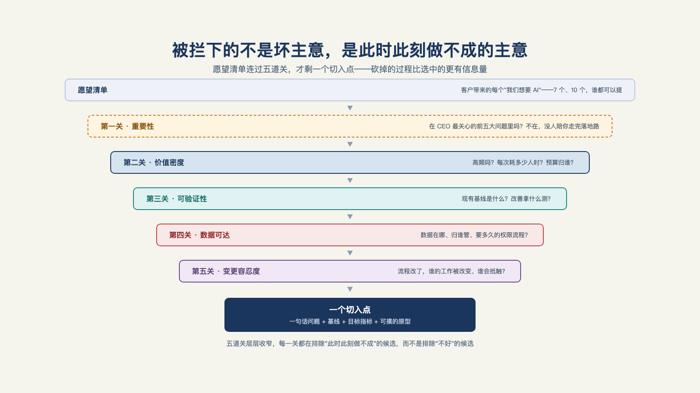
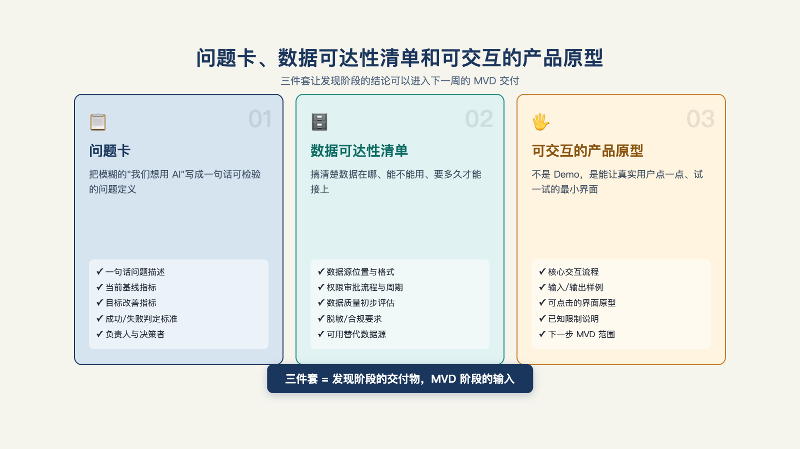

# 第 6 章 · 进入客户现场，怎么找到值得解决的问题？

> 在拿到数据之前就建立理论，是天大的错误。
> ——阿瑟·柯南·道尔，《福尔摩斯探案集·波希米亚丑闻》

在现场第一次开会，客户坐下来就给你列出七个愿望：智能报价、会议纪要、质检拍照识别、供应商邮件分类……每个都有人举手支持，每个听起来都能"用 AI 做点什么"。

听起来像是“许愿池”，但是可交付团队只有人力做其中一个。

怎么选？许多项目的失败，不是因为做得不好，而是因为一开始就选错了问题。问题选错了，团队做得越卖力、浪费得越彻底。

本章就讲这个问题：真问题去哪儿挖，挖回来怎么过五关，五关走完剩下什么。

## 一、真需求，往往不是在开会发现的

先说发现需求。多数项目把"发现"理解成“访谈”：约一串会，记一堆需求，回办公室整理成文档。这条路径最大的风险不是问漏了什么，而是**你听到的每句话都经过了翻译**，已经不是“第一手”的数据了。

一套流传很广的田野方法把这一步叫"影子工作法"：跟着真实用户，过完他真实的一天——不是采访他，是坐在他旁边看他工作，看他打开哪些系统、在哪些表格之间复制粘贴、在哪个环节皱眉、绕过了哪条"官方流程"。观察的重点是**变通，而不是流程**：官方流程图告诉你组织"应该怎么运转"，变通告诉你组织"实际怎么运转"。这套方法在人类学里叫参与式观察，在丰田生产方式里叫现地现物——OpenAI 的 FDE 团队在约翰迪尔的项目里就是这么干的：飞到爱荷华州，跟着农艺专家和农场主下地，看施药决策怎么做、哪些信息真正进入决策、农时这道硬期限如何支配一切。他们最终替代的那套旧流程——农艺师挨家挨户打电话、口头给设备使用建议——不会出现在任何文档里，只有下地才看得见[^l03]（见图 6-1）。

*图 6-1：真需求藏在真实动作、例外处理和未写下的规则里。*

为什么必须亲眼看？因为**用户自己说不出来**——说不出来有两层。

一层是不肯直说。直接问"你觉得这个方案好不好"，得到的多半是客气话。创业圈有本方法论小书专门讲这件事：Rob Fitzpatrick 的《The Mom Test》，书名来自一个损招式的提醒——别问你妈"我这个生意点子好不好"，她因为爱你，一定会说好。客户的恭维同理。解法是把问题从观点挪到事实：不问"你觉得需要吗""将来会用吗"，只问"上一次遇到这种情况，你是怎么处理的"。问过去，不问将来；问具体的一次，不问一般情况——客气话没法核对，事实可以对质。

另一层是真的不知道要说。士兵需要路边炸弹预警工具——这个需求在任何访谈里都问不出来，因为士兵不知道"原来软件可以提供这个功能"，他们以为巡逻的忐忑本来就是巡逻的一部分[^l03]。国内一位企业 AI 落地顾问的说法异曲同工：痛点很少挂在嘴边，"它藏在每天重复的手工活里，藏在某个岗位没人愿意接的烂摊子里。挖掘不能靠问卷，得靠现场泡"[^l02]。

听不懂的时候，有个笨办法：连问三层为什么——第一层问清楚要什么，第二层问为什么现在要做，第三层问如果不做会怎样。问到第三层，真问题往往才浮上来。客户说"我要个知识库问答"，三层问下去，真问题可能是老专家快退休了，三十年的经验带不走，新人上手要半年，期间经常出错——表层需求是知识库，深层问题是经验传承。

还有一层失真更隐蔽：**你面对的根本不是使用者**。需求方是中间的数字化团队时，"你以为在给使用者做系统，其实全程对话的是一群背着数字化指标的人，他们转述一线诉求时已经过了一道滤镜"——解法也很简单，就是绕开中间层直接触达一线，"哪怕只访谈两三个真实使用者，得到的信号也比十场中层会议扎实"；实在见不到，就把需求假设一条条列出来，让中间层逐条确认这是一线真要的，而不是他以为要的[^l02]。

**举一个真实例子**：某公司用智能体处理退款请求。它读取每一项请求，逐条对照退款政策，拒绝所有不符合条件的申请——每笔拒绝都"正确"。几周后，合作多年的老客户开始流失。查不出原因，因为智能体拒掉的每一笔，确实都是政策规定该拒的。最后有人去和从前经手退款的人坐下来聊，才发现他们心里有一条从没写进任何文档的规矩：用企业信用卡付的订单，直接批——这些客户每月都采购，为一笔退款斤斤计较，可能丢掉整个客户账号。政策里对此只字未提，是处理者们多年前自己摸索出来的经验。解法不是换模型，是把这条检查固化成工作流里的固定规则，放在模型判断之前[^c23]。

这个案例把发现阶段的本质暴露得很彻底：**模型正确不等于业务正确，中间隔着一层没写下来的流程知识**。这类知识不在需求文档里，不在系统日志里，只在每天经手这件事的人的手上。同类的案例还有一个：一次文件格式迁移停滞了整整一年，所有人都以为是技术问题，直到有人坐到那位抵制迁移的工程师旁边看他干活——他一直靠双击文件看数据，而新格式没有可以双击的东西。团队当晚给他做了一个能照旧双击的工具，两天后他批准了迁移[^c23]。

所以发现阶段需要懂系统的人最先入场。一家投资机构的数字化负责人复盘内部实践时说，做 AI 技能封装，"最关键的是你要知道你想封装什么"——而想清楚这件事的架构能力，需要公司中层甚至更高层的人先参与进来，再去指导[^b04]。访谈负责收集愿望，架构师负责判断愿望背后的真实诉求——两件事得同时做。

## 二、第一关：这个问题重要吗

挖回来的清单，先别急着评估技术可行性。第一关问的是：**这个问题，在客户组织里够不够重要**。

Palantir 出身的高管鲍勃·麦格鲁（Bob McGrew）讲得非常直白："传统实施的范围，往往从接近产品现有能力的地方起步，但你想解决的是领导层认定的关键问题之一。如果你解决的不是 CEO 的前五大优先事项之一，那很可能行不通——他们大概没有精力陪你走完那条艰难得多的路。"[^c06]他给的理由完全不是技术性的：问题要是需要本地部署，你就得和客户的 IT 团队周旋；组织内部每一层都有"不点头你就动不了"的人，而这些人不像初创公司那样思考、跟最终用户的目标也不一致，你必须想办法绕过他们——所以你解决的问题必须重要到"能够请动高层的人来拍板，授予他们操作权限，允许他们使用"[^c06]。

重要性门槛的另一个理由是选战场：AI 要动的是哪条核心生产线——研发、合同与交付、制造质量、销售运营还是客户服务里的哪一个环节？它得跟交付、收入、毛利、风险或客户体验直接相关，而不是只"看上去省时间"；宁要高难度高价值的，也不要容易做的，否则收益非常有限。

这和国内一些从业者的看法不谋而合，他们认为：现有 AI 方案能做到的只是"有限范围内的降本增效"——在旧流程上加一点 AI，效率高一点、成本低一点，"你公司原有的那些流程、人员、业务是不变的"；而"人才和组织不变革，AI 的能力就是发挥不出来"[^b17]。

反过来说，值得 FDE 化的问题，多半是那种顺藤摸瓜会摸到流程和组织的问题——这样才配得上 CEO 的前五大问题，也才请得动拍板的人。

Palantir 早期一个客户把第一关走成了样板。那位 FDE 工程师的第一家真正客户是空客的图卢兹工厂，他搬过去住了一年，每周四天泡在产线上。切入点不是"我们能演示什么 AI 能力"，而是 CEO 直接告诉他们的最大问题：A350 量产爬坡。团队据此只做了一件事——把分散在多个系统里的工单、缺件、质量问题（"不合格项"）整合进一个界面：可以勾选任务、追踪零件、查生产计划，还能模糊搜索历史质量问题。说穿了都是基础软件功能，但把"最佳实践"的界面真正铺进生产环境，最终帮助把制造速度提到了约四倍[^b18]。

方向是从 CEO 关心的最大问题倒推的，不是从技术能力正推的。

这道关为什么排在最前面？因为重要性不够的问题不解决，后面每一关都白过——验证做成了没人认领，部署卡住了没人拍板。这个问题会在第 16 章详细讨论：AI 落地为什么是一把手工程。这里先记住这个问题：**这事在 CEO 的前五大问题里吗？**

## 三、后四道关

过了第一关，剩下的问题再过四道关：**价值密度、可验证性、数据可达、变更容忍度**。加上重要性，一共五道关——五道关不是并列的清单，是层层收窄的通道，每一关都在砍掉一类特定的死法（见图 6-2）。

*图 6-2：被拦下的不是坏主意，而是此时还不具备落地条件的主意。*

**第二关：价值密度。** 现场问三句话就够：这事现在靠谁在做？一天做几遍？做错了会怎样？三句答出来，问题的"体质"基本就定了。

判断价值，有三个朴素的信号：
高频发生——每天都在做的事，优化一点就有大收益，一年只发生三次的事，效率提升十倍也省不了多少；
现在靠人肉——全靠人工、经验、老师傅的地方，才有 AI 切入的空间；
能好十倍——好一成没人愿意换，好十倍大家抢着用。

所以"只快一成的场景，碰都别碰，把力气留给高频、靠人肉、能好十倍的地方"[^l02]。别忘了本章开头那份七个愿望的清单：价值密度不只算"省几个人"的账，还算"打开过去够不着的市场"的账[^c25]。

**第三关：可验证性。** 这个问题现在的基线是什么——基线也就是现状，当前人工做一遍耗多少时间、错误率多少、成本多少？改善拿什么测？没有基线的问题，先建基线，再谈 AI。

这一关拦下的是那种"做完大家都叫好、半年后说不清值不值"的问题：效果没法量化，预算季一来就成了第一个被砍的项目。有经验的团队会把"验收指标"放在"上线"之前——从具体场景起步，让业务的人和工程师逐条给输出打分，分数回流到迭代里。验收指标怎么建，会在第 12 章里专门讲。

**第四关：数据可达。** 解决这个问题需要哪些数据？数据在几个系统里？权限归谁？要多久的审批？这个问题要在发现期就摸清楚，不能拖到生产期。一个真实案例，某企业内部上马的客服 Agent 项目迭代到第二版才把真实客户数据接进来试，数据安全的顾虑立刻摆上桌面，最后被迫改成预算内的本地小模型部署，模型能力因此大打折扣[^b03]。数据安全的约束是真实的，但发现期就该把它摸清、把应对设计进方案，而不是留到生产期才发现。画数据地图时要特别记一笔：**几乎每个组织里，官方数据源和员工真正信任的数据源都不是同一个**——某个老员工私藏的表格、只在邮件里流转的报表，往往才是干活的人天天用的那份；接错了源头，系统再准也没人信。

**第五关：变更容忍度。** 方案落地后，谁的工作被改变？这个问题是某位主管的权力来源吗？自动化掉的流程，原来养着谁？这不是人事八卦，是项目生死：系统上线演示那天，全程配合的部门在鼓掌，角落里另一个部门的主管一言不发——他要维护的那套流程，正是被你自动化掉的那套。成熟的做法是在方案设计里就给利益受损的人安排"新生路"而不是"死路"——把把关人转型成教练，让老师傅的经验变成训练系统的素材[^l03]。这道关排查出的问题清单，第 15 章讲采用、第 16 章讲一把手工程时都要回头用。

关也有闯错的时候，四类错误最常见：
**从最高价值的问题切入**——通常不可验证，一上来就赌大的；
**从最好做的问题切入**——通常没人真痛，做成了也是自嗨；
**从 CEO 的个人偏好切入**——老板拍脑袋指定的场景，往往既不高频也不可测，还没人敢反驳；
**接下"先做个 Demo 给董事会看"的单**——演示的目标是好看，生产的目标是可用，两套目标做出来的东西从头就不是一回事。

## 四、五关走一遍

**下面是一个脱敏后的真实案例**：

客户是一家中型制造企业，进场时带来七个愿望——智能报价、会议纪要、质检拍照识别、供应商邮件分类、设备维修知识库、销售话术助手、合同审查。

先过第一关：这家客户的 CEO 今年只关心两件事——交付延期和原材料成本。七个愿望里，智能报价和合同审查直接挂在交付与成本上，设备维修知识库沾边（停机影响交付），其余四个都是"各部门顺手提的"。关外砍掉四个。

第二关（价值密度）：智能报价每周发生几十次，每次销售要花两小时翻价格表和历史成交，错了直接亏钱——高频、人肉、能好十倍，过。合同审查一年三十来份，单份审查两小时——真痛但不高频，这一轮先挂起。维修知识库：停机时每分钟都在烧钱，但"知识库"本身不解决停机，先退回重问一层为什么（真正的问题是老师傅退休经验带不走？还是备件查找太慢？）——挂起待进一步挖掘。

第三关（可验证性）：智能报价有干净的历史数据——过去三年的报价单和成交价就是基线，改善可测，过。

第四关（数据可达）：价格表在 ERP 里，历史成交在 CRM 里，权限分属两个部门——能接，但审批要两周，发现期就把申请提上去。过，带条件。

第五关（变更容忍度）：报价流程的销售总监是 CEO 的老部下，明确支持；销售团队多一步"确认 AI 建议价"，可以设计成默认采纳——过。

七个愿望，过五关、斩六将，剩下一个：智能报价，一句话问题（"销售报价从两小时缩到十分钟，错误率不升"）、一个基线（当前平均耗时与改价率）、一条数据权限清单（ERP 价格表＋CRM 历史成交，两周审批）。**砍掉六个的过程，比选中一个更有信息量**——每个被砍掉的愿望都留下了记录：为什么现在不做、缺什么条件、什么时候可以重提。这份记录本身就是下一季度的路线图。

## 五、发现阶段的交付物：三件套

问题发现做完了，在这个环节应该交付什么？

不是 PPT，是三样能让下一周直接开工的东西：

1. **一张问题卡**：一句话问题＋当前基线＋目标指标——就一页，写不进一页说明还没想清。
2. **一份数据可达性清单**：需要哪些数据、在哪个系统、权限归谁、审批多久——第四关（数据可达）的原始记录。
3. **一个可交互的产品原型**：不是演示视频，是让客户的人亲手点一次的东西。一位入职两个月的日本 FDE 写下他的现场心得："比起完美的规格书，（更要）能上手摸的原型。看着客户的反应，当场修正方向。"[^b13]规格书锁死方向，原型暴露方向——客户摸到实物时说的第一句话，常常推翻前三次会议的共识（见图 6-3）。

*图 6-3：问题卡、数据可达性清单和可交互的产品原型，让发现可以进入下一周的交付。*

三件套到位，发现阶段结束。那张问题卡上的一句话问题，接下来要变成一个真的跑在客户环境里的系统——第一个版本做多小、做多真，这正是第 7 章要重点讨论的问题。

---

[^c25]: 硅谷 101 E240：聊硅谷最火新职位 FDE
[^c06]: Y Combinator：The FDE Playbook for AI Startups（Bob McGrew）
[^b17]: 破局点 TURNING POINT 第 31 期：中国式 FDE
[^b18]: Reflections on Palantir（Nabeel Qureshi）
[^b03]: AI 职觉：别再卷 Agent 了
[^b04]: 一路瞳行 EP134：从 AI 辅助到数字员工
[^b13]: 「以为 FDE 是在客户现场独自作战」——入职两个月看到的真实
[^c23]: FDE 工程师 101：弥合 AI 与业务的鸿沟（中文汇编视频）

[^l02]: 《关于 FDE 的 100 个问题》
[^l03]: 范冰《前线部署工程师（FDE）》（XDash 开源书）
