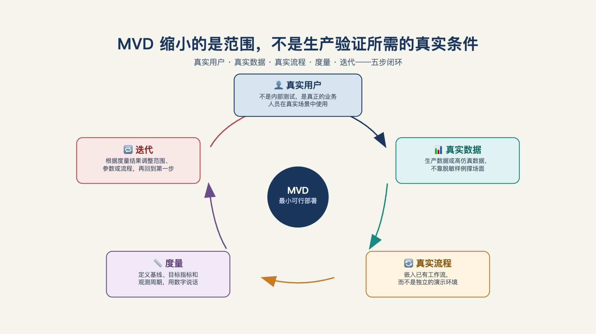

# 第 7 章 · 什么才算"最小可行部署"，而不是又一个 Demo？

> 先让它能跑，再让它对，最后让它快。
> ——肯特·贝克（Kent Beck），软件工程师

问题卡到手后，业务方的下一个问题就是："那什么时候能看到结果？"

你的第一反应是不是"先做个 Demo 给你看看"？

但这里有个常见误区：许多团队把 MVD（最小可行部署）理解成"Demo 的小号版本"——功能砍掉七成，做成四不像。结果既验证不了什么，又浪费了时间。

Demo 追求"看起来能行"，MVD 追求"测出真的能不能行"。

这是两回事。怎么样的"小"才对、怎样做才能避免这个误区，这是这章要讲清楚的。

## 一、差距

一家保险行业的企业级 AI 应用公司从业者公开写过他们的第一天：新智能体第一次跑在客户的真实工作流上——读一堆杂乱的入站文档、做结构化和推理、把结果写回一套老旧的保单管理系统——客户自己的专家打分，约 70%；而合同里承诺的数字，是超过 98%[^b16]。他的原话很有意思：我的工作里所有有意思的东西，都活在这道差距里[^b16]。

这 28 个点为什么重要？因为在演示环境里，你永远看不到它们——演示数据干净、边界友好、没有历史遗留，跑出 100% 是常态。**差距只在真实环境里显形**，而问题发现得越晚，代价越大：签了 98% 的合同才发现起点是 70%，中间的每一分都要在客户的注视下补。

MVD 的存在理由就在这里：它不是为了交付一个缩小版的系统，是为了**尽早测出这段真实差距的形状**——用最小的工程投入，在客户的真实环境里，对着真实的痛点，验证价值能不能真的发生。

顺带把 MVD 和 MVP 的差异说一下：MVP（最小可行产品）验证"要不要做这个产品"，裁判是市场；MVD 验证"这个方案在这个客户身上能不能产生价值"，裁判是这个客户的具体业务方。

这一字之差，差在裁判。这也解释了企业交付的残酷之处：一个在之前十个客户那里验证成功的方案，到第十一个客户那里仍然可能失败——数据基础不同、组织惯性不同、痛点的形状不同。价值没法从上一个客户继承，只能在这一个客户身上重新验证。所以 MVD 没有模板答案，只有方法论。

## 二、三个"真"

MVD 与 Demo 的分水岭，展开成三个"真"：**真实数据、真实用户、真实基线**。少了任何一个，交付的还是一个换了名字的 Demo（见图 7-1）。

*图 7-1：MVD 缩小的是范围，不是生产验证所需的真实条件。*

**真实的数据。** 用客户脱敏的样例数据、或自己构造的演示数据做验证，是概念验证坟墓的第一块砖。原因不是仪式感，是真实数据里全是坑：字段含义与文档不符、三成的空值、三年前的编码规则，以及最要命的——数据本身记录着错误的流程。在假数据上成立的方案，上线那天就会撞上文档里不存在的字段，而那时候已经付了真价钱。所以硬性要求只有一条：客户必须带自己的真实业务数据来；可以脱敏、可以给沙箱副本，但 **分布要真** 。

**真实的用户。** 至少一个一线用户，每周真实地用它、真实地反馈——不是产品负责人代用，不是验收会上礼节性地点一遍。判断标准很朴素：这位用户休假一周，工作还会不会找上这套系统。演示是演给决策者看的，使用是长在使用者手里的，MVD 要的是后者。

**真实的基线。** 上线之前，把人工流程的基线测好：一件事现在耗多少时间、错多少、成本多少。没有基线，"改善"两个字就无从谈起——这正是第 6 章第三关（可验证性）在执行层的延续：过关时说好的基线，到 MVD 这儿必须变成一组写下来的数。

三个"真"齐了，MVD 才开始产生 Demo 给不了的东西：**一段可测量的真实差距，和一段被真实使用检验过的判断**。

## 三、砍范围，不砍价值

三个"真"让差距测得真；下一个问题是范围——切多小、怎么切？

"小"的正确切法是三刀：**砍流程数**——只做一条端到端流程，不做平台；**砍用户群**——只服务一个团队；**砍智能边界**——Agent 只接管流程中最可测的一段，其余留人工。

三刀的前提是一条军规：**缩小的是范围，不是价值**。最常见的错误，是把 MVD 理解成"阉割版的大方案"——功能砍掉七成，做得四不像。正确的做法是不砍深度、只砍覆盖面：不追求"覆盖全公司的智能客服"，而是"只覆盖退换货这一类工单，但做到端到端、无人干预"；不追求"全集团的供应链优化"，而是"只做这条产线的排产冲突，但每周实实在在省下 20 个人时"[^l03]。切入点要小，才做得深；做得深，业务部门肉眼可见，才会主动传播。

至于"砍到多小算够"，也有现成的判据："用户不改变原有习惯就能用，这叫够用；为了用你的系统他得先重塑工作流，这就过度了。"[^l02] 曾经一个专业团队花几十万、三个月做出全链路 AI 化，结果不如一位六十多岁校长三天手搓的简化版——他只做模板生成，其余环节照旧人工填，其他校长爱用，因为不强迫他们改变习惯。

有句评语说到了点子上："衡量成败的标准从来不是技术多先进，是使用的人明天还愿不愿意打开它。"[^l02]

范围之外还有一道环境边界：MVD 要不要迁就客户的旧系统？

实践给出的中间路线叫"读旧写新"，即数据上深度兼容——客户的数据在哪就从哪读（注意：只读不写），哪怕在老主机和共享盘的表格里；架构上绝不耦合——代码写在自己可控的边界里，通过接口跟旧系统交互，不把代码塞进旧系统。

理由也摆在明面上：验证期的方案有一半以上概率被推翻重写，耦合越深浪费越大；写入旧系统要走变更管理流程，周期以月计，跟周级节奏根本冲突。

流程上则顺从人的习惯而不是系统的习惯——用户的核心动作发生在表格和邮件里，界面就长在表格插件和邮件里。也有国内从业者这么总结：客户核心系统用了十年，先在外围做轻量插件，"判断标准很简单：改动是否逼用户离开熟悉的系统。逼，就缓；不逼，就推。"[^l02]

还有一条容易忽视的阶梯原则：MVD 是第一级台阶，不是终点的缩微版。

一家投资机构的周报自动化走了三级——先用对话式梳理省掉"写"，再升级到语音生成，最后连语音都省了，直接读工作留痕自动汇总出周报。每一步都能独立验收、独立叫停，前一步的真实使用就是后一步的需求依据[^b04]。想一步到位做出第三级的样子，通常连第一级都站不稳。

## 四、以周计，不以月计

第三条军规是**定死截止时间**：MVD 的验证周期以周计，不以月计——Palantir 的训练营压缩到一到五天，公开报道里最快上线四周、典型部署四到八周[^l03]。截止时间的意义不在快，在**逼双方如实做取舍**：凡不能在这几周里体现价值的部分，都还不是核心价值。一个六个月的"最小验证"，几乎必然重新长成一个什么都想要的大项目——那就是概念验证坟墓的又一次开工。

两周冲刺可以拆到天：

| 天 | 做什么 |
| --- | --- |
| 第 1 天 | 进场对齐：和客户把"单点问题"写成一句话，把验收指标写成一个数 |
| 第 2-3 天 | 接数据：只接这个问题需要的最小数据集；权限、脱敏、导出方式当场定死 |
| 第 4-5 天 | 搭骨架：能查数、能回答的最小原型跑起来 |
| 第 6-8 天 | 接进真实业务流：一两个真实用户开始真的用它干活 |
| 第 9 天 | 收集使用痕迹和问题清单 |
| 第 10 天 | 演示与拍板：不是给信息部门演示功能，是给业务方演示"你那个问题，现在这样了"——当场决定放大、调整还是散伙 |

客户方同样有三项配合要求：一个能拍板的业务方负责人在场；一个懂数据的内部接口人全程陪同；真实数据的访问权限第 1 天就位，而不是"正在走流程"——三条缺一条，两周冲刺大概率滑回传统概念验证[^l03]。

《FDE 交付范式革命》里把同一套节奏总结成四步：**业务理解**——进场先摸清业务链路、痛点与价值支点，不急着写 Prompt、搭 Agent；**协作搭建**——业务专家和工程师把场景一起转化成 Agent、工作流或原型，不是技术单打独斗；**工具保障质量**——从真实聊天记录、工单和业务数据里生成测试集，做自动评测和 A/B 对比；**业务结果验证**——AI 组与人工组逐环节对比，用触达率、响应率、转化率这些人效指标证明价值。四步背后是同一句话：**卖成果，不卖软件**——客户不为"用了 AI"付费，为业务真的变好付费。

## 五、被抛弃，就是第一版软件的宿命

MVD 做完，代码怎么处置？麦格鲁把两拨人的分工讲得很清楚：FDE 在客户现场快速交付一套定制实现——只为这一个客户、允许粗糙、有坑也认；产品与工程团队的角色，是审视这套实现，从根本上思考如何把它推广到接下来的五个或十个客户，把一次性的定制变成可复用的产品[^c06]。一版代码不该同时追求这两件事：既要它十天跑通，又要它维护十年。

所以招 MVD 阶段的工程师，什么样的人不能要也很具体：讲究手艺、执着于把抽象层打磨到恰到好处、要写一套能维护十几年的软件——因为那不是这个阶段的工作。

快速原型的人写出来的代码有时很漂亮，"但通常不会，也没必要——这也不是工作的关键部分。关键是有人能按时以软件形式交付成果。可能他们写的第一版代码必须被抛弃，然后重写完整的第二版。"[^c06]

把这两段合起来就清晰了，MVD 真正积累的资产，**不是代码，是考题和认知**。

考题是评测集——这个客户的真实输入里，哪些该出什么答案；认知是流程理解——哪些需求是通用的、哪些是这个客户的特例、哪些坑下一个客户还会遇到。代码会扔掉重写，这两样东西全部带走。这也直接纠正一个普遍的执念——"把 MVD 代码直接改成生产代码"：省下的那点开发量，远抵不过把定制代码补成生产系统的成本，而那正是第 9 章要展开讲的。

下面是一份自检清单，大家对照着看：
**用 Demo 代码直接改 MVD**——演示数据的假设全部渗进基线，测出来的差距是假的；
**MVD 做成功能全家桶**——范围失控，两周变两月，验证变成开发；
**"先上线再说" 跳过基线**——之后永远无法证明价值，续约谈判桌上无话可说。

最后是退出条件：MVD 阶段允许没有完整的审批链、没有监控、没有降级方案，**但不允许没有评测集**——它是 MVD 唯一必须从第一天就开始建的东西，怎么建是第 12 章的主题。带着一套跑通的评测集和一组测出来的真实差距，才答得上客户接下来必然要问的那句话——"所以，什么时候可以上线？" 这会在第 8 章里介绍。

---

[^b16]: Inside an Applied AI company（Pace 长文）
[^c06]: Y Combinator：The FDE Playbook for AI Startups（Bob McGrew）
[^b04]: 一路瞳行 EP134：从 AI 辅助到数字员工

[^l02]: 《关于 FDE 的 100 个问题》
[^l03]: 范冰《前线部署工程师（FDE）》（XDash 开源书）