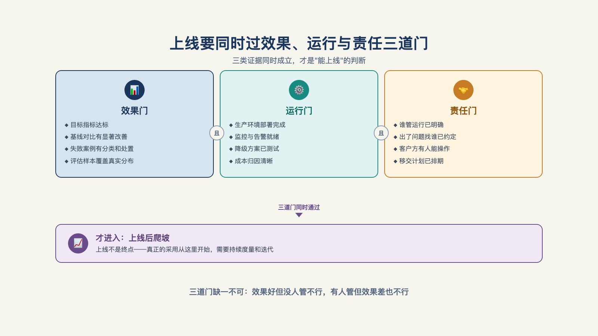

# 第 8 章 · "什么时候可以上线"的答案是什么？

> Good fences make good neighbours.
> 好篱笆造出好邻居。
> ——罗伯特·弗罗斯特（Robert Frost），《补墙》（Mending Wall，1914）

上线评审会开到第三个小时，甲方合上电脑，问了一个全场最朴素的问题："所以——什么时候可以上线？"会议室安静了十秒。供应商想说"效果已经很好"，业务方想问"出了错算谁的"——两句话都卡在嘴边，谁也没说出口。

这个场面之所以在行业里反复上演，是因为"上线"从来不仅仅是个技术问题，而是一份没人起草过的双向契约：供应商按事前约定的指标证明达标，客户按事前约定的清单接手运行责任。

契约没人起草，那两句话就只能一直卡在嘴边。

本章要做的，就是讨论如何起草这份契约。

## 一、问到上线时，到底在问什么

先站到桌子的另一边。作为要为企业引入 AI 系统的负责人，评审会上心里排着的问题清单通常长这样：数据接不进怎么办？权限归谁？答错了算谁的？出了事怎么追责？什么时候才算可以上线？

把这张清单看一遍，会发现一个共同点：**全是验收问题，没有一个是模型问题**。模型的能力在演示那天就已经定了，关键点从来不在模型上，在验收上。

"什么时候可以上线"听起来在问一个日期，实际在问的是：**由谁、按什么标准、判定这件事成了**。

答不出这三样，任何回答都是拍脑袋；答得出，日期只是水到渠成的落款。

所以标准答案不是一句话，是一份契约、三份文件：**效果验收单**（指标+基线+判定人）、**运行就绪清单**（监控/降级/回退/值守）、**责任交接表**（每个事故场景谁负责）。三份文件，一份管"值不值得上"，一份管"敢不敢上"，一份管"出了事找谁"。

## 二、效果验收单：五个要素，缺一项就翻车

"效果很好"是没法验收的。能验收的指标要写全五个要素：**基线值**（上线前人工做这件事的水平，第 6 章第三关的承诺、第 7 章最小可行部署（MVD）测出的那组数，到这里落进合同）、**目标值**（上线后要到的水平）、**测量窗口**（按周还是按月统计）、**分母口径**（算谁、不算谁）、**判定人**（谁说了算）（见图 8-1）。

*图 8-1：上线要同时过效果、运行与责任三道门，之后仍需爬坡验证。*

五个要素里最容易埋雷的是分母口径——同一个"解决率 90%"，分母是全部会话、还是进入 AI 通道的会话、还是 AI 尝试回答过的会话，三个数字能差出一个档次。

这正是指标口径的纪律所在。企业部署最核心的价值指标（解决率、分流率），恰恰是各家口径最乱的指标——以 ServiceNow 的官方口径为例，一次"分流"成立要同时满足两个条件：交互后 24 小时内未提交工单，且用户随后有正向参与（如继续使用）。所以引用任何厂商的解决率或分流率之前，先问清三件事：**分母是什么、判定窗口多长、谁来判定**。一句话把这条纪律说到点子上了："口径不清的 86%，不如口径清楚的 51%。"[^l03]

五个要素写全的指标长什么样？前面提到的保险行业公司给过一个样板：他们和客户约定的质量标准是 99.5%——换算成可检验的说法是，每周一千次调用，做对九百九十五次[^b16]。这个数字好就好在三点：**可数**（一千次里数九百九十五次）、**有窗口**（每周）、**能复查**（客户自己数得出）。可数、有窗口、能复查，验收单上的每个指标都该经得起这三问。

验收单还有一层谈判功能：指标事前冻结，上线日就没有"这个月数据特殊"的扯皮。所有对口径的异议，都被推回到成本最低的时刻——那时候还没开跑、改一行字就行。

## 三、运行就绪清单：告警响了谁看

效果达标只回答了"值不值得上"，第二份文件回答"敢不敢上"。四问，逐条过：

**告警有人看吗？** 告警响起时有一个名字、一张值班表对得上，而不是邮件落进垃圾箱、消息沉在群聊里。监控体系怎么搭是后面的工程话题，这里只问验收级的一句：告警响了，谁看？

**降级路径可用吗？演练过吗？** 包括最朴素的一条：**明确退回 Excel 和人工**。把"退回人工"写进方案，很多团队觉得脸上挂不住，仿佛写了就承认 AI 不行——恰恰相反，敢写回退的方案才敢上线：它承认系统会坏，并且提前说好了坏了怎么活。这一条在国内被反复强调，是验收清单里最容易被略过、出事时最被感谢的一项。降级路径不是失败的遮羞布，是设计出来的安全网。

**运行手册存在吗？客户方有人读过吗？** 故障处置步骤写在纸上、演练过一遍，而且客户那边的对接人手里有一份、读过一遍——手册只存在乙方电脑里，等于没有。

**值守谁排？** 上线后的前几周，乙方谁值守、响应时间承诺是多少，白纸黑字。这三份文件里最不起眼的一条，出事时最先被问。

反例不长，但足够疼。一位在 AI 创业公司做 FDE 的工程师在周记里记过一句：上游服务商（Cloudflare）宕机，无预案救火，自己手上所有客户的系统一起受影响[^b12]。上游故障从来不在你的控制范围内——但"无预案"在你控制范围内。运行就绪清单管的正是这一项。

## 四、责任交接表：每个死法都有名字

第三份文件最常缺席，也最考验双方诚意。做法是把系统可能的死法逐个列出来，每种写明**第一责任人**和**升级路径**（多长时间内、升级到谁），以下为示例：

| 出了什么事 | 第一责任人 | 升级路径 |
| --- | --- | --- |
| 模型输出错误，造成业务损失 | 谁判定、谁拦截、谁赔付 | 1 小时内到双方负责人 |
| 数据源故障 / 上游服务宕机 | 数据方接口人 | 4 小时内到供应商值守 |
| 用户误操作引发故障 | 客户侧系统管理员 | 当日到联合复盘 |
| 成本超预算 | 平台方 | 周报到项目负责人 |

这张表为什么值得画？回到题记那句话。弗罗斯特写"好篱笆造出好邻居"，说的不是提防，是**把边界划在出事之前**——篱笆立好的时候，邻居做得成朋友；等羊踩了菜地再划界，怎么划都是伤感情。责任交接表就是上线前的篱笆：模型坏归谁、数据坏归谁、误操作归谁，白纸黑字写清楚，出事时照单找人，不伤交情。它是第 17 章完整移交的前置切片——上线时交接的是"第一响应"，长期运行责任是另一张更大的表。

三件套齐了，放到评审桌上过一遍堂，就知道成色。下面这份评审会纪要虽然不是真实案例，但每一项都来自前面的清单：

> **上线评审会纪要（模拟示意）**
> 通过项：验收单五要素齐全，判定人一栏写的是业务负责人本人，不是"业务方"；灰度第三级的回滚线已量化。
> 卡壳项：降级路径"退回人工"写了，但没演练过——现场约了演练日期才放行；值守表只排到上线后两周，两周之后空白。
> 争议项：误操作引发故障的责任归属，供应商主张客户方管理员全责，客户主张界面应有防呆设计——僵持后写入"共担+复盘定则"。
> 三分之一通过、三分之一卡壳、三分之一争议——一份真实的评审会纪要，大抵就是这三个三分之一。

最后看一下责任悬空的两种退化，它们都发生在没人起草契约的地方：一种是"**先免费跑三个月**"——责任无主，跑得好皆大欢喜，出一次事就翻脸，因为没有任何一页纸说过算谁的；另一种是"**效果很好，你先用着**"——供应商实际上拒绝交接，系统永远停在"试用"，永远长不成生产系统。两种退化方向相反，病根相同：契约缺席。

## 五、双方都要做功课

这份契约不该等到上线评审才想起。两边各有更早的功课。

**甲方的自检清单。** 把乙方筛选客户的防线翻个面，正好翻成甲方的自检清单：你的项目在公司内部是不是乙方眼里的"无主之地"——集团发文压下来、信息部门牵头、业务部门无人署名？你的采购流程是不是天然制造"只许看、不给碰"——要求对方先证明能力，真实数据却一份不给？你写进招标书的是不是宇宙级需求——"AI 赋能全集团"？判断很直接：最后这种需求，吓跑的是最懂行的供应商，吸引来的是最敢吹牛的。三个问题有一个"是"，先修自己，再谈上线。

**供应商的功课。** 一份好提案是倒着写的：第一层必须是**业务结果**，一段话、客户语言说完——"八周内，把反洗钱调查的平均处理时间从 4 小时降到 15 分钟"；第二层是**价值验证路径**——验收指标、测量方法、基线数据、每阶段的退出机制，传递的信号是"我们敢被检验"；第三层才是**交付方法**，写明需要客户配合的事项；最后是**风险与对策**——"我们想过会怎么死"[^l03]。第二层就是本章三件套在售前阶段的影子：验收单不是上线时才补的作业，是从提案第一页就埋下的伏笔。这个打法有比 AI 时代早十年的先例——一家数据分析公司从 2013 年起就在免费试用期内做重型售前实施，原则只有一条：**演示就是概念验证**——永远向潜在客户要真实的数据集，绝不用精心准备的样例数据表演。

**谈判桌上的现实**是：甲方不懂指标时，会退回两种姿势——"要 100% 准确"（把验收单变成不可能任务）或"先免费跑三个月"（责任悬空）。两种姿势的解法是同一句话：把"效果"写成可测的数。这也是供应商的销售逻辑——**用验收单换信任**：验收写得越清楚，客户越敢签，成交越快。在被过度承诺伤害过的企业市场里，敢被检验，是最稀缺的诚意。

## 六、上线是爬坡，而不是一个开关

契约签了，上线也不是一个开关拨过去。更像爬一段坡道：按流量或用户组分级放量，每一级都有一条**回滚线**——指标跌破约定值，退回上一级，查清再上。上线日不是终点线，是坡道的第一级。

坡道的长度里，藏着一段最容易被排期表忽略的时间。一个在中文社区流传的银行项目复盘给出过一组悬殊的数字：技术层面六到八周就做完了，试点与信任建立又花了四个月[^c23]。前半段是供应商能控制的进度，后半段是客户组织需要的时间——多数排期表只画了前半段。所以"什么时候可以上线"的完整答案里，必须给信任建立留出**明确**的时间预算：让一线用户从"不敢用"到"离不开"，这段时间和开发时间一样真实，怎么赢得它是采用机制那章的主题。

给全书这段路收个口。有一份开源的方法论文档把这类部署的节奏标成过参考刻度：最小可行部署的验证以周计（2–6 周），完整部署以月计（1–4 个月），并且给了一条警报——**价值实现时间持续变长，是方法论或平台本身出问题的第一信号**[^l03]。用三件套对照：验收单签了字、就绪清单过了堂、责任表上了墙、坡道爬完最后一级——"可以上线了"这句话才说得出口，而它真正宣布的不是系统成了，是那份契约生效了。

但契约生效只是拿到了入场券。把一个"能跑的验证"变成一个"能托付的生产系统"，中间还隔着八堵墙——数据、权限、评测、审批、成本……每一堵都真实，每一堵都有翻法。那是第三部分要讨论的事。

---

[^b16]: Inside an Applied AI company（Pace 长文）
[^b12]: 一名前线部署工程师的一周（10 个客户，50 小时）
[^c23]: FDE 工程师 101：弥合 AI 与业务的鸿沟（中文汇编视频）

[^l03]: 范冰《前线部署工程师（FDE）》（XDash 开源书）