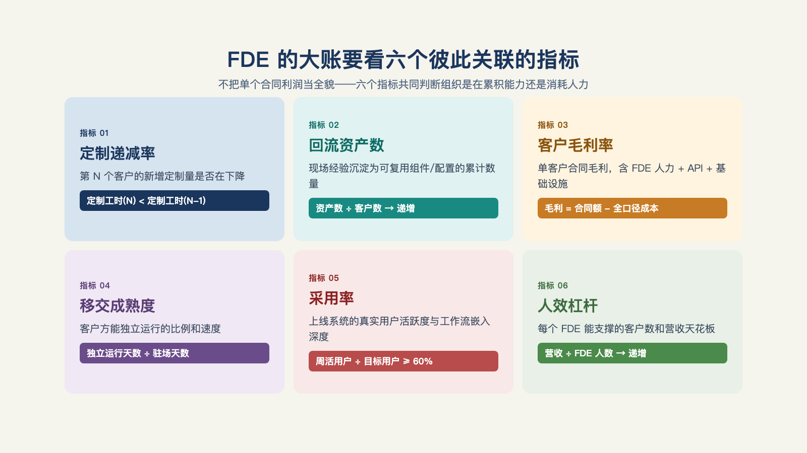
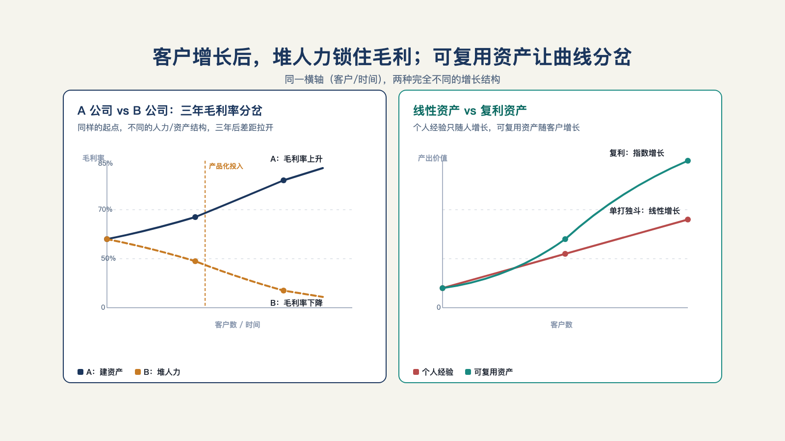
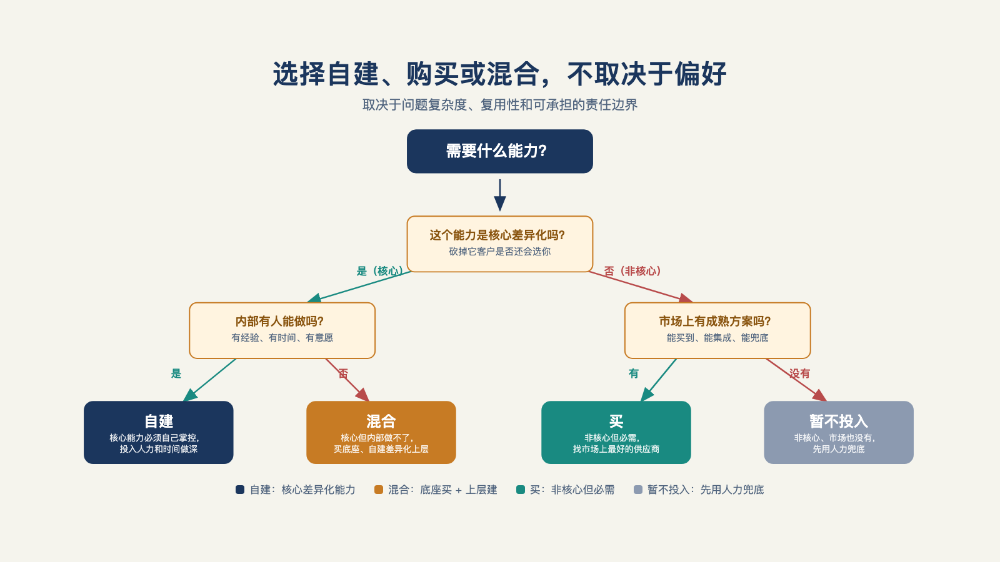

# 第 19 章 · 为什么"招几个 FDE"，要算大账，不是小账？

> 你该投资那种好到傻瓜也能经营的企业，因为迟早会有傻瓜来经营它。
>
> —— 沃伦·巴菲特

"这个客户很重要，我们先招两个 FDE。"

这句话在项目会上听起来几乎没有问题。客户需要深度部署，销售不愿失单，现有工程团队也抽不开身；两个能驻场、能救火的人，看上去是最快的解法。

但招聘决定一旦做下，问题就不再只是多付两个人的薪水。下一个客户来了，还要不要再招两人？这两个人为客户写下的代码、跑通的流程和积累的经验，能不能带到下一个项目？

"招几个 FDE"表面是人事问题，实际上是在决定公司将来靠什么增长。这一章要算的，正是这笔账。

## 一、小账与大账，先分清再动笔

小账是招聘视角：这个人什么背景、多能干、要多少薪水、能不能吃苦驻场。大账是投入产出视角：这个团队的投入产出结构是什么？它随客户数怎么变化？它会把这个组织变成什么？

两组问题摆在一起，差别一目了然。小账问"这个人一年成本多少"，大账问"每增加一个客户，成本增加多少、毛利变化多少"；小账问"他能不能搞定客户"，大账问"他搞定的东西，下一个客户能不能用上"；小账问"团队要几个人"，大账问"团队规模是不是必须随客户数线性增长"。

本书的立场很明确：先答大账，再答小账。大账不成立，小账答得再漂亮也是给一个错误的组织招人。这也是第 26 章（什么时候建团队、怎么建）的前置——组织设计的一切细节，都从这一章的账本里长出来。

## 二、六个指标，把大账落到数字上

大账不能只是姿态，要能算。六个指标，每个说清两件事：怎么算，什么样算健康。[^c14]

**其一，实施杠杆率：一名 FDE 能把多少客户收入做上线？** 分子是新进入生产环境的客户收入，分母是投入的工程师人数。它回答的是这门生意最基本的问题：一个人扛得动多少？

**其二，价值实现周期：客户从签约到第一次可衡量的业务见效，多久？** 参考口径：最小可行部署的验证以周计（2–6 周），完整部署以月计（1–4 个月）；这个周期持续变长，是方法论或平台出问题的第一信号。[^l03]

**其三，服务成本：部署期和上线后各要多少工程投入？** 这项要算全——差旅、支持、返工这些隐性项最容易漏。

**其四，扩展效应：有 FDE 参与的客户，是不是比没有的客户长得更快？** 老客户的新增收入里，有多少不需要新的交付？它检验的是"深度服务换来信任扩张"这条逻辑。

**其五，产品杠杆率：为一个客户做的工作，有多少变成了后续客户可复用的能力？** 一项平台组件如果能替每个未来部署省下两个月，它创造的是公司级杠杆。

**其六，也是看得最紧的一个：定制递减率。** 第 N 个客户的定制量，应该显著小于第一个客户——连续三个客户不降，立即检视产品回流机制。这一条是第 21 章重点讨论的，大家先有个印象。

六个指标不必凑齐——盯住与当前阶段最相关的三到五个，胜过铺满一面墙的仪表盘。[^l03]但一个都不看的组织，就是闭着眼在算小账（见图 19-1）。

*图 19-1：FDE 的大账要看六个彼此关联的指标，而不是只看新增收入。*

## 三、英雄主义的账

六指标里，最先让"英雄主义"现出原形的是实施杠杆率。

什么是英雄式 FDE：个人能力极强，什么都自己扛——最难的单子给他，最难的客户给他，救火也给他。十个客户的时候，英雄是公司的资产：他的名字就是口碑，他的存在让三个单子起死回生。但一百个客户的时候，英雄是公司的灾难——因为组织能力沉淀在他个人身上，而不是在流程和产品里：他带不动一百个客户，他教不会一百个工程师（知识在他脑子里），他走了公司就塌一角。

比英雄个体更深的坑是英雄文化。一个没有边界的前线部署团队，会成为组织里"所有不好归类的东西"的默认去处：销售把承诺过的功能塞过来，产品把填不上的缺口塞过来，工程把不想做的集成塞过来，客户成功把升级投诉塞过来——很快，什么活都往这里塞，最后全靠几个英雄硬撑：少数几个杰出的工程师靠蛮力让客户活着，业务依赖的是人而不是系统。十个客户的时候运转良好，一百个客户的时候就转不动了。

解法在第 22 章，把个人能力回流成产品能力，但在这里先记下：**英雄是线性增长的资产，而这门生意要么复利，要么退化，没有线性档位。** 一位从业者把这层意思说到最透：最好的前线部署组织，致力于消除自身的工作——建模板、造工具、把客户特定的代码变成可配置的平台能力，把角色不断移向更有价值的问题（见图 19-2）。[^c14]

*图 19-2：客户增长后，英雄式人力会锁住毛利；可复用资产才让曲线分岔。*

## 四、麦格鲁的两笔口径

聊大账绕不开麦格鲁，他是这套模式最成功的亲历者，也是账算得最细的讲述者。他在播客里给过两笔口径。[^c06]

第一笔，关于 KPI。他区分了两种策略：产品市场契合策略里，你希望为每个客户做更少的工作、降低成本、保持合同金额不变；而 FDE 策略正相反——你要驱动合同金额增长，在同一位客户上做越来越有价值的事，因为做的事更有价值，所以为单个客户保持一定的定制量是可以接受的。因此内部的衡量标准是合同金额，而不一定是每个客户的工作量。

乍听之下，这与"定制递减"矛盾——不是说好定制要降吗？别急，这个张力是真实存在的，第 21 章会正面拆解：递减的正确度量是定制占交付的比例，而不是绝对工时。合同变大、单位定制量不变时，占比仍在降、毛利仍在改善——两种读法量的是同一个健康度。

第二笔，关于利润率的路径。他说：为客户做一次新部署，早期实际上可能是在亏钱的；随着你在客户那里时间越长，产品因发现过程而更贴合需求——你不再需要一大群人驻场摸索——并且你赢得了处理更重要问题的权利；于是你交付成果的单位价值成本下降，利润率从负转正——可能要一年，也可能是好几年。[^c06]

这笔账解释了一件事：为什么成熟的 FDE 组织敢在前几个客户上"亏本"——那不是不会算账，是把早期亏损当作产品发现的投资，赌的是合同随时间变大。它同时给六指标补了一条时间轴：前两个客户的所有指标都难看是正常的，要看的是方向，不是起点。

## 五、一张三年损益的对照表

给一张可以换上自己数字重算的演示表。

两家同规模的供应商，起点几乎一样：各三个客户、每客户合同额相当、团队各六人。A 公司从第一天起把每个客户的定制请求打上标签，第三个客户起复用连接器，第五个客户起一半流程走配置；B 公司每单都从零干起，因为"客户着急、复用太慢"。

第一年，B 公司的收入更高——不复用就意味更多的人天，更多的人天可以直接卖出去。
第二年，分岔出现：A 公司的第六到第十个客户交付周期缩短四成，边际成本压向产品成本，交付毛利率从三成爬向六成；B 公司的毛利率被人力成本锁死在三成以下，且团队规模必须随客户数线性扩张。
第三年，A 公司的人均产能是 B 公司的两倍以上，老客户续约时新增的服务几乎零交付成本；B 公司最资深的三个工程师职业倦怠离职——他们手上的四个客户，各需要两名新工程师重新摸索半年。

上面的具体数字不是真的，但分岔的机制是：毛利率从纯人力期的两三成向平台复用后的六成以上爬升，"不上升的 FDE，是咨询公司"。[^l03]

## 六、自建、买，还是混合

账算完，落到决策。管理者面对"要不要有自己的 FDE"，实际是三选一。[^c14]

**自建**：适用条件是差异化就在交付里（你的市场里深度部署就是产品的一部分）、且管理层接受前一两年指标难看。失败形态：没有边界的团队沦为英雄文化的温床（本章第三节），或在平台能力还没成形时硬上。

**买**：向外部服务商按项目采购前线部署能力。适用条件是需求间歇、场景非核心。失败形态：知识从不沉淀在自己组织里，第二个项目从零买起（第 17 章移交三件事全部缺席）。

**混合**：核心场景自建，峰值外包。适用条件最宽，但失败形态也最隐蔽：自建团队慢慢被外包"惯坏"，能力空心化。判据是自建团队是否始终保有最难的那几个客户。

三种选择没有优劣，只有与大账的匹配。唯一错误的选项是第四种：没算过账就招人（见图 19-3）。

*图 19-3：选择自建、购买或混合，不取决于偏好，而取决于问题、复用性和可承担的责任。*

## 七、不要轻易尝试

最后是麦格鲁的劝退：他的第一、第二、第三条建议是同一句话——不要轻易尝试。[^c06]原话的分量在于说话的人：把这套模式从 Palantir 带到 OpenAI 的最成功实践者，给出的却是全场最响亮的劝退。

把这句话放回本章的框架，它其实是"大账思维"的最后一条检验：算大账，最终可能算出的答案是"不该做"。这不是失败，是这笔账最值钱的输出——每一家想做 FDE 的公司都该先问自己能不能承受这个答案，问不出口的，多半已经在坑里了。

大账算清了结构，还有一笔更细的账等着要算：每一个合同，钱怎么收？下一章，我们谈一下如何收费。

---

[^c14]: @deployengineer（Bhaulik Patel）系列长文
[^c06]: Y Combinator：The FDE Playbook for AI Startups（Bob McGrew）

[^l03]: 范冰《前线部署工程师（FDE）》（XDash 开源书）