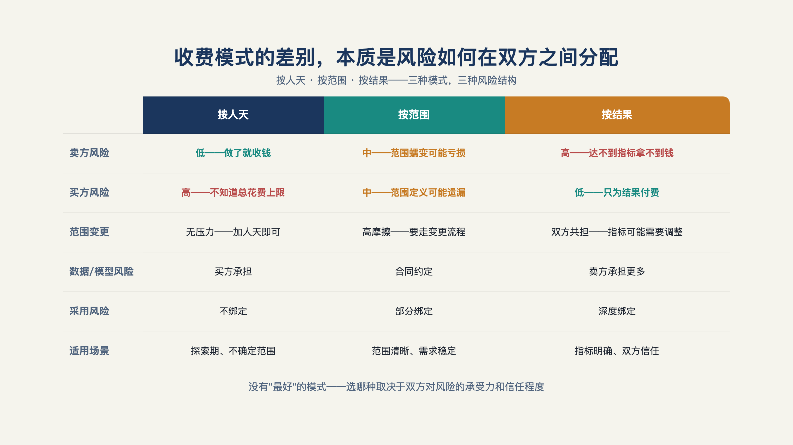

# 第 20 章 · 怎么收费：按人天、按范围，还是按结果？

> 战略的本质，是选择不做什么。
>
> —— 迈克尔·波特

"不达标不收费"，是最容易让客户心动的一句话。

它把一件原本说不清的事说得很简单：项目做出效果再付钱，做不出效果就不付。对刚经历过烂尾项目、又不想再为一堆人天账单买单的客户来说，这几乎很难拒绝。

可是，当双方开始把这句话写进合同，简单的承诺会立刻长出细节。补货准确率提高多少才算有效？滞销库存下降，到底是系统的功劳，还是季节、促销和采购策略的共同结果？三个月后才看得见的收益，能不能覆盖供应商前三个月已经投入的人和成本？

一张写着"不达标不收费"的报价单，真正开始谈的并不是价格，而是这些问题。不同的收费方式，差别只在于把这些不确定性放在哪里：留给客户、留给供应商，还是由双方分担。

这一章拆解收费这个黑箱：三种计费模式各在什么条件下成立、按结果收费的前提、一个从业者的定价方法，以及合同里必须写清的几件事。

## 一、不同的模式，不同的风险

**按人天。** 最古老、最成熟、最好卖——客户懂，采购流程认。风险全压在客户一边：买到的是时间，不是结果。它的失败形态是第 2 章判据三的失守——卖时间的人不对结果负责，做着做着就滑向高级外包。按天计费，增长的上限永远封在人天上，分不到结果增值的那部分。[^b01]一家企业客服 AI 平台商（Cresta）走得更彻底：他们"从来不是以 FDE 的小时来计费的"——FDE 的人力投入折进平台订阅与成功费的总账，不单独逐项列账；对意向强但还没签单的客户，甚至会主动倒贴人力先免费做出效果，"就像送货上门，你已经试穿了，你说你再退掉也不愿意"，把 FDE 成本当作获客投资而非计价单位。[^c25]这条路径不是本章后面要展开的按结果分成（客户仍然按订阅付费，只是内部不把 FDE 工时暴露给客户），而是提醒一句：把 FDE 人力从计价单位里拿掉，本身也是一种风险分配方式——供应商把交付成本前置的风险自己扛了，换来的是更短的成交周期。

**固定范围交付。** 验收制环境里最常见的形态——尤其与中国项目制的采购节奏合拍。风险双方各担一半：乙方担范围内的交付，客户担范围定义不清的后果。它的失败形态有两种：范围蔓延（"顺手再改一下"累积成第二个项目）和墙没摸清——第 9 章说过，报价期数不清八堵墙的合同，就是烂尾的合同级起因。

**按结果分成。** 结果导向对齐得最彻底：客户为零效果付的钱最少，乙方分享增值。但它的失败形态也最锋利：基线争议（省下的钱到底有多少算系统的功劳？）和回款滞后（交付成本前置、分成收入后至，现金流先被压垮）。所以它从来不是"更先进"，只是**更贵的前提换更深的对齐**（见图 20-1）。

*图 20-1：收费模式的差别，本质是范围和结果风险如何在双方之间分配。*

## 二、按结果收费的四个前提

"不达标不收费"听起来，像供应商把自己和客户绑在了一起：项目没有产生效果，客户就不必为一堆工时、会议和中间产物买单。比起按人天计费，这当然更像一次对结果的承诺。

但真正开始谈合同，问题很快会变得具体：什么叫"达标"？销售额上涨，是系统带来的，还是旺季、促销和销售团队共同带来的？效果三个月后才看得出来，前面几个月的交付成本谁来垫？

有人把这种安排称为"结果即服务"（Result as a Service）：供应商不只交付一套系统，也把一部分收费条件绑在业务结果上。客户买到的，不再只是开发工作，而是一项被写进结算规则的结果承诺。

这也解释了它为什么诱人，又为什么难做。一句"不达标不收费"背后，至少要先把四件事谈清：效果从哪里开始算、效果该归给谁、等多久才能结算、最差情况下谁来兜底。少了其中任何一项，结算时都可能变成另一场项目。

下面这四个前提，决定了按结果收费究竟是一种可执行的合作方式，还是一场看似漂亮的对赌。

**基线可测。** 效果要有事前双方签字的基线——这正是第 8 章验收契约的商业意义：没有基线的分成，结算是扯皮。

**归因可信。** 效果提升要能归到系统头上。销售额涨了三成，是智能体的功劳还是季节？归因逻辑要在签约前写死（对照期、对照门店，或至少一个双方认可的折算规则）。

**周期可承受。** 交付成本在前、分成收入在后，中间的时间差要算清现金流能否活过——按结果收费饿死的公司，比做砸的多。

**下行有底。** 保底费用要覆盖交付成本。纯对赌不是定价，是赌命；一家现金流健康的公司没有理由用下一季的工资单去对赌客户的业务指标。

四前提背后有个共同的名字：可测量性。第 12 章的评测体系在这里完成它的商业闭环——**评测不只是质量工具，是定价的地基。** 评测口径说不清的生意，只能按人天卖。

## 三、三个报价锚点

一位服务过多家企业的顾问，将自己见过的报价方式归成三类。它们不是通用范式，只是提供一个思路：

**公式一，降本。** 他举例：一家有五十名研发人员的公司，人均年成本二十万元；若人数从五十人降到三十人，节省四百万元，收费可以锚定在这笔差额的一部分。客户不必先相信供应商的报价，只要先算清自己的成本账。

**公式二，固定成本置换。** 一家电商的商品详情页，每年要花两三百万元在摄影、模特、修图和设计上；为其搭建人工智能生图系统，收费一百万元。被替代的存量开支，就是价格的锚；为实现这种替代所需的额外工程成本，也要计入报价。

**公式三，增收。** 销售人员月业绩从十万元做到三十万元，增量二十万元里按约定比例分成。价格只落在新增部分，客户也更容易把它和原有业绩区分开来。[^b17]

三条公式外形不同，内核是同一句话：**价格锚在客户自己能核算的账上。** 降本锚在人力差额、置换锚在存量开支、增收锚在增量流水——没有一个锚需要客户"相信"乙方的报价，每个锚客户自己都能按计算器。这与第 2 章判据三（对什么收钱）和第 8 章基线测量完全互证：报价的说服力，来自客户能在自己的账本上复算它。

大厂供应商的价目表，与这三条独立顾问的公式对得上。阿里瓴羊的销售口径是双轨：一类按坐席——客户原有五百人的客服团队，今天用相当于原成本八到九折的投入做到同等效果，锚的是被替代的人力开支（公式一的变体）；一类按效果分成——营销、投放类场景，转化率超出原有基线的部分才分成，锚的是增量（公式三的变体）。[^b19]更值得注意的是他们对"不达标不收费"的叫法："不叫对赌，还是叫做测评"——先在客户的真实业务单元上做最小价值验证，客户验收通过才继续服务，并且明言，算不过账的客户不会连续续费。[^b19]"对赌"能不能改口叫"测评"，分界线恰好就是本章第二节的四个前提：基线可测、归因可信，才有资格叫测评；测不了，就只能叫赌。

## 四、混合结构：一种更稳妥的安排

对交付成本高、效果滞后的项目，一种更稳妥的结构是：**固定费 + 效果奖金 + 运行费。** 固定费覆盖可预见的交付成本，效果奖金分享增值，运行费对应移交后的托管运行。运行期仍在持续消耗工程与支持资源；不单列收费，这部分成本就会侵蚀交付毛利。

一个条款参考骨架是：固定费按里程碑分三期，各挂验收口径（第 8 章）；效果奖金设两条档线，基线以下为零、达标以上按约定比例封顶；运行费按年计，写明响应级别、升级路径与责任边界（第 17 章）；任何一方提前终止的结算规则。

## 五、合同里必须写清的五件事

模式之外，是条款。五件事写不清，什么模式都会翻车。

**其一，评测口径与判定人。** 用哪个评测集、什么算达标、谁说了算——第 12 章的评测体系在这里变成合同附件。

**其二，甲方配合义务。** 数据与权限的配合是交付的前置（第 10 章）——甲方拖延导致延期，责任怎么算？没有这条，所有延期都是乙方的。

**其三，验收节点与灰度规则。** 分几期验、灰度比例怎么爬（第 8 章），写进合同而不是留在邮件里。

**其四，移交后的责任边界。** 验收之后、托管期内的故障分级与响应，接第 17 章的责任交接表。

**其五，知识产权归属。** 定制代码、评测集、可复用模块各归谁——这条与第 22 章的产品回流直接冲突（回流的原料就是现场资产），乙方必争，但争的方式可以设计：定制代码留客户、可复用组件留乙方、评测集随移交（第 17 章的立场）。

为了防止被"白嫖"，还有一条来自一线从业者的做法：**方案要分拆。** 售前方案只交代问题判断、技术路径和报价；真正可执行的分阶段步骤、验收指标和落地细节，签约后再共同细化。原因也很直白：客户拿着一份已经能执行的方案去找别人做，或者交给内部团队照着做，乙方前面的售前工作就打了水漂。[^b17]

## 六、买方视角：怎么读一张报价单

最后站到桌子的另一边——甲方。拿到报价单后，先问三件事。

**第一，这笔钱买的是什么？** 是工时、明确范围，还是已经定义的结果？先看收费结构，再看总价，才能知道项目失控时风险会落在谁身上。

**第二，低价漏掉了什么？** 集成、数据治理和运行支持是否已经算进报价？这些成本没有消失，只是可能在交付中以变更单的形式回来。

**第三，指标由谁定义？** 报价里写"预计提升 40%"，分母是什么、观察窗口多长、谁来判定？定义不清的承诺，到了结算时很难不引发争议。

单笔合同算得再好，也只是小账的胜利。第 19 章的大账里最难的一条曲线——第 N 个客户的定制量——不下降，任何收费模式都救不了毛利率。下一章讨论如何实现定制递减。

---

[^b17]: 破局点 TURNING POINT 第 31 期：中国式 FDE
[^b19]: 硅谷 101 E248：和阿里瓴羊朋新宇聊中国式 FDE
[^c25]: 硅谷 101 E240：聊硅谷最火新职位 FDE
[^b01]: 十字路口 × Rolling AI：FDE 对谈
