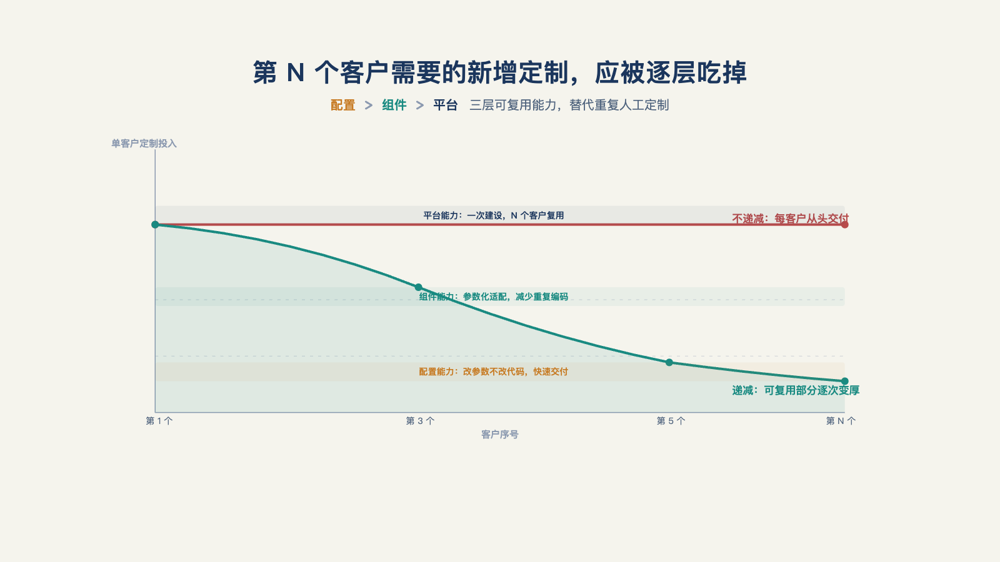
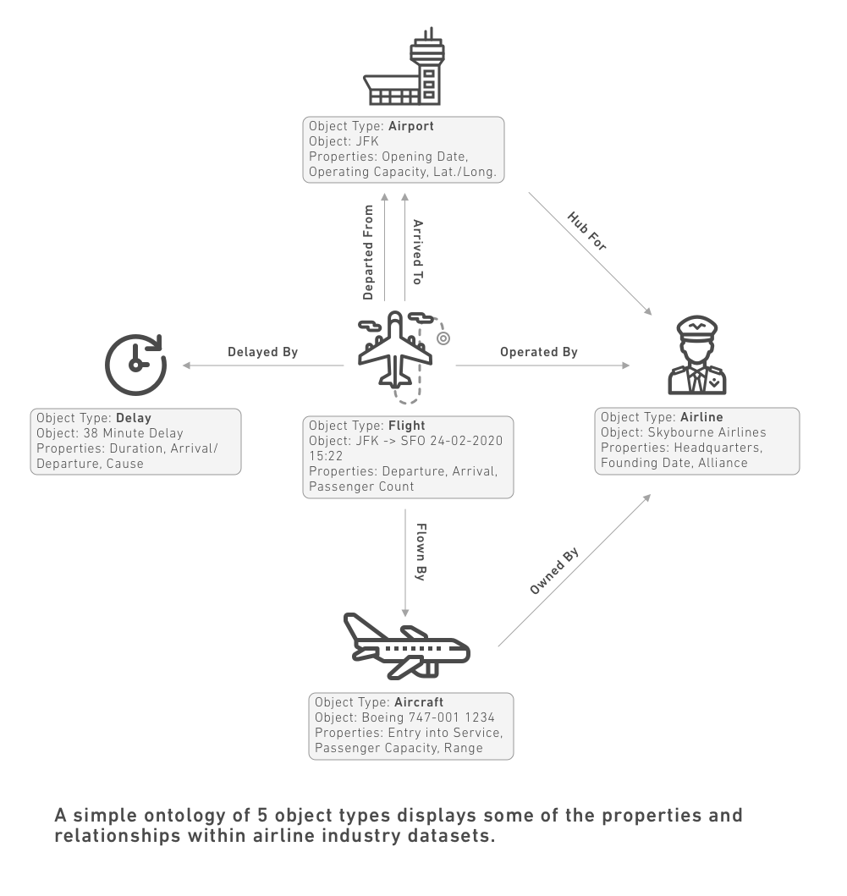

# 第 21 章 · 第 N 个客户的定制量，为什么必须下降？

> 今天的问题，来自昨天的解决方案。
>
> —— 彼得·圣吉《第五项修炼》

"这个客户和前九个客户一样，还要再派一组工程师吗？"

第十个客户刚签下，项目经理开始排期：接系统、配权限、改流程、做评测、上线后支持。每一项在前九个项目里都做过，排期却仍然像面对第一个客户。

真正危险的不是交付团队不够努力，而是公司没有把前九次交付变成第十次可以直接使用的能力。第 N 个客户的定制量为什么必须下降？这就是本章要回答的问题。

## 一、批判的不是定制，是不可递减

前线部署模式靠定制起家——这一点全书没有含糊过。第一个客户百分之百定制是必然：你连这个行业的流程长什么样都是第一次见，除了定制没有别的动作可做。把"定制"当贬义词的批评打偏了靶子。

真正致命的是另一个东西：**定制量不随客户数下降。** 第一个客户全定制，是模式的开端；第十个客户定制还占八成，是模式的失败——因为毛利、交付速度、质量稳定性会全部随客户数线性恶化，下面两节会去拆解。

所以本章的问题不是"怎么少做定制"，而是"怎么让第 N 个客户的定制量显著小于第一个客户"。指标已经有了：定制递减率，第 19 章提过、参考书写明判读法的那个——连续三个客户不降，立即检视产品回流机制。[^l03]

需求方也在同一方向上移动。一位大厂交付负责人说，客户买人天的投入这种订单会越来越少——人天定制对双方都是"从养鸡场到养鸡到下蛋，所有都干完"的低效模式；连以服务收入著称的 Databricks，他也辨析为"帮客户找出有价值的问题，而不是帮客户实现他列出来的 to-do list 的 100 个功能需求"。[^b19]"按人天买功能"退潮，逼着交付方回答本章的问题：不靠人头堆定制，靠什么。

## 二、两条成本曲线

先用数学把"慢性死亡"说清楚。

不递减的世界里，成本结构是一道乘法：**总定制成本 ＝ 客户数 × 单位定制成本。** 假设每个客户五十人天，十个客户就是五百人天——团队规模必须随客户数线性扩张——这正是第 19 章那张三年对照表里 B 公司的路径：毛利率被人力成本锁死，B 公司最资深的工程师在第三年职业倦怠离职。毛利率陷阱（第 19 章）和这条成本曲线，是同一张账的两个侧面。

递减的世界里，第 N 个客户的交付成本逐步靠近产品的复制成本。

到第十个客户，两种世界的单客户成本差十倍——而递减世界里省下的不只是钱：交付周期会缩短，质量稳定性也会同步上升。递减不是省钱项，是这门生意从"人力生意"变成"产品生意"的门槛。

## 三、当定制能力只长在人身上

问题不在于某位 FDE 能力太强，而在于他的判断、取舍和踩坑记录只留在自己脑中。第一个客户做过的工单集成，第四个客户来了，他仍凭经验再做一遍；这叫更熟练的定制，不叫可复制的交付。

个人熟练度可以提高，客户数也会增长。若每次交付都没有留下组织可用的资产，客户最终会多到个人能力接不过来。

解法与第 17 章对外移交同构：**对外交付系统，对内沉淀知识。** 每次定制结束，都应留下可复用资产清单：哪些集成能力可以组件化，哪些流程可以配置，哪些评测结构可以迁移，哪些部分只属于当前客户。

## 四、定制不降，合同也能增长吗？

麦格鲁在播客里说：FDE 策略要驱动合同金额增长，在同一位客户上做越来越有价值的事，因此**为单个客户保持一定的定制量是可以接受的**，内部衡量标准是合同金额而非每客户工作量。[^c06]——"定制量大致不变"？这与本章标题直接冲突了。

关键在度量口径：**递减衡量的是定制占交付或合同的比例，而不是绝对工时。** 单个客户的定制量可以暂时不变；只要产品杠杆推动合同金额和交付价值增长，定制占比仍在下降，毛利仍有改善空间。

降分子（少定制）与增分母（做更大、更有价值的合同）是同一个健康度的两种读法。多数团队先要做到前者；后者成立的前提，是定制内容确实在持续回流成产品能力。

## 五、递减的三类可复用能力

口径立好了，问题是拿什么降。三个引擎，每个都有现场证据支撑。

先立一个总纲：客户数据属于客户，不能被带到下一个项目。真正能随部署累积的，是对场景的判断、评测与验证的方法，以及把一次跑通变成稳定交付的工程流程。[^b16]

**能力一，集成能力组件化。** 可复用的不是客户数据，也不只是接口代码，而是一套可配置的集成能力：认证方式、字段映射、同步规则、异常处理和权限边界。客户差异留在配置层，稳定部分进入平台组件。

**能力二，流程模板化。** 同一行业的业务流程，抽象成可配置模板。这里有一个容易搞混的界限：**配置不是定制——配置改参数，定制改代码。** 模板化的目标，是把"改代码"的需求降级成"改参数"的请求：审批层级、字段命名和阈值区间进配置表；流程拓扑本身变化，才动代码。

**能力三，评测结构迁移。** 跨客户的评测模式可以沉淀：任务类型、难度分层和判定规则可复用，案例数据不可复用。带走的是"怎么考"，不是客户的"考卷"。

三类能力共用一个特征：**每次复用都在让下一次交付更轻。** 平台组件补齐异常处理，模板积累参数经验，评测结构扩展失效样本。复用不是把旧方案原样搬走，而是让可复用的部分越攒越多，下一次交付就轻一分（见图 21-1）。

*图 21-1：第 N 个客户需要的新增定制，应被组件、配置和平台能力逐层吃掉。*

## 六、配置与定制的分界线

引擎转起来之前，每个需求进门要先过一道闸。三问依次问下来：

**第一问：能否配置解决？** 参数、模板、规则表能搞定的，禁止进代码。

**第二问：能否作为下一个客户的默认能力？** 这个需求是这家客户独有，还是别的客户也会要同样的能力——后者即使今天要写代码，也按"未来默认能力"的标准写：进主干、带抽象、留参数。

**第三问：是否只能定制？** 本客户特殊、且无复用预期——可以定制，但定制代码必须**打标签**：一次性代码明确标记，与产品代码物理隔离。标签的用处不是仪式感，是防止定制代码伪装成产品能力——下一段要讲的死代码，一半就是这么混进去的。

这三问背后还有一个更根本的方向判断，来自一位大厂交付负责人的三段论：定制化、标准化、个性化。过去的软件交付是"用定制化的方式去解决标准化的问题"——把企业已经跑顺的流程刻画进系统，刻画得到位能解决三成，刻画不到位"天天有七成的新增量"，项目变成"又长又久的黑天鹅工程"。[^b19]智能体时代的机会是反过来的："用标准化的方式去解决个性化的问题"——把工作流、数据流、企业上下文这些环节标准化之后，同一个产品就能在不同客户那里自主长出各自的特性；而"既然定制化，就很难做到个性化"——定制锁死的恰恰是变化的能力。[^b19]落到操作上，就是三问闸门要推的方向：让"改代码"持续降级成"改参数"，再让"改参数"沉淀为产品出厂就带的预设能力。

## 七、产品化的时机：何时抽象，何时保留定制

引擎和闸门都就位后，剩下的是时间问题：什么时候把定制升级成产品。第一个客户通常要走完全程，产品团队再从中抽象出能服务后续客户的通用版本。[^c06]

这里有两个常见误判。

**把一个客户的方案直接塞进产品。** 它只解决了一个客户的问题，未来客户却都要为它付维护成本。正确的抽象必须比客户带来的问题更通用一级。Palantir 早期从为"人员""资金"等具体对象分别建表，转向用对象、属性、关联和操作来描述业务——这套建模方式后来定型为**本体论（Ontology）**：不为每个具体对象单独建表，而是用统一的对象类型、属性、关联类型和操作类型来描述任何一类实体（见图 21-2）。[^c06]Palantir 官方把本体论定位为"组织的数字孪生"，并特别强调它不是一层薄薄的语义层——数据、逻辑、操作、安全四者的整合，靠贴标签式的字段字典做不到。[^c26]客户差异留在建模与配置层，通用能力留在产品层；本体论怎样跨客户持续生长、反哺下一次交付，第 22 章展开。

*图 21-2：Palantir 官方本体论教学案例（航空业），图中英文标注为原图，未译；图片来源：Palantir 官方文档。[^c26]*

**共性信号还没出现就急着产品化。** 只有第一个客户时就为未来客户投入，容易把猜测做成平台功能。更稳妥的纪律是：没有第二个客户之前，不急着铺开；有了第三个同类需求仍不处理，就该检查回流机制。

判断信号可以来自三个地方：同一段流程被两个客户以不同变体提出；售前反复演示同一套集成；新客户主动要求沿用上一套方案。还有一个前提：后面的客户必须走相近的业务路径。一位从业者的个案是，服务三到五家同行业客户后，流程才逐步成型为面向该行业的智能体产品。[^b17]

## 八、不会递减的部分，按服务生意核算

有些定制天然不递减：超大型客户的独有流程（那是它竞争力的载体，不会为你的复用让路）；强监管行业里各家不同的合规要求（监管文本不同，改造义务就不同）。这类需求的正确处理不是硬套递减叙事，而是承认它：**这就是服务生意，按服务生意定价**（第 20 章的人天与混合结构），把它单独核算（第 19 章的服务成本），别让它混进"我们也在做产品"的故事里抬高估值预期。

把天然不递减的部分诚实标注为服务，反而保住了递减部分的含金量——递减曲线上的每一分下降都是真的产品化；混在一起报"产品收入占比"，才是毛利率陷阱里最隐蔽的那一种。

曲线下降的背后，是一只手在把现场的经验搬回产品。这个机制怎么建、搬什么、谁负责、怎么激励——下一章，产品回流。

---

[^c06]: Y Combinator：The FDE Playbook for AI Startups（Bob McGrew）
[^c26]: C26
[^b16]: Inside an Applied AI company（Pace 长文）
[^b17]: 破局点 TURNING POINT 第 31 期：中国式 FDE
[^b19]: 硅谷 101 E248：和阿里瓴羊朋新宇聊中国式 FDE

[^l03]: 范冰《前线部署工程师（FDE）》（XDash 开源书）