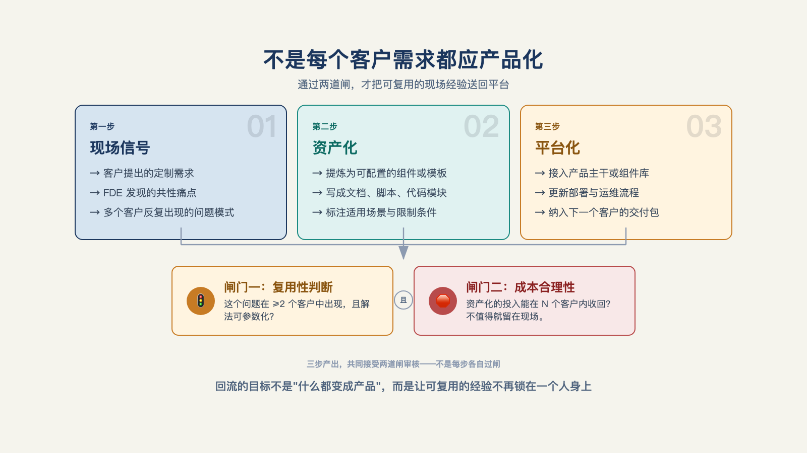

# 第 22 章 · 客户现场的经验，怎么沉淀为产品能力？

> 好的意图不管用，机制才管用。
>
> —— 杰夫·贝索斯

"这个坑怎么又来了？"

第二个客户上线前夜，FDE看着报错记录愣了一下。问题和上一个客户几乎一样：两个系统对同一件事用了不同叫法，流程一接起来，权限和审批就全乱了。

他知道怎么修。上一次他已经修过一次。

只是上一次的规则、映射和测试，都留在另一个项目里。于是他又从头做了一遍。客户的问题解决了，公司却第二次忘掉了答案。

## 一、现场的答案，为什么没有回到产品里

一家公司做前线部署时，实际上同时运行着两套东西。

第一套在客户现场。FDE 用这家客户的数据、权限和流程，把一个具体问题跑通；目标是让项目上线。第二套是供应商自己的产品平台：可供多个客户复用的数据模型、集成组件、流程能力和应用工具；目标是让下一次交付不必从头开始。

现场与平台之间并不是天然连通的。FDE 在现场发现了问题，也写出了能用的解法；如果它只作为项目交付物留在客户目录里，平台就没有学到任何东西。久而久之，平台功能看上去不少，现场却仍要反复定制，最后实际做的还是外包。

问题的本质是：需求信号产生在交付团队，产品决策发生在平台团队，中间没有固定的传递机制。交付团队优先赶里程碑，产品团队优先守路线图；谁都没有错，经验却会停在项目里。

回流因此不是一句"多写文档"，而是一套被设计出来的接口：把现场形成的资产识别出来，带入产品决策，再让新的产品能力回到下一次交付。

## 二、先把现场问题翻译成共同业务语言

本章开头那个问题，表面上是字段映射，实质上是两套系统没有说同一种业务语言。一个系统叫"服务请求"，另一个叫"工单"；FDE 临时把两者连起来，客户就能继续使用。可下一个客户又会换一套名称、状态和审批方式。

要让这类经验跨客户留下来，不能只保存某次映射规则，还要沉淀一套描述业务的共同语言。这就是**本体论（Ontology）**：它规定业务里有什么对象、对象之间怎样关联，以及在什么规则和权限下可以执行什么动作。[^c06]

以工单场景为例：工单、客户、设备和服务人员是对象；"某张工单属于哪台设备""由谁处理"是关联；派单、升级、关闭是动作；金额阈值、审批层级和可见范围是规则。客户可以保留自己的字段名和原始数据，平台沉淀的是这套建模方式。

这套建模方式里，还有一层容易被"对象、关联、动作"三个词盖住的维度：**权限**。谁能看到这张工单、谁能派单、谁能改字段——这些边界本身也要沉淀，不是事后补一层访问控制。Palantir 官方用一家医疗制造企业的例子说明这一点：生产团队需要设备的全局遥测权限，仓库员工的权限按所在区域收窄，供应链分析师的权限精确到行和列；当这三类角色都开始用 AI 智能体去操作同一套业务对象时，每个智能体的权限必须能继承自它所代表的人类用户或所属项目的权限结构，不能另开一套规则。[^c26]对象、关联、动作、权限，合起来才是这套共同语言的完整定义——但定义写清楚只是起点，它怎么从一次性的映射规则，变成下一个客户能直接拿去用的资产？

"蒸馏"这个词，是"回流"更通俗的说法。陆骁鹏（Ventus AI 联合创始人）的表述最锋利：散落在每个人脑子里的经验不叫沉淀，汇聚成具象化的知识库或 Skill，才叫沉淀。钟钱杰（Cresta）给出了更进一步的产品化形态：他的团队把蒸馏后的成果——可能是一份 Markdown、一个 CLI、一段脚本——封装成智能体（agentic）工具，客户说想做什么，后台自动调用最佳实践去尝试[^b21]。业务本体是"蒸馏"出来的共同语言，下面这六类资产，是这套语言之外还能被蒸馏出来、并能封装成工具反哺现场的其余部分。

## 三、回流的不是"经验"，而是六类资产

业务本体是共同语言，但它不能独自完成交付。现场还会留下五类可搬运的资产。

**连接器。** 连接器不是"接了一个接口"的口头经验，而是可复用的集成组件：认证方式、数据读取、字段映射、同步规则、异常处理和权限边界。它解决的是数据怎么稳定地接进来，而不是把客户数据带走。

**工具与审批模板。** 现场为约束智能体动作而搭出的工单系统、审批链、风险分级和操作界面，若能被不同客户配置使用，就不该永远留在一次项目里。

**流程模板。** 同行业反复出现的流程，可以抽象成参数化模板。配置改参数，定制改代码；模板的价值，是把越来越多的"改代码"变成"改参数"。

**评测结构与失败模式库。** 可带走的是任务类型、难度分层、判定规则和失效模式，不是客户案例数据。它让下一个项目从"怎么验证"开始，而不是从"先试试看"开始。[^b16]

**需求信号。** 哪些请求在不同客户处反复出现、哪些只是一家客户的例外，这些记录决定什么值得进入产品路线图。它往往最容易被扔掉，也最接近产品方向。

一位 Palantir 前员工回顾，现场反复出现的导数据、做可视化和搭页面需求，后来逐步沉淀为数据摄取、可视化和应用构建工具。产品不是先画好再被客户接受的；很多时候，它从重复出现的现场请求里长出来。[^b18]

## 四、让资产真正回到平台：三步与两道闸

第一步，FDE 在现场构建并记录问题的上下文：客户为什么要这个能力、替代方案为什么失效、哪些部分属于当前客户。

第二步，FDE 带着这些上下文回到产品团队，共同讨论"正确的通用版本"。只交一份需求文档不够，因为文档通常丢掉了形成需求的约束和取舍。

第三步，邀请服务其他客户的 FDE 一起校验。三个略有不同但同源的工作流摆在眼前，团队才更容易分清什么是行业共性，什么只是单个客户的习惯。[^c06]

三步前后还要加两道闸。第一道闸管进：需求先分为一次性、行业共性和通用三类，一次性需求可以交付，但不直接进入产品队列。第二道闸管出：回流评审必须给每项资产明确去处——进入产品路线图、进入组件库、进入模板库，或明确不做（见图 22-1）。

*图 22-1：不是每个客户需求都应产品化；通过两道闸，才把可复用的现场经验送回平台。*

钟钱杰团队的做法是这条出口路径的一个具体范例：蒸馏后的资产不只是"进组件库"这么模糊，而是直接封装成一个智能体（agentic）工具——客户说想做什么，工具自动调用沉淀好的最佳实践去尝试，不行就换下一个方案再试[^b21]。

产品化也不能只听客户开口要什么。一个需求至少要同时过三问：它是否在相近客户处重复出现？是否服务客户真正重要的业务目标？能否比当前客户方案再抽象一层？三问里任何一问答不上来，就不应急着把它做成平台能力。

## 五、让回流成为双方都愿意做的事

清单和流程改变不了激励，就只能停在纸面上。做交付的人要能看见回流的收益：自己沉淀的组件、模板和评测结构被后续项目复用时，应计入交付成果。

产品团队也需要为现场信号预留空间。没有明确容量和决策权，现场需求永远排不过既定路线图；只收件、不处置，回流评审只会变成收集箱。

回流也不该是单向的。平台每沉淀一个可配置组件、流程模板或评测结构，都应优先回到 FDE 手里，让他在下一个客户处少拉人、少写一次性代码、把时间用在更难的问题上。麦格鲁将 FDE 称为产品的另一类关键客户，指的正是这种关系。[^c06]

回流跑没跑起来，不看会议纪要，看 FDE 的选择：面对新需求时，他会不会主动用平台组件拼装，而不是绕开平台再写一套临时方案。

## 六、三种让回流失效的做法

**把评审开成甩锅会。** 交付团队吐槽产品，产品团队辩解路线图，却没有产出可处置的资产、做出明确的决定。评审只讨论可处置的资产，每项都要有明确去处。

**把评审开成只进不出的收集箱。** 需求被记进待办，却没有人能调整排序；几个月后，现场自然不再提交。回流评审必须拥有影响产品优先级的权限。

**把第一个客户的答案直接产品化。** 这不是回流，而是把定制代码搬进平台。没有第二个相近客户前，不必急着投入；同类需求持续出现后仍没有动作，才应回头检查机制。

第 21 章问的是：第 N 个客户为什么不能继续重复第一个客户的劳动。本章给出的答案是：要把现场反复得到的答案，翻译成共同语言、组件、模板和评测，再通过一套有决策权的机制送回平台。

---

[^c06]: Y Combinator：The FDE Playbook for AI Startups（Bob McGrew）
[^c26]: C26
[^b18]: Reflections on Palantir（Nabeel Qureshi）
[^b16]: Inside an Applied AI company（Pace 长文）
[^b21]: 腾讯研究院 AI 透镜圆桌 06：来自硅谷一线创业者的 FDE 非共识与落地指南
