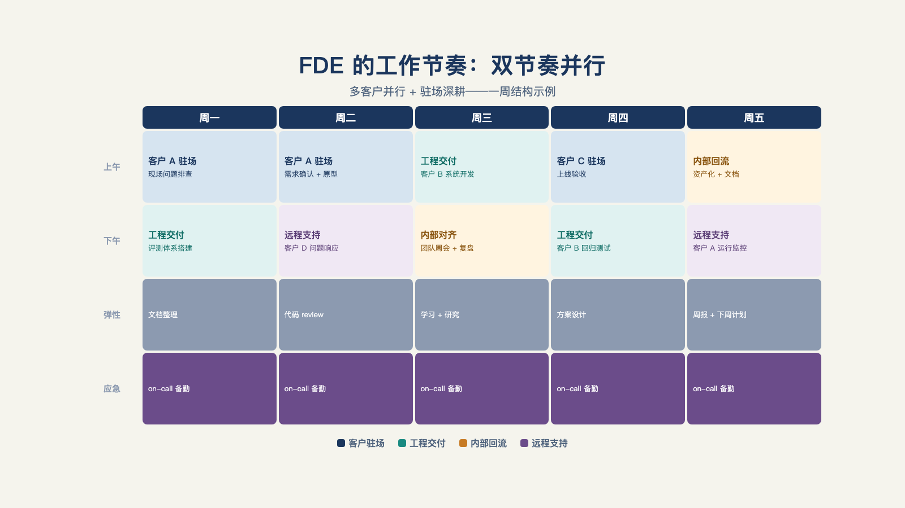

# 第 23 章 · FDE 到底在干什么？

> 管理者的活动，特征是简短、多变、不连续。
>
> —— 亨利·明茨伯格

杭州，晚上十一点半，一位 FDE 的微信响了：客户打来语音，说周报机器人不发消息了。他远程连上系统查了一圈，一切正常——最后派人第二天跑一趟现场，发现是那台电脑不知道被谁关机了。[^b17]

同一周，硅谷，另一位 FDE 的十个客户系统同时报警：上游的 Cloudflare 宕机，没有预案，救火一晚上。

这是同一份工作的两种夜晚。这一章拿掉职位滤镜，从四个真实样本里拆出这个角色的真实节奏、任务构成与情绪体验：硅谷的两种打法（多客户并行、驻场深耕）、一位刚入职的日本新人，和杭州这头的中国日常。

## 一、两种节奏：多客户并行 vs 驻场深耕

第一份样本来自硅谷，一位有十二年经验的工程师，近两年转入前线部署式的角色。他自己发了一篇"一周日记"：**十个活跃客户，一周约五十小时，会议与真正写东西的时间约各一半**，外加计划外的救火——开头那次 Cloudflare 宕机，就是他这十个客户的系统一起报警。[^b12]

值得逐条看的是任务构成：并行推进多个客户的构建、售前电话、救火、周报。没有一条是"研究算法"。有人在这篇日记下问他与传统软件工程师的差别，他的回答很直接——某种意义上更有成就感，因为解决方案从头到尾归他所有。[^b12]

第二份样本节奏完全不同，同样在美国：Baseten 的那位 FDE（就是第 1 章时间账的作者，七成半在工程与模型优化），交付完成后转入支持角色，继续守着同一个客户。[^b11]

对照着看：一个是**多客户并行型**（十个客户、高频切换、售前也管），一个是**驻场深耕型**（少数客户、工程占比更高、交付后接着运维）。同一个头衔，物质基础、节奏、能力侧重都不一样——第 18 章讲过这是市场结构决定的，这里先记下一个事实：**谈"FDE 的日常"之前，先问哪一种 FDE。**

## 二、新人的第一天，不是写算法

第三个样本来自一位入职两个月的日本新人，她的记叙纠正了最常见的想象。她原以为这是"在客户现场一个人战斗"的工作，两个月后看到的真实是：项目刚上线，正处在等客户真正上手使用的阶段；她的日常是**整理需求、有时写代码、跟进到客户的愿望真正实现为止**。[^b13]

两个细节最有分量。其一，她做的事包括**和客户的管理员一起，把生产环境的权限与认证配置好**——新人 FDE 的起点不是算法，是接系统（第 10 章的全部）。其二，她的工作信条是：**与其写完美的规格书，不如做一个能让客户实际上手试用的原型，看客户的反应，当场修正方向**——这不就是第 7 章最小可行部署的新人版吗。[^b13]

## 三、拼一张一周结构图

三个样本各有侧重，拼一张综合的周结构图：**周一**，现场或计划会——对齐本周目标与风险；**周中**，构建与联调——写代码、接权限、跑评测（第三部的日常）；**周五**，客户周报与评测回顾——用数据说话（第 12、13 章）。

但理想循环只是一半。另一半，是随时冒出来的生产事故（半夜的微信、宕机的上游）、临时加塞的需求（老板要的演示、客户临时拉会），和维系关系的人情——中国样本里这一项不是润滑剂，是承重墙。两个一半的比例，基本决定了这份工作的体验是哪一种（见图 23-1）。

*图 23-1：FDE 的工作节奏在客户现场、工程交付、内部回流与持续支持之间切换。*

## 四、中国的一天

把目光转回中国——这里的物质基础完全是另一套。开头那通深夜电话——周报机器人不发消息，一查是电脑被顺手关了机——就是这套物质基础的产物；第 18 章那笔**六成时间在业务梳理与人情**的时间账，落到一天里就是这种节奏。[^b17]同一份记叙里还有一个更荒诞的细节：客户拿着 XP 系统的电脑来装部署包，这可是2026 年，还在用XP系统。[^b17]

真正的分岔在这里：社区观察到的国内"驻场原型型" FDE，一天的主轴是守着一个客户做原型、改原型——责任半径窄，但深度和依附性强；硅谷的多客户型，责任半径宽，切换成本高。[^c21]同样是"一天"，装的东西完全不同——这正是第 18 章结构差异落到个人日程上的样子。

## 五、正在变宽的上限

现在回到第一节的两个数字：十个客户、五十小时。他能同时扛十个，除了个人能力，还有一个正在起变化的因素——**工具杠杆**。一位硅谷从业者给出的方向性判断：录音转写、企业内部搜索一类工具，短期内可能把单个 FDE 能同时扛的项目数从两三个提到五六个；长期则会让角色分化——一端是啃最难问题的高端 FDE，另一端是服务中小客户、甚至不上现场的远程 FDE。[^c25]

这与第 5 章"执行层贬值"的判断同构：工具把"一天"的产出上限往上推的同时，也在把角色拉开档次。**"一天"不是常量，是被工具改写中的变量。**

## 六、情绪的真话

先说正面情绪。回到第一节那位硅谷工程师的话：端到端的所有权感——自己看见问题、自己解决、自己收到客户的反馈，这是十二年工程师转岗后最直接的收获。[^b12]

反面的痛感则有两层。第一层在甲方：认知误区、技术栈不统一、代码做不到端到端交付、安全没保障，返工不断，全压在一线团队身上。[^b03]第二层，这股痛感会沿着责任链传导到乙方：甲方的 997，就是 FDE 的半夜微信、崩了要抢救的系统、多客户并行反复切换的消耗。

同一份工作，在不同人身上是天堂或地狱。分界变量只有两个：**对模糊性的耐受，和对所有权的需求**——耐得住打断、受得了模糊、并且强烈需要"这事从头到尾归我"的人，在这份工作里如鱼得水；反过来则是持续的消耗。这两个变量，就是下一章能力模型的最后一道门槛。

## 七、想去这个方向，先试三件事

不必先辞职再验证。想检验自己适不适合，可以在当前岗位里先试试这三个场景：

**给内部用户做一次真实交付。** 找一个跨部门的内部工具需求，从需求访谈做到上线运维——体验"用户就坐在旁边"的交付。

**跟一次完整的客户会议。** 从售前听到售后，数一数一场会里有多少个"这不是技术问题的问题"。

**接手一个上线后的系统，管一个月。** 哪怕只是值班——上线之后的每个报警、每句"怎么又不好用了"，就是这份工作的日常质地。

三件事做完，对模糊性耐受与所有权需求这两个变量，你会得到比任何测评都准的答案。

这一天、这一周的真实质地，算是摸清楚了。谁能扛下来、扛得好——下一章，从能力模型说起。

---

[^b12]: 一名前线部署工程师的一周（10 个客户，50 小时）
[^b11]: Baseten：我做前线部署工程师学到了什么（Het Trivedi）
[^b13]: 「以为 FDE 是在客户现场独自作战」——入职两个月看到的真实
[^b17]: 破局点 TURNING POINT 第 31 期：中国式 FDE
[^b03]: AI 职觉：别再卷 Agent 了
[^c21]: 有在做 FDE 这个工作的佬吗（linux.do 帖）
[^c25]: 硅谷 101 E240：聊硅谷最火新职位 FDE
