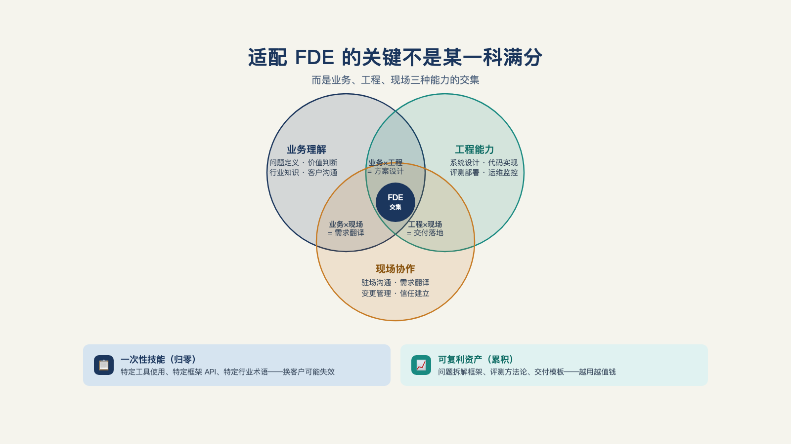

# 第 24 章 · 什么样的人适合做 FDE ？

> 狐狸知道很多小事，刺猬知道一件大事。
>
> —— 阿尔基罗库斯，经以赛亚·伯林《刺猬与狐狸》转引

关于 FDE 岗位要什么能力，网上有两种说法，吵得不可开交。

一种说法：业务知识可以在工作中学，技术不行——技术是硬门槛，业务是软门槛。

另一种反过来：构建早已交给智能体，业务理解才是真正稀缺的东西。[^c23]两种说法都说得斩钉截铁——该信哪一种？

先别急着下结论，它们是同一个市场在前后两个阶段、两种立场下给出的答案。

真实的判据要等两个框架搭完再回来：三大支柱说清"要什么"，两层结构说清"什么会归零、什么会复利"——最后你会发现，那两种打架的说法各抓住了其中一层。

## 一、三大支柱：交集，不是单科

FDE 的能力是三根支柱的交集。[^l02]

**支柱一，工程交付能力。** 不是算法研究，是"把东西弄到能运行"的工程：集成、权限、评测、运维——第三部的全部内容。它首先反驳"FDE 靠嘴"的想象：驻场样本里工程师把七成半的时间花在工程与模型优化上，靠嘴的人活不过第一堵墙。[^b11]

**支柱二，业务理解能力。** 把客户的模糊目标拆成可测的流程。它分三层递进：第一层，听得懂行业术语；第二层，看得懂流程逻辑——这家的单子为什么这样走；第三层也是最稀缺的一层，读得懂激励结构——谁的绩效被这个流程撑着、谁的利益会被新系统动到。第三层恰好是第 16 章"三不懂"的反面：不懂组织的一把手做不了这个角色。

**支柱三，项目推动能力。** 知道谁拍板、谁受影响、谁的抵制要处理。甚至有人把"一把手认知"放在能力地图最前面、叫"第一道门"——这道门进不去，后面的能力无处施展；用它的比喻：门、流程、肌肉，只练肌肉的人会被挡在门外。[^l02]这是第 15 章三组人物（支持者/影响者/受损者）的操盘版。

三大支柱抽象，一家公司的真实招聘要求能把它落到具体门槛上。

Cresta 的 FDE 负责人有一条明确"不招谁"的标准：**不招资历浅的 FDE**——一个项目现场往往只有一两个人和客户共创，资历不够建立不起信任。三大支柱在他的招聘语言里对应成三层：技术上必须是"合格的开发者，开发测试过 AI agent"；沟通上要有"过硬、让人信服的面向客户的经验"，能跟对方 CTO、IT 总监、安全负责人对话，也能把复杂问题讲给非技术人员听懂；剩下是靠谱、韧性、能扛不确定性的特质——他偏好招创始工程师、有过大风大浪经验的人（其称之为迷你 CTO，实干型，能写代码、能跟客户交流、非常靠谱）。[^c25]

三大支柱是交集不是全满：**及格线以上即可入场，长板决定风格**——工程长板偏交付型，业务长板偏发现型（本章第三节的两种角色），组织长板偏推动型。"全栈全能超人"是误解，三类长板各成一派。

三大支柱也不是固定配方——权重随市场结构变。硅谷样本七成半时间在工程；[^b11]中国一位服务过三十多家企业的从业者却把这活拆成顾问、销售、工程、教学四块，工程排第三，六成时间花在业务与人情上。[^b17]差异不在谁对谁错，在有没有产品底座（第 18 章）：底座替你扛住复杂性，工程时间自然变成交付；没有底座，顾问与销售才是瓶颈。**读者要学的不是背下哪个排序，而是判断自己面对的市场该用哪个排序。**

还有一层关系要点破：三大支柱是"建制所需合成能力"的岗位化表达。支柱模型描述的从来不是某个超人，而是一支小队能力的分解图。团队形态下，三根支柱可以分属不同角色——第 26 章的中国三人组（BA、AI 架构师、业务教练/陪跑团队）就是一支小队各长一角；个人形态下，三根支柱压在一个人身上。

## 二、两层结构：什么归零，什么复利

比排序更要紧的是时间维度。

**行业层**：某行业的流程、术语、数据形态。换行业即归零重学——零售的补货逻辑帮不上金融的风控。

**元能力层**：问题拆解、基线测量、验收设计、责任管理——这是元能力层原来就有的四项。还要再加一项更底层的：学习本身的能力。模型、框架、行业黑话年年在变，新术语、新流程层出不穷；元能力层里最抗折旧的，不是记住了什么，而是"多快能吃透一套新东西"这个本事，以及愿不愿意持续接收新东西的心态——开放程度本身，也是一种元能力。跨行业复利——第 8 章的验收契约、第 12 章的评测方法，换个行业照用；换了新工具、新术语，靠的也是同一套"重新学习"的肌肉（见图 24-1）。

*图 24-1：适配 FDE 的关键不是某一科拿满分，而是三种能力的交集和可复利资产。*

样本佐证：那位十二年经验的工程师转入新角色，可迁移的显然不是任何行业知识，而是工程元能力——生产意识、排障直觉、对系统的手感。[^b12]同理，一位 FDE 从零售换到制造，归零的是行业层，带走的是元能力层。

投资含义直接：**培养与招聘的预算应该向元能力倾斜**——行业知识可以买到（顾问、专家访谈、驻场几个月自然长出来），元能力买不到。这也是对开头两种说法的回答。第一种，"业务可学"，在元能力层上成立。第二种，"业务理解才稀缺"，在行业层和激励结构层上同时成立。两层都对，合起来才完整。

## 三、发现者与落地者：同一种角色的两种人

三大支柱之上还有一层角色内分层——同一个 FDE 团队里，发现者与落地者招的是两种人。麦格鲁给过两类人的画像——发现者与落地者。第 1 章定义过这套分工，这里看它在招聘上的含义：[^c06]

**发现者（Echo 型）**：从所服务的领域里来——他举的例子是前陆军军官、医疗行业老手这样的领域老兵；并且必须是"叛逆者"：既懂现状、又认定现状不够好。为什么必须是叛逆者？因为新软件要带来三倍或十倍的阶跃式改变才值得做——安于现状的领域专家看不出为什么非得是这个倍数，也说服不了任何人。

**落地者（Delta 型）的反画像更扎心：工匠型工程师是错误人选。** 沉迷抽象的正确、追求"可维护十几年"的代码——而落地者的工作是快速写出真正能运行的原型、承受大量的痛苦，并且**第一版代码通常是要扔掉重写的**（麦格鲁的原话在第 7 章 MVD 的代码处置处引过）。性格与背景与发现者完全不同，两者不能互换。

这段反画像会给工程师读者带来冲击，但要读对地方：它不是说工匠型工程师不好，是说**工匠价值观与这个岗位的交付节奏错配**——原型是拿来验证问题的，不是拿来传世的。

## 四、资深工程师的优势与短板

三大支柱+两角色合起来，资深工程师转 FDE 的体检单就出来了。

天然优势是**系统级判断力**。一个来自国内交付一线的教训：给客户做能力封装时，最关键的不是封装本身，而是**知道想封装什么**——这需要架构判断，需要公司的中层甚至更高层以架构师的角色第一顺位参与。[^b04]资深工程师十年攒下的功底，恰好补在这一项上。

常见短板是项目推动能力：习惯了对代码负责、不习惯对人负责；习惯了自己写、不习惯看着别人写；最不习惯的是在没有明确规格的地方开工——而现场根本没有规格。所以**转岗培训的重心应放在短板而非长板**：让工程骨干去跑客户会议、做需求访谈、挨一次投诉，比教他们新技术有用得多。

两家公司的招聘哲学能互相印证，也能互相较劲。钟钱杰（Cresta）这边不招任何 junior FDE，只招做过 AI Agent 开发测试的人；陆骁鹏（Ventus AI）这边招过两个还在读书的年轻人——一个刚高中毕业准备去哈佛、一个 NYU 肄业——但他自己也承认"差点意思"，原因是早期公司的 FDE 要独立承担客户沟通和项目管理，"没自己踩过几次坑，很难有项目管理的意识"[^b21]。两条招聘线合起来印证的是本章"三大支柱不是全满、但门槛不能降"的判断：Cresta 靠资历筛门槛，Ventus 靠承认短板控制风险，路径不同，但都不敢用没经历过项目推动能力考验的人补位——恰恰是本节说的短板，两边都躲不过去。

招聘漏斗的数字也可以参考：钟钱杰的团队一个岗位收到过 7000 份简历，发出的 offer 不到 20 个[^b21]。这组数字印证的正是本章开篇的判断——三大支柱交集不是写书的人事后总结出来的框架，是招聘现场真实在用的筛子，而且筛得比想象中更狠。

## 五、适配度自查

十二个问题，帮你自查——不是心理测评，别当判决书用。每问按"经常如此/看情况/几乎不"给自己记 2/1/0 分。

1. 别人给一个模糊目标（"把这件事搞定"），我能自己拆出第一步。
2. 被打断后回来，能较快捡起之前的思路。
3. 和陌生业务的人聊天，我能问出对方真正着急的事。
4. 我能对着不懂技术的人把技术方案讲到对方能决策。
5. 没有标准答案时，我敢基于有限信息拍板并承担后果。
6. 我愿意对"结果"负责，而不只对"代码质量"负责。
7. 客户半夜找我，我的第一反应是解决问题而不是烦躁。
8. 我能同时挂着三件以上的事而不漏。
9. 看到别人的业务流程乱，我手痒想理顺它。
10. 我能接受第一版方案将来被扔掉重写。
11. 我愿意花时间经营关系（吃饭、闲聊、人情）并视其为工作的一部分。
12. 换一个行业从头学起，我觉得兴奋多于恐惧。

**18 分以上**：三大支柱的底子和心理门槛基本齐备，值得一试（第 25 章给路径）。**12 到 17 分**：具备部分条件，先看失分集中在哪一支柱，用第 23 章第七节的三件事定向补。**11 分以下**：不是能力不够，是适配存疑——先看第六节的三思清单再决定。

## 六、不适配的三思清单

最后保留反方：三种人转 FDE 前应三思。注意，这不是能力问题，是**对齐问题**——错配的代价是双输。

**偏好深度专注单问题的人。** 这份工作的默认状态是高频切换（第 23 章）——频繁切换对有些人只是家常便饭，对偏好深度专注的人却是持续的消耗。

**需要明确规格才能开工的人。** 现场的规格要自己写，而且写了会改。等待清晰指令的工作习惯在这里是奢侈品。

**只愿对代码负责、不愿对结果负责的人。** 这份工作的考核对象是客户业务的变化，代码只是手段——把手段当全部责任边界的人，会在每一次"系统对了但业务没变"的复盘中失语。

## 七、公司视角：买不到，就自己养

个人视角之外，我们从公司视角看 FDE。

复合型人才不是贵就是能力不行，大部分公司只能自己培养。[^c21]内部的培养路径因此比招聘更重要：**工程骨干＋现场轮岗＋影子交付**——从工程团队挑元能力底子好的人，放进真实客户现场轮岗一到两个季度，先做影子（跟着资深 FDE 看全流程），再独立扛一个小客户的完整闭环。

能力模型立起来了。下一个问题非常实际：一个已经在岗的工程师，怎么走完从写代码到扛结果的这段转型——下一章，转型路径。

---

[^c23]: FDE 工程师 101：弥合 AI 与业务的鸿沟（中文汇编视频）
[^b11]: Baseten：我做前线部署工程师学到了什么（Het Trivedi）
[^b17]: 破局点 TURNING POINT 第 31 期：中国式 FDE
[^c06]: Y Combinator：The FDE Playbook for AI Startups（Bob McGrew）
[^b04]: 一路瞳行 EP134：从 AI 辅助到数字员工
[^b12]: 一名前线部署工程师的一周（10 个客户，50 小时）
[^c21]: 有在做 FDE 这个工作的佬吗（linux.do 帖）
[^c25]: 硅谷 101 E240：聊硅谷最火新职位 FDE

[^l02]: 《关于 FDE 的 100 个问题》
[^b21]: 腾讯研究院 AI 透镜圆桌 06：来自硅谷一线创业者的 FDE 非共识与落地指南