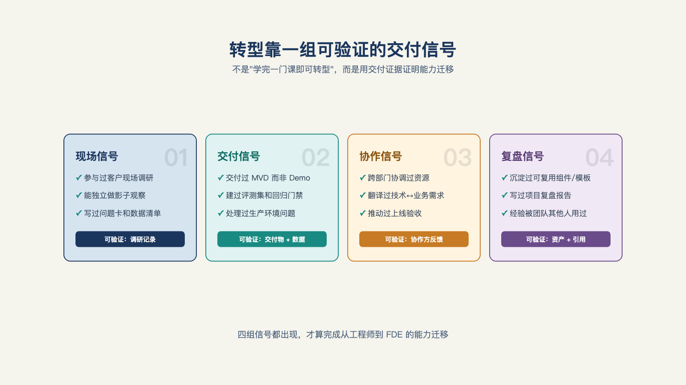

# 第 25 章 · 工程师怎么转型 FDE？

> 疤痕，标志着真正下场玩过。
>
> —— 纳西姆·塔勒布《非对称风险》

两个"三十天"。

一个在硅谷的社交平台上：一条"如何在三十天内成为百万美元级前线部署工程师"的帖子，三十六万次浏览，附三十天路线图与薪酬档位。[^c16]中文的"FDE 培训"课表，只能用四个字来形容——"一言难尽"：第一节课教怎么在电脑上打印 Hello World，通篇没有一点落地训练，请一堆名师，收两万块。[^b17]

转型的焦虑是真的，围着这份焦虑长出来的培训市场，最先吹起了泡沫。这一章不再重复"怎么准备"——这个话题已经被写烂了，只谈两个常被忽略的问题：**被点名转岗时该怎么判断，雇主招人时到底在看什么。**

## 一、转型路径

五类背景各有各的近路和坑：后端出身，工程交付力现成，要补的是业务还原与组织推动；产品经理出身，业务与组织的底子在，缺的是端到端的工程手感；咨询顾问出身，客户沟通不是问题，最难迈的坎是从"交一份方案"变成"交一整套能跑的系统"；数据分析师出身，评测和数据的底子在，要补系统集成与责任承担；算法工程师出身，最容易犯的错是高估模型、低估集成——第 9 章的八堵墙里，模型甚至不占一堵，集成和数据权限才是先撞上的墙。

有一句所有背景都通用的话：**转型的入场券不是学完一门课，是拿出一个能给人看的交付证据。** 

## 二、被点名转岗：是机会还是坑

谈转型的内容，默认的都是"你想转"。但现实里，大量转型是被推着走的——一位外企后端工程师的帖子写得很实在：他 AI 用得熟练，在研发团队里沟通表达也算好的，领导因此想安排他转 FDE；可他喜欢技术，"一想到要走这条路，就感觉自己可能会离技术越来越远"，心里不甘。[^c22]碰到这种情况，不该急着"接受"或"拒绝"，该先做三步检验。

**第一步，做一次三重检验，** 标准来自第 2 章。 问三个问题：我写的代码上不上生产？现场的经验回流到哪？这个岗位考核什么？三问都能得到明确的答案，是真 FDE；支支吾吾、只会说"先干着看"的，多半是实施换了张皮。

**第二步，验组织支不支持**：公司是真有一个业务问题要解决，还是"别人都有我也想有"？有没有业务方愿意投入？还有一个更直接的信号：这个岗位挂在哪个部门、向谁汇报。挂产品或工程线，收入记在平台产品上，FDE 成功等于产品被采用；挂销售或交付线，按人天收费，容易沦为售前的人力池、退化成高级实施。[^l02][^l03]面试时可以直接反问"FDE 向谁汇报"，比自己猜更准。孤岗 FDE——全公司就你一个人，没有回流通道，没有业务接口——是个高风险配置：干好了是个人的功劳，干砸了没有组织兜底。

**第三步，验自己对不对得上**（第 24 章的十二问）。分数高低不是重点，真正要看的是"离技术越来越远"这个担心站不站得住脚：真 FDE 的工程含量并不低（第 23 章那七成半的工程时间就是证据），离得远的其实是算法研究式的深度专注——先弄清楚自己在意的到底是哪一种"技术"。

三步走完，结果无非三种：三关都过，全力转；岗位是真的但组织支持弱，就谈边界——要业务接口、要回流机制再接；岗位本身是假的，那就在内部换个轨道，别把职业生涯押在一个换了皮的头衔上。

## 三、雇主看什么

还有一个常被忽略的角度：招转岗者的公司，凭什么给你机会。这决定了转型者该把力气花在哪。

**算得上信号的证据**：给内部用户做过的真实交付——有真实用户，有上线后的运维痕迹；跨部门项目里的推进记录——会议纪要里你是那个跟到底的人；维护过一个上线后的系统——处理过报警、接过抱怨、做过迭代。

**算不上信号的证据**：课程证书；没有真实用户的演示合集；"学过某某 Agent 框架"——框架很快就会过时，元能力才留得住（第 24 章的两层结构在招聘上的体现：雇主买的不是你会用哪个框架，是你在没人给需求的时候，自己做过架构选择）（见图 25-1）。

*图 25-1：转型靠一组可验证的交付信号，而不是把岗位名称写进简历。*

所以"先学完再动"是个策略错误：学是必要的，但学的产出——证书、课程作业——恰恰是最没说服力的信号。**在现在的岗位上做出一个能给人看的交付证据，比上任何课程都值钱**——这也是为什么第 23 章那份一天体验清单（内部交付、客户会议、管一个月上线系统）同时也是转型者的简历工程。

## 四、培训市场：怎么判断靠不靠谱

回到开头那两个"三十天"。中美两个样本说的是同一件事：转型培训是这条链路上最先吹泡沫的一环——焦虑出现在需求成熟之前，而焦虑向来是最好卖的东西。[^c16][^b17]

选课或选训练营，只有一条硬判据：**有没有真实项目代练。** 有真实客户、真实交付、真实验收的训练，贵也值；没有的话，课表越漂亮越要留心——"三十天百万美元"和"第一节课打印 Hello World"，本质是同一种生意。多说一句提醒：上面那位批评培训泡沫的从业者自己也在办训练营，卖点正是"真实项目代练"——观点和他的生意方向一致，听道理归听道理，留一分清醒。[^b17]

## 五、最省钱的验证方式

不辞职也能验证这条路——第 23 章那三个场景（内部交付、跨部门项目、客户会议）本来就是最省成本的试错，不用另外再想一套。做完它们，你会同时拿到三样东西：一个能给人看的证据（第三节）、一份合不合适的答案（第 24 章）、以及"会不会离技术越来越远"这个问题的答案（第二节）。

## 六、降薪与预期

最后一个诚实的问题：转型要不要降薪？市场给不出可信的数字——转岗定价这件事正处在混乱期，同一座城市、同一个头衔，价差能大到离谱。不给数字，给一个结构性的判断：**混乱期里，个体的差异比岗位的差异更大**——那份能给人看的交付证据有多硬，对你身价的影响，比"FDE"这三个字母本身更大。所以谈判该锚定的不是头衔对标，是证据对标：拿着那份内部交付的记录去谈，和拿着一句"我会做 FDE"去谈，站的位置完全不一样。

个人这条路走完了。再看桌子另一边：一家公司什么时候需要第一个这样的人、把他放在哪、怎么让团队长起来——下一章，雇主那边的问题。

---

[^c16]: 「30 天百万美元」课程营销帖（@gregisenberg）
[^b17]: 破局点 TURNING POINT 第 31 期：中国式 FDE
[^c22]: 研发转 FDE，是升维还是转行做实施？（linux.do 帖）

[^l02]: 《关于 FDE 的 100 个问题》
[^l03]: 范冰《前线部署工程师（FDE）》（XDash 开源书）