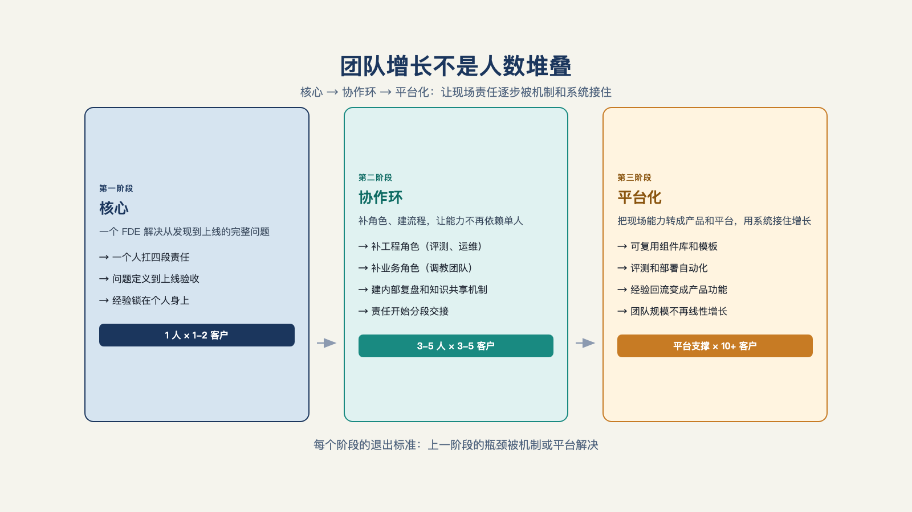

# 第 26 章 ·  FDE团队怎么建？

> 没有什么，比把根本不该做的事，做得很有效率，更没有意义了。
>
> —— 彼得·德鲁克

公司的 AI 项目落不了地，第一反应通常是三连问：模型不够强？加两个算法工程师。人不行？换一茬团队。工具跟不上？买一整套平台。

钱花了，人换了，工具也升级了——项目还卡在原地。

这一章告诉你，真正缺少的，可能正是一个从头到尾对结果负责的角色。
症结找到了，什么时候招、招几个、怎么长成一支队伍——答案自己会浮出来。

## 一、先诊断：你缺的到底是什么

开头那三连——模型不够强、人不行、工具跟不上——背后至少藏着三种不同的病，药完全不同。

**病因一，问题选择错。** 选了一个不值得解决的问题（第 6 章五道关没过）——这是方向病，换人没用，重选问题才有用。

**病因二，工程墙没翻。** 问题和方向都对，人倒在第三部那八堵墙上——数据与权限没理清、集成打不通、效果证不出来、结果换不来信任——这是工程病，需要的是交付工程能力。

**病因三，没人对结果负责。** 系统上线了，没人用——这是组织病，需要的是一个对结果端到端负责的角色。

三种病因只有第一种可能涉及换人，多数时候正确答案是**加一个角色，而不是换一个团队**。

诊断工具推荐项目失败原因分析：
把失败项目逐个按八堵墙（第 9 章）+四个责任段（问题发现/生产工程/业务采用/产品回流）归因——归因集中在"做不出"是模型与工程能力问题，集中在"没人用"是交付闭环所有者缺位。同样的诊断，埃森哲与微软 2026 年设立联合前线部署工程实践的公告里也写进了官方文案：企业 AI 卡住，缺的不是技术，是能把工程能力放对位置的人。[^a21]

## 二、时机的三个信号

诊断出缺口，第二个问题是现在建不建。三个信号，齐了再招。

**信号一，有明确的业务问题。** 不是"探索一下 AI"，是一个说得出来的问题——哪个环节、什么代价、谁在着急（第 6 章）。"想搞 AI"是预算的起点，不是建制的起点。

**信号二，有业务方愿意投入。** 一把手背书、业务方出人出数据出时间（第 16 章两道门）——没有内部同盟的交付是空降，空降的存活率极低。

**信号三，已经跑过一次尝试。** 哪怕是外部服务商做的一个最小可行部署（第 7 章）——公司至少见过一次"从问题到上线"长什么样，知道自己要什么。

三信号不齐时的正确动作不是憋编制，是**先买小服务**：外部评估、单点交付，用别人的交付帮你把信号凑齐（那个市场下一章展开）。建制是重资产，确定性不够就不要押上。

## 三、第一个 FDE：画像、放置、考核

信号齐了，招第一个人。三件事定成败。

**画像：资深，不是新人。** 第一个 FDE 要的是资深工程交付力+业务还原力（第 24 章三大支柱的前两条强、第三条可练）。不能是新人——新人需要有团队罩着的成长环境：第 23 章那位入职两个月仍在客户确认期的日本新人，她的成长环境是有团队罩着的；[^b13]把同样的人直接扔进没有支持的单岗，就是让她自己一个人在深水区扑腾。第一个 FDE 得是能自己搭脚手架的人。

**放置：业务交付线，不是纯技术线。** 汇报给业务或交付负责人，不是研究线——汇报线决定他优先响应什么。同时，与产品团队的接口从第一天就定义：哪怕只是每月一次的回流评审（第 22 章机制的最小版）。没有这个接口，第一个人就会一步步变成外包团队。[^c14]

**考核：对结果考核，不对工时。** 验收指标加采用指标（第 8、15 章），不是代码量或人天利用率——考核错位会把 FDE 用成普通开发，这是第 2 章判据三的组织版：卖时间的人不对结果负责，考核什么，人就是什么。

## 四、外部参照系（一）：双角色与三职能

建制没有标准答案，但有几组高信度的参照。第一组是角色分工的两种现代形态。

**发现/落地双角色**（第 1、24 章引过画像）：Echo 型的驻场分析师管发现与关系，Delta 型的部署工程师管落地——两角色按画像分开招，不能互换。[^c06]

**三职能与账户制**：一家应用人工智能公司把自己组织成三块——工程（平台与基础设施）、市场拓展（获客漏斗）、应用人工智能（桥梁：接住温热商机、定义价值证明、把 Agent 部署到生产环境）；应用人工智能内部再分两角——**Agent 产品经理**，从价值证明一路带到生产之后，技术好到自己能搭 Agent 但不必写生产代码；**前线部署工程师写代码、反哺产品**，且要有足够的商业感，能直接参与销售对话——因为"真正会去造这个东西的人，是房间里最有说服力的声音"。[^b16]另一家公司（Cresta）的变体给出了配比：一位前线部署产品经理带两到三位 FDE，产品经理可同时管理多个项目；团队规模化后还会有意识地按行业（如医疗保险）和技术领域（如支付、搜索）培养专长，而不是让每个人都当通才。[^c25]

两个样本合起来的启示：**"懂客户的"与"能落地的"从第一天就该是两个明确的角色**——要么两个岗位，要么一个岗位明说的两顶帽子；把这些要求全压在一个人身上，还要他样样全能，是很难招到人的。

## 五、外部参照系（二）：中国版——三人组与极限形态

第二组参照来自中文市场与巨头端。中国版给出的建制答案更完整：不是把工作切两半，是三兵种合成的一支小队。

**走得最深的是瓴羊的"组织三人组"**（建制背景与案例细节见第 18 章）。他们的判断为："我们的做法不是一个人，而是一个组织"——要一个人有这样的全才"非常难"。[^b19]组织因此分成三类角色：**BA 管方向**，以业务结果为导向——编排两百多步的客服流程、找出 AI 的最佳工作模式、设定评测标准，他们本是美妆、家电、汽车这些行业专家；**AI 架构师管技术**，把业务问题翻译成模型选型与系统设计——用什么尺寸的模型、哪个环节人干预、哪个环节机器接管；**客户方调教团队管业务（陪跑教练）**，从客户里选出最好的客服和销冠，像教练一样在过程中持续反馈、调教 AI——供应商在这里主动退后。[^b19]

把它与 Palantir 的 Echo/Delta 摆在一起，结构同源、切法不同：

| | Palantir Echo/Delta（美国版）[^c06] | 瓴羊三人组（中国版）[^b19] |
| --- | --- | --- |
| 方向：该做什么 | Echo 驻场分析师与客户经理 | BA：业务结果、流程编排、评测标准 |
| 技术：怎么做出来 | Delta 部署工程师 | AI 架构师：模型、数据、系统设计 |
| 业务：怎么用好 | 隐含在 Echo 的关系维护里 | 明确建制：客户方调教团，教练式持续反馈 |

差异集中在第三行：美国版两分（发现/落地），"业务教练"是 Echo 的隐含职责；中国版把它升格为正式建制的第三角——标杆业务知识散落在客户方（第 18 章的"岗位标杆为预设"），不把客户的人编进建制，模型就调不准。

弹性的口径同样来自中文市场。一位从业者曾分享过，国内企业做 AI 改造，真正需要的是三个角色：项目经理、工程师、产品经理；这三个角色可以是一个人，可以是两个人，也可以是一个团队，不强求编制。[^b17]说到底是同一句话：需要一个懂业务、能把需求翻译给 AI 工程师的人。三个角色怎么拼，看公司大小和信号强弱（第二节的三信号）——信号刚齐，一个人兼三个角色也能起步；信号扎实，再拆成三个岗位。三人组是标准形态，弹性拼法是它的裁剪。

**极限形态**：埃森哲与微软的联合实践——数千名人工智能技能工程师的规模，官方口径"从想法到生产以天计而非以月计"，充当"企业人工智能转型的门户"。[^a21]供参照，不供模仿——数千人是交付工业化之后的形态，不是起步形态。

两组参照横向对比，能提炼的共同点有两条。其一，**FDE 的完整形态不是一个人，是一支建制小队**——特种部队式的：小规模、多兵种合成、嵌入前线、对任务结果负责；单人 FDE 是这支小队被裁剪后的形态，本章第三节"第一个 FDE"说的正是裁剪到一人时怎么保住关键件。其二，**FDE 必须与产品团队有制度化的回流通道**——没有回流通道，交付就会在不知不觉里变成外包，这是跨市场的共同警告。[^c14]

## 六、团队怎么从一个人长起来

第一个人站住后，团队怎么长？

**第一步，跑通最小闭环。** 一名 FDE＋一个产品接口人＋半个平台支持（后端/基础设施工程师的分摊），跑通两到三个完整交付。这一步验证的不是人，是**闭环本身**：问题定义→交付→采用→回流，全链路在公司里走通一遍。

**第二步，按瓶颈扩，不按规划扩。** 交付排队——加 FDE；同类定制反复出现（第 21 章的触发信号亮了）——加产品化人力，把定制收进平台；客户多到服务质量下滑——先问是人的瓶颈还是回流的瓶颈（是后者的话加人只会加乱）。每一步扩张用第 19 章的六指标复盘——扩张不看感觉，看实施杠杆率与定制递减率的方向（见图 26-1）。

*图 26-1：团队增长不是人数堆叠，而是让现场责任逐步被协作机制和平台能力接住。*

这个路径的反面是"一步到位招一个二十人交付部门"——人员先于闭环到位，组织会在没有回流习惯的时候就固化成人海形态，第 19 章的英雄文化与咨询化陷阱都是从这个形态里长出来的。

## 七、三种反模式

收尾照例是镜子。

**跟风设岗。** 竞争对手有 FDE，所以我们也要有——第 3 章"外包换皮、一阵风"的组织版。信号不齐就设的岗位，最后都会变成挂新头衔的旧实施。

**招了不管。** 招了人、给了客户，但没有业务接口、没有回流通道、没有结果考核——三个缺失任占其二，这个人就在为竞争对手培养人才。这类人的离职信通常写得很客气，原因都不在信里。

**用管咨询的方式管 FDE。** 按人天考核、按利用率排产、把回流时间视为"没在干活"——管理动作全是咨询公司的，却期待产品化的结果。考核什么，得到什么；按工时管理，得到工时。

公司这边至此闭环。还剩最后一组人：不进公司、自己单干的人——个人能不能独立、兼职或创业做 FDE？下一章。

---

[^a21]: 埃森哲推出微软前线部署工程实践
[^b16]: Inside an Applied AI company（Pace 长文）
[^c06]: Y Combinator：The FDE Playbook for AI Startups（Bob McGrew）
[^b17]: 破局点 TURNING POINT 第 31 期：中国式 FDE
[^b19]: 硅谷 101 E248：和阿里瓴羊朋新宇聊中国式 FDE
[^c25]: 硅谷 101 E240：聊硅谷最火新职位 FDE
[^c14]: @deployengineer（Bhaulik Patel）系列长文
[^b13]: 「以为 FDE 是在客户现场独自作战」——入职两个月看到的真实
