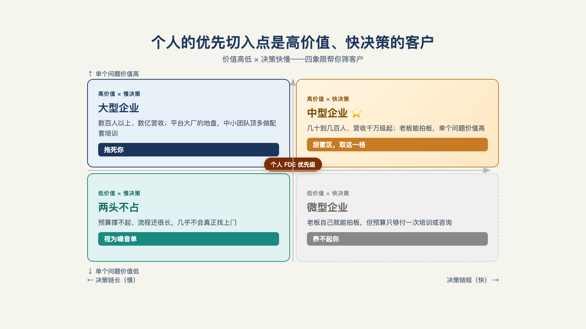

# 第 27 章 · 个人能独立做 FDE 吗？

> 精通一门手艺的技术活，不等于懂得经营一家靠这门手艺盈利的公司。
>
> —— 迈克尔·格伯《E-神话：再谈创业》

"FDE 这活，自己干没背书，打工又苦。"

一位独立从业者在论坛上留下这句自我总结。他管自己叫 OPC——One Person Company，一人公司；没有背书，他能想到的办法是放低身段，先攒够经验、方案和基础设施；帖子结尾，他在找同伴：一起探索客源、方法论、基础建设。[^c18]

这句话问到了本章讨论的问题：一个人到底能不能以 FDE 的身份接企业客户的活？哪些单能接、哪些接了就是坑？

## 一、先把一个问题拆成两个

"个人能不能做 FDE"这个问题——其实混合了两个完全不同的问题。

**问题一：单人能不能完成一个窄范围的原型或评估？** 能，而且 AI 显著放大了这个能力——一个熟练者用现成的模型、工具与框架，几周内给单个客户做出可评估的原型，今天完全可行（第 24 章"组装思路"）。

**问题二：单人能不能可持续地承担多客户的生产级交付？** 极难。因为生产交付不是一项技能，是**并行的责任**：业务发现、系统接入、安全合规、工程交付、客户沟通、培训采用、线上支持、产品回流——八项责任挂在同一个人身上，其中任何一项在客户的生产系统里出事，都得有人顶着。线上支持意味着客户系统报警时你在，多客户并行意味着三个客户同时报警时你也在——7×24 的责任结构，一个人在数学上就扛不住——交付远不止写代码，参见撤场三件事：业务融合、知识治理、系统对接，[^b01]每一件都是持续责任。

换个角度看更清楚：这八项责任本来就不是为一个人设计的。FDE 的完整形态是一支建制小队（第 26 章的三人组是它的一个编法）——OPC 走不通的根源，正是它要把一支小队压缩进一个人。

所以答案不是"能"或"不能"，是：**OPC 在逻辑上并非不可能，但作为商业命题，不能当主流组织形态来做。** 能不能走通，取决于你选的模式与条件——这正是下面两张表要给的。

## 二、FDE 模式之父的劝诫："不要轻易尝试"

被问"想尝试这套打法的人该做什么"，麦格鲁的建议是一句话——不要轻易尝试（don't try this at home）："它可能对你不利，你很可能最后做成服务业务。只有当真的努力不做却失败了，那么，也许它对你来说真的是一条护城河——如果它是你市场上唯一行得通的路径。"[^c06]

这句话对个人命题的预警意义比对公司更高：**个人做 FDE 的默认结局，是变成一人服务商**——按人天卖自己、承担无限责任、没有产品杠杆、没有复用资产。

但注意这句话的结构：它没有说"不可能"，它说"默认结局不好，除非满足特定条件"。

条件是什么？就是接下我们要讲的。

## 三、四种模式：条件表

| 模式 | 成立前提 | 不应混同为 |
| --- | --- | --- |
| **分数型 FDE／顾问**（按固定节奏投入，如每周两天） | 客户有明确决策人、系统边界有限、客户侧有维护负责人、目标可量化 | 全天候结果兜底 |
| **固定范围评估／上线就绪审计** | 交付物、数据访问、责任边界在合同写明 | 完整交付项目 |
| **垂直 FDE 工作室** | 少数客户交付中沉淀出可复用资产（连接器/评测/模板） | 按人天驻场外包 |
| **FDE 引领的产品创业** | 先以少量设计伙伴验证工作流，再把重复部分抽成产品 | 无限定制项目堆积 |

四种模式按责任从轻到重排列：前两种**不承担生产责任**——交付物是报告或原型，交完即止；后两种承担部分生产责任，但用资产（复用库）或组织（合伙人）对冲了单人极限。

每一行最值钱的是右列——**不该混同的东西，正是个人接单翻车的标准姿势**：谈的是模式一的价格，干成了兜底的活；签的是评估合同，做着做着客户说"顺手也把上线管了吧"。模式的边界要在第一封邮件里说清，不能在第三个月才发现被混同了。

用条件表回头看开篇那位实践者：三年接单+自建案例库+可复用模块——**资产项已具备模式三（垂直工作室）的雏形**，这正是他自己说的"攒基础建设"；卡点也清楚：背书（客户凭什么信一个人）与渠道（活从哪来）——所以他放低身段、找伙伴、去社区发帖。[^c18]他的路径直觉与条件表完全吻合：一个人扛不住全部责任，就用资产复用+合作网络把责任拆出去。一个社区样本不构成结论，但它真实存在：模式表不是理论，是有人正走在这条路上的地图。

Ventus AI 是一家 10 人规模、A 轮阶段的公司，联合创始人陆骁鹏本人就是 FDE。他描述的早期形态，几乎是模式三（垂直工作室）与模式四（产品创业）的混合体：FDE 从售前跟到售后，直接背商业指标——"帮客户省两百万还是多赚两百万"，这是本章"八项责任挂在一人身上"论点的具名版本。更值得记的是他的驻场策略：Ventus 的 FDE 基本不驻场，原因是"很清楚给客户提供什么、能收多少钱"；他区分了驻场的两种动机——好的动机是给大客户安全感、有明确交付目标；坏的动机是"我也不知道给你做什么，但你是大客户，先占坑"——后者他直接判定为不健康，产生不了价值[^b21]。本章开头那位社区里的从业者证明了条件表描述的路径确实有人在走，Ventus AI 证明了这条路径走通之后长什么样——一个能报出具体数字、具体客户关系、具体商业模式的对照组。

## 四、哪些客户是你的：市场分层

选客户先看客户体量。[^b17]大型企业（数百人以上、数亿营收）是平台大厂千万级单子的地盘，中小团队顶多做配套培训；微型企业预算只够付一次培训或咨询；**最适合个人切入的是中型企业**——几十到几百人、营收千万级起：决策链短（老板能拍板）、单个问题价值高（他自报的口径：单个问题值一千万，收一百万成立）。选择框架四象限：价值高低×决策快慢——**取"高价值×快决策"那一格**，其余三格要么养不起你，要么拖死你（见图 27-1）。[^b17]

*图 27-1：个人的优先切入点是高价值、快决策的客户，而不是名气最大的客户。*

## 五、审计：个人的第一个可售卖物

如果四象限里选中了客户，第一件卖什么？一份从业者给了具体到动作的答案：**流程审计**。做法：争取坐到客户公司里干活最重复的那个人旁边，观察一个小时；按第 6 章的路数（记录追问→过滤→量化）产出一份审计报告——这家公司某个环节的真实流程、哪些步骤适合交给 AI、经济价值多少。[^c23]

审计是**企业真正愿意付费**的服务；它是**任何项目开发前的第一阶段，也是最大的瓶颈**；报告本身就是你的展示物——申请 FDE 职位或向企业推销业务时，它证明你见过真实流程。[^c23]对照条件表：审计就是模式二（固定范围评估）的标准产品形态——**不需要生产责任，天然规避八项责任里单人扛不住的那几项**。个人入门的完整路径由此成形：审计（见真实流程）→窄原型（模式二加深）→加入合作网络（第八节）或沉淀为工作室（模式三）。

## 六、接单前的止步清单

反过来，什么单不能接。六个预警信号，中两条以上，要么不接、要么改结构（改固定范围、拉合作方分责）：

**其一，客户没有明确决策人。** 谈了三个月还在"我们内部再对齐一下"——付费能力和拍板能力都不存在。

**其二，系统在关键生产链路上且要求不间断。** 7×24 的责任与单人的现实直接冲突（第一节）。

**其三，要你独自承担安全合规的签字。** 签字是组织行为，个人签字等于个人兜底——无限责任。

**其四，客户没有内部维护负责人。** 上线之后的维护没有对接人，意味着这个人默认是你，免费且永久。

**其五，"先做着看"的无边界需求。** 范围都不存在的项目，价格没有意义（第 20 章）。

**其六，驻场邀约说不清目标。** 好的驻场是客户已经想清楚要交付什么、给大客户一份安全感；坏的驻场是"我也不知道给你做什么，但你是大客户，先占个坑"[^b21]——分不清是哪一种，先问清楚再接。

## 七、兼职：算不算、卖的是哪一种

顺带说清兼职：**兼职做原型与评估，可行**（模式一二本就限边界限周期）；**兼职做生产交付，对客户不负责任**——这不是保守主义，是责任结构的推论：线上支持与兼职在时间上不兼容，客户买生产交付时买的就包括"出事时你在"。想清楚卖的是哪一种，要在谈价格之前。

## 八、不单干的三条出路

最后，不想单干的人的结构化出路。

**其一，加入合作网络。** 第 26 章那位从业者的体系就是活样本：核心团队掌握获客与验收，外部顾问按项目合作。[^b17]对个人，这解决了单干最致命的两缺——背书（网络的品牌替你背）与渠道（单子从网络来）；代价是让渡一部分定价权。

**其二，加入建制。** 巨头正在建数千人规模的交付组织（第 26 章埃森哲×微软形态）——个体加入建制，杠杆大于单干：同样的能力，踩在别人的平台、品牌与回流机制上。[^a21]

**其三，把工作室做垂直。** 锚定一个行业，用三到五个客户把流程做穿（第 21 章），让产品产生复利。

单干也好，建制也好，合作也好——这条路走上五年、十年，通向哪里？最后一章，终局。

---

[^c18]: 在武汉做 FDE，寻伙伴（linux.do 帖）
[^c06]: Y Combinator：The FDE Playbook for AI Startups（Bob McGrew）
[^b17]: 破局点 TURNING POINT 第 31 期：中国式 FDE
[^c23]: FDE 工程师 101：弥合 AI 与业务的鸿沟（中文汇编视频）
[^b01]: 十字路口 × Rolling AI：FDE 对谈
[^a21]: 埃森哲推出微软前线部署工程实践
[^b21]: 腾讯研究院 AI 透镜圆桌 06：来自硅谷一线创业者的 FDE 非共识与落地指南
