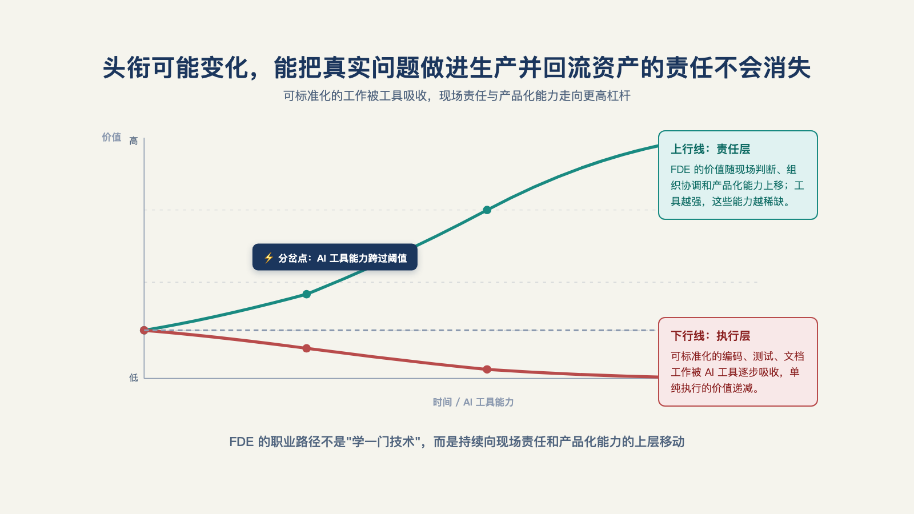

# 第 28 章 · FDE 的终局是什么？

> 君子不器。
>
> —— 《论语·为政》

五年后回头看，一位FDE的工作清单里，总有一部分已经不值钱了：某个框架的熟练度、某套提示词的手感、某款产品的操作路径。工具更新得太快，昨天的新技术，明天可能只是默认功能。

但另一些东西不会随版本一起过期：知道该评什么、怎样验收、谁该为结果负责；知道一个方案在演示里能跑，和在客户现场能活，是两回事。

也许到那时，"FDE" 这个头衔本身已经不常见了。它可能被拆进产品、工程、行业解决方案或交付团队，换成另一个更时髦的名字。

但客户系统出问题时，仍然会有人要回答：这个方案到底能不能跑到结果，跑不起来谁负责？

所以，这个职业会不会消失，不是终局的第一个问题。先问两件事：你今天积累的经验，五年后还值不值钱？而那个把新技术扛到生产结果的责任，届时又会由谁承担？本章从个人、角色和产业三层回答这两个问题。

## 一、个人层：经验的资产负债表

先答最切身的：干这行攒下的经验，五年后值钱吗？把工作所得列成三栏。

**贬值项**：具体框架的使用技巧、提示词的手感、某个产品的操作细节——工具层的经验折旧最快。模型、工具和工作流每迭代一轮，这一栏都会被重新估值。

**保值项**：评测方法、验收设计、责任管理、组织推动力——元能力层，跨行业复利，且随案例积累增值。

**增值项**：行业纵深＋可复用资产——连接器、模板、评测集——这一栏的特殊之处在于它能**交易**：能跟着人走，成为你的市场价；也能留在组织里，变成平台的一部分和你的议价权。

职业建议一句话：**定期把贬值项换仓成保值项**——每察觉自己在熟练使用某个即将过时的东西，就问一句：它背后有什么我该抽出来的方法。换仓勤快的人，保质期无限延长。

## 二、三条路径与各自的门槛

这些资产不会只留在简历上。随着经验加深，它们会把人带向三个不同的位置：把交付经验变成团队能力，变成产品能力，或变成一家公司的持续交付能力。

**管理线：把经验变成团队能力。** 从交付负责人走向更大的管理岗位，真正的转折不是带更多项目，而是从"自己扛结果"变成"让一套机制持续扛结果"。能否培养人、安排责任、处理冲突，决定了这条路的上限。

**产品线：把经验变成产品能力。** 现场反复出现的问题、评测结构和交付模板，都可以沉淀进平台。Retool 的 FDE 团队曾孵化出十多家初创公司，正说明一线经历可能成为产品和创业的起点。[^c20]这条路的门槛，是辨认什么值得标准化，以及愿意从解决单个客户的问题，转向解决一类客户的问题。

**创业线：把经验变成持续交付能力。** 垂直工作室和产品创业的难处，不是接到第一单，而是把获客、方案、交付、支持和产品化组织成一个能反复运转的系统。行业的人工智能需求刚从尝鲜走向真实预算时，这套能力尤其稀缺；太早，需要教育市场；太晚，优势又会被同质化吞掉。

这也是端到端现场经验会成为创业者训练场的原因：它迫使人同时理解客户为什么付钱、方案怎样落地，以及交付之后谁来承担结果。

前 Palantir 员工纳比尔·库雷希观察到，尽管 Google 的员工数量约是 Palantir 的 50 倍，YC 每一批项目中前 Palantir 员工创办公司的数量通常反而更多。[^b18]这个比较无法分开训练效应和人群自选择，却提示了一点：习惯在现场从头扛到尾的人，更容易看见可以独立成立的问题和生意。

## 三、头衔会变，责任留下

这个问题没有共识——两位一线从业者给出的是相反预测。钟钱杰（Cresta）认为 FDE 会是很长一段时间的主干："一个公司有好的销售，销售也很难被替代掉"；FDE 属于"非常接地气、有工程能力、又能用好 AI 的人"，这部分也很难被 AI 化。陆骁鹏（Ventus AI）则认为 FDE 会越来越往客户成功方向偏："对技术的要求越来越低了，如何 out-compete 别的公司？在于提供情绪价值、更好的服务、更好的理解需求"[^b21]。两种预测都来自身处一线的人，却指向两个方向——这恰好印证了本章开篇的立场：对终局的回答不该只是预言，该盯的是能被现实检验的信号（见图 28-1）。

*图 28-1：头衔可能变化，能把真实问题做进生产并回流资产的责任不会消失。*

FDE 这个头衔五年后还在吗？未必。但这不等于这类工作消失，而是工作正在被重新分配。

一部分执行会被人工智能和平台接走。Palantir 已将部署、配置和问题定位写入 AI FDE 的产品能力；这只是产品口径，却清楚指向一个方向：重复、标准的执行会越来越少地依赖人工完成。[^a24]

另一部分会被产品化接走。某类问题一再出现，解决方法逐渐稳定，它就会从一次次现场交付，变成平台上的默认能力。

两端吸收完，中间剩下什么？**判断与担保**——对"这个方案在该客户的生产环境里成不成"的判断，和"成了我负责、不成我兜着"的担保。B 端采购的永恒需求不是代码，是**风险转移**：客户买的从来是"有人替我把这个新技术扛到结果"。这个内核不被吸收——AI 能替执行，不能替客户承担对结果的责任。

## 四、技术越强，前线为什么还在

把视野放到整个产业：模型公司、应用公司和企业客户之间存在同一种落差——上游拿到的能力超前，下游真正能用上的部分滞后。填平这段落差，需要把新能力放进具体流程、权限和组织里；这不是待消除的缺陷，而是持续出现的商业空间。

一位中国从业者看到的是旧流程的阻力：老板容易高估 AI 无所不能的一面，却低估它被既有制度和协作方式困住的一面。他预期市场最后会收敛为两种形态——标准化产品，或标准化服务。[^b17]

另一位美国实践者看到的是能力与采用之间的时差。模型一代代升级，人们实际用起来的速度却未必跟上；人工智能需要有人探索、推动，也需要有人承受落地时的摩擦。[^c06]

两种观察并不矛盾。前者解释为什么新技术会被旧组织拖住，后者解释为什么能力再强也不会自己发生。模型公司像总部的产品团队，应用公司和客户现场则不断把新能力变成可用的东西；每一层都在为下一层承担前线工作。[^c06]

这个节奏并非人工智能独有。经济史学者卡萝塔·佩蕾丝描述过技术革命从少数先行者的建设、验证，走向大范围扩散的过程。[^l04]能力与采用之间的最后一公里会长期存在，只是不断上移：今天在企业现场，明天可能在行业流程和组织协作之中。

## 五、三类读者现在怎么做

对终局的回答不该只是预言。下面给出可跟踪的动作和信号：如果判断错了，读者能及早发现。

**个人**：往资产负债表的哪一栏投资——少背贬值项，多攒保值项与增值项；三年一次换仓检查。

**公司**：先确认三件事：有没有明确的业务问题，业务方是否愿意投入人、数据和时间，是否已经跑过一次小范围尝试。三件事不齐，先买小服务，不急着设岗位。

**行业观察者**：盯三个信号：AI FDE 类产品的自动化边界扩张多快，按结果计费在企业合同中的比例是否上升，以及"FDE"头衔是否消失而职能仍以别的名字存续。它们会告诉你，这一章的判断正在怎样兑现或失效。

## 六、最后

答案可以一句话说尽：**AI 项目卡住，往往不是因为做不出，而是没有人为最后一公里负责。** 模型在云上、能力在增长，真正的难处在"用得上、用得久、算得清"。

FDE 是这个责任此刻的名字。名字会变——会变成产品能力、变成平台职能、变成别的头衔；责任不会变——只要企业采购的仍是"把新技术扛到生产结果"这件事，就总要有一个角色对它端到端负责。这本书教的是这个责任的全部技术细节；而读完这本书的你，无论站在交付、产品还是组织的位置上，都已经在用同一套视角看这个问题了。

路铺到这里。剩下的，在现场自己探索发现吧。

---

[^c06]: Y Combinator：The FDE Playbook for AI Startups（Bob McGrew）
[^b17]: 破局点 TURNING POINT 第 31 期：中国式 FDE
[^a24]: Palantir Foundry「AI FDE」产品文档
[^c20]: @jamiecuffe 关于 Retool 孵化产品线的自述
[^b18]: Reflections on Palantir（Nabeel Qureshi）
[^l04]: 卡萝塔·佩蕾丝《技术革命与金融资本：泡沫与黄金时代的动力学》
[^b21]: 腾讯研究院 AI 透镜圆桌 06：来自硅谷一线创业者的 FDE 非共识与落地指南
