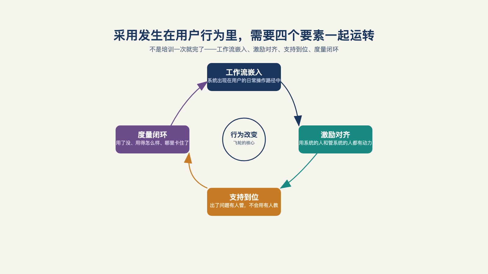

# 第 15 章 · 系统上线了，为什么没人用？

> 给我看激励，我就能给你看结果。
>
> —— 查理·芒格

系统终于上线了。

验收会开得很体面：技术指标逐项打钩，双方项目负责人握手合影，甲方信息部门的一句"系统正式投入运行"念完，掌声整齐。

三个月后回访，却看到了另一种景象：上一次的登录还停留在上线后的第二周，业务骨干的桌面上还是那张用了六年的电子表格，问起来，回答是"那个系统啊，偶尔开一下"。

没有事故，没有投诉，没有反对——系统就那么安静地、体面地死了。

这一章讨论的问题是：系统上线之后，技术验收全过、指标全绿，但业务方为什么就是不用？

## 一、上线走的是流程，激活发生在行为里

先拆一个被混用的词。"上线"走完的，是采购和验收的行政流程：合同履约、部署完成、验收签字。而系统能不能算真的活了，标准只有一个——目标用户群体在日常工作中，形成了对它的稳定使用习惯：不是演示会上鼓掌，是三个月后没人催，它依然被高频使用。

企业软件行业内从来不缺这样的项目：功能清单百分之百打钩，但用的人只有百分之五；系统可用性做到四个九，业务部门却宁愿继续用电子表格。

为什么企业部署普遍死在激活这一环？因为它要过的三道关，全都不在代码里：
用户嫌它不顺手——比旧习惯多一步，就没人用；
用户觉得它不可信——错一次，信任就清零；
用户觉得它与自己无关——那就没人碰。[^l03]

三道关没有一道能在总部解决，只能到客户的会议室、车间和工位上，一道一道去过。

这正是 FDE 与"交付即走"的传统实施的分水岭：传统实施把验收单当终点，FDE 把客户行为的改变当终点。

## 二、"上线成功"之后平静地死去

一位一线 FDE 从业者在播客里把失败项目的原因归成以下三条：

第一，一把手对 AI 能做什么有超出现实的预期。以为上了 AI，企业就起飞，把它当超人而不是工具——预期过高注定崩盘，崩盘的结果就是弃用。

第二，让技术部门立项，而不是让业务部门立项。业务部门把自己当甲方、把技术团队当乙方，这样立项的系统，几乎一定会失败——懂业务的是业务团队，技术团队提供不了选品、预估、谈判这些知识和经验。系统于是成了技术团队的业绩，不是业务的工具。

第三，也是最底层的：组织的激励机制没有跟着变。嘉宾原话是——"大家不要把它看成一个工具的上线，它是一堆员工上线，一堆新的生产力来了，生产关系要改变了"。[^b01]翻成大白话：系统不是多了一个软件，是多了一批"新员工"——新员工上岗，考核、分工、汇报关系都要跟着重排；如果还按管理一件工具的方式去管它（不动考核、不动分工），这批"新员工"自然干不起来。

注意这三条死法的共同点：它们没有一条发生在上线之前，全都发生在"上线成功"之后。上线那一刻项目还是满分，死是在后面的三个月里，一天一天安静地发生的。而三条死因里，前两条指向一把手（会在下一章里详细展开），第三条——激励——是这一章重点要讲的，先看下其他来自一线的真实反馈。

一位在客服场景里做了四版迭代的工程师，四版方案从编排框架一路演进到带工程外壳的本地部署，技术上是成功的；被问到项目对业务的实际帮助时，他的回答是：[^b03]不裁员，就体现不出投资回报。他们的客服团队一个人没裁，省下的时间大家去"创造更好的价值"——但投资回报的账因此算不清了，因为在多数老板的算法里，省时间不算数，省人头才算数。投资回报的账和员工的利益，在这里直接冲突了。

还有一位从业者抱怨道："我们用了 AI 反而是 997，不用 AI 是 996。"——工具增加而不是减少了工作量：系统崩了要抢救，记忆丢了要重喂，流程卡了要手动疏通。[^b04]

这些真实反馈都不是"项目失败"的抱怨——技术能力没问题。

真正卡住的是结构：省下来的时间折不进投资回报的账，多出来的工作量没人重新分配。

项目做对了，用的人处境却没有变好，这才是真正问题所在。

## 三、培训解决不了的问题，激励能解决

把第三条死法展开成一个可操作的诊断工具。对一线用户，用不用取决于三个问题——不是问出来的，是用户在心里自己算的：

其一，用了这个系统，我的考核变了吗？如果考核还是老指标，那么学习新工具的每一分钟都是无偿加班。

其二，我省下来的时间归谁？如果效率提升的收益全部归公司，成本却由我承担（学新工具、兜新错误），这笔账没人愿意签。

其三，系统出错算谁的？如果新系统的错误算我的，旧流程的错误算"正常的"，那么理性人的选择就是守住旧流程。

三个问题里任何一个答不好，培训做得再漂亮也没用——培训解决"会不会"，激励决定"愿不愿"。前文那位从业者举过一个正面对照：销售团队采用新工具时，配套把考核从百分之百看结果，改成八成看结果、两成看过程——用新系统沉淀的过程数据可以直接换算成考核积分，工具的采用才真正落了地。

激励设计还有一个更彻底的正面样本。一家住房租赁平台里有个"管家"角色，管租客的大事小情：邻居家狗叫、空调漏水，全是带情绪的琐事。人工智能团队进场后没有做"自动回复"，而是先重新划了分工：机器接走全部琐事应答，人去做有温度的关怀——再配一个探查销售机会的智能体，提示管家"这家租客养猫、这几天要出差，可以推上门喂养"。

一年下来，人效从一个人对五百个租户提到一个人对一千二百个，第二年目标两千。关键的是：这个部门没有裁员。[^b01]提效不与减员挂钩，员工才不会把系统当敌人——"不裁员"在这里不是道德姿态，是激励设计本身。

## 四、员工的敌意：怕，会变成不配合

这两年，"教会 AI，自己就下岗了"变成了打工人之间心照不宣的黑色幽默——"蒸馏"本来是模型训练的术语，"蒸馏同事"也开始流行起来，专指"把老员工的经验喂给 AI，然后老员工被优化掉"这件事。

玩梗背后是真实的时代背景：密集的 AI 相关裁员新闻，把"我的经验值不值钱"变成了每个一线员工心里随时会响的一道警报。

自保是本能，而本能触发之后，很少有人会当面说不——更常见的是把警惕悄悄嵌进日常配合里：教是要教的，但留一手；配合是配合的，但能拖就拖，能刁难就刁难。

激励设计解决的是"划算不划算"，但账算得再清楚，也拦不住员工从心底里不信任这套系统——这种不信任比"不划算"更难对付，因为它经常不说出口。

一家做企业智能体交付的公司，在给一线老师傅配"AI 学徒"时，"老师傅会说，你把我的经验蒸馏了，把我的东西都学走了，那我之后在企业的价值也没了。"[^b01]这句话精确地说出了前几节没讲透的另一半：前面讲的是"这笔账划不划算"，这里讲的是"就算是划算的，可我就是不想用你"。

那家公司的应对措施拆开是两层。第一层，互惠先行："你要学习他的东西，首先你要给他付出一点东西。"他们的 AI 学徒进场不是先偷师，是先干活——老师傅要排班时给建议，要做营业预估时提建议，老师傅先觉得"这徒弟有用"，才会真正教它。第二层，重新定义价值："一个能被蒸馏出经验的优秀基层员工，其实是企业最大的资产，你不应该放弃他"——因为商业场景每天在变，AI 能帮你想很多事，但替代不了一线的判断和决策。

更进一步，这种员工的价值不是变小了，是变大了：以前一个金牌销售厉害，是自己能卖两三倍，再厉害一点，是能带出一个团队卖两三倍；现在，他积累的判断和方法论能够复制给全国一千个、一万个销售——对企业的价值只会更大，对应的激励也必须跟着涨，不能维持原状。老师傅在系统里的新身份，是训练师和权威，不是被替代的对象。

同样的恐惧，来自于一位企业 AI 落地顾问遇到的客户："它都全自动了，还需要我点一下干嘛？我这个人有什么必要再存在呢？"[^b17]这不是矫情，是真实的存在焦虑：如果一个人在流程里的全部职责被压缩成"点一下确认"，这个岗位本来就是悬空的。采用设计必须正面回答"人在这条流程里的新角色是什么"，哪怕新角色只是判断与担保，也要明确告诉他、写进新的岗位职责里——不说清楚，员工只能自己在焦虑里瞎猜，猜的结果通常是往最坏处想。

怕不会总是说出口，更多时候会悄悄变成行为，而不是摆在台面上的反对。最常见的四种：

拖——该反馈的问题拖着不说，等系统自己撞上去；
护——明里配合、暗里继续用老流程"保底"，出了事好证明"我早就说了不行"；
刁——鸡蛋里挑骨头，用一堆边角需求和"不好用"的抱怨拖慢验收，让系统看起来比实际更不成熟；
散——用最负面的措辞把体验讲给同事听，把观望者提前拉进对立面。

这四种共同的杀伤力在于，它们都披着"配合"的外衣，比明着反对更难发现、更难拆解。

化解这种不配合，实战中有三招屡试不爽：别让系统以替代人的姿态出现（人工智能处理重复活，人处理要判断的活）；先挑用户最烦的重复劳动开刀，让他先尝到甜头；让受益者替你说话——受益用户的现身说法，比你自己解释一百句管用。[^l02]

前面管家案例里"这个部门没有裁员"的承诺、周报自动化里"从写周报变成把工作留好"的渐进过渡，本质都是先接住这层恐惧，再谈激励——恐惧不解除，账算得再清楚也没人敢用，甚至会有人暗中盼着系统出错。而这层恐惧真正的解药，往往不在项目团队手里：员工要看的不是某个负责人怎么说，是组织最高层怎么表态，这道门谁来开、怎么开，下一章详细展开。

## 五、渐进式变革：别一步到位

激励之外，采用的第二战场是系统进入工作流的方式。

这里有一条被反复验证的规律：嵌入旧习惯，胜过另起炉灶。

一家投资机构的周报自动化，走过了教科书式的三个阶段：第一阶段，在协作平台上搭了个日报机器人，填写还是要靠人；第二阶段，改成语音对话——下班路上跟系统聊几句"这周忙了什么、卡在哪"，系统梳理成周报；第三阶段，连语音也不需要了，直接授权系统读取工作留痕——聊天记录、文档、日历——自动汇总生成。人从"写周报"变成"把工作留好"。[^b04]注意这条路的方向：不是一次性把人甩出流程，而是每一阶段都让人少做一点、多保留一点确认权。

反面的教训更深刻。有一个流传很广的案例：一群执行了多年、共十一道工序的老员工，拿到了一个"一步到位"的智能体版本——结果他们停用了。改成保留原有步骤、让智能体逐步完成每一步、且人能看到中间产物之后，采用才回来。[^c23]道理不玄：中间产物是人的确认点，确认点是信任的载体。把所有中间步骤藏进黑盒，等于要求用户用职权为黑盒担保——没人愿意。

所以，做采用设计时先问一个朴素的问题：我做的东西，是想改造他的工作方式，还是他愿意顺手用起来？

这个问题在"全自动"场景下会被放大到极致。一位企业人工智能落地顾问提到客户对全自动质量的判断："AI 全自动出来的东西，往往就只有六七十分。"[^b17]原因很朴素：全自动的水平就是模型的能力，而模型是所有人共享的——模型进化，大家的能力一起进化，等于谁都没进化。全自动的平庸因此是采用的天花板：用户很快发现系统产出与自己的职业声誉不匹配，弃用只是时间问题。反过来，那被保留下来的人的二十分判断增量，恰恰是系统输出的及格线与优秀线之间的差距——这也是渐进嵌入要保留"中间产物"和"确认点"更深一层的原因：不是流程上舍不得，是那二十分离不开人。

**人应该是问题的答案，而不应该是问题的障碍**。

## 六、把组织经营成采用的基础设施

激励与嵌入解决的是"要不要接住"和"怎么接住"，员工的敌意解决的是"信不信得过"；把时间拉长到整个项目周期，采用还有一个组织层——不是防御恐惧，是经营盟友。两类人物值得单独点名（见图 15-1）。[^l03]

*图 15-1：采用发生在用户行为里，需要工作流、激励、支持与度量一起运转。*

支持者：客户内部真心相信这件事、愿意押上自己信誉为你开路的人。对他的经营有三件套——给他能讲出去的材料，把他的远见变成他的战功，失败时替他挡在前面。一个被善待的支持者，胜过十场产品宣讲会。

影响者：每个组织里的无冕之王——车间老师傅、部门里"问他就行"的人。他们不掌权力，但掌握信任；一句"这玩意儿还真行"，抵过管理层三封全员邮件。让他们第一批试用、认真对待每一条吐槽、把采纳建议显性化（"这个字段是按王师傅的意见加的"），是破解"不是我做的东西我不用"的最短路径。

最后是节奏。部署期的迭代要以"天"计，而不是以"版本"计：上午业务用户说输出少了字段，下午字段就加上；今天车间主任说戴着手套点不准按钮，明天按钮放大一倍。这种响应速度的意义远超功能本身——用户在第一个月就会形成判断：这个团队是来真的，还是又一个交完就走的。配套的排序规则也和产品期相反：不按功能重要度排，按"使用阻塞度"排——什么在阻碍明天的使用，什么就是今天的最高优先级。

培训亦然：培训不是宣讲，是陪跑——陪跑真实工单一周，比一堂课有用。

## 七、采用要有度量，口径先立规矩

采用的改进要有仪表盘，两个指标就够用。

**激活率**：多少目标用户每周真实使用系统——注意三个口径要素，分母（目标用户是谁，按第 8 章验收契约里定的人头算）、窗口（每周还是每月）、判定方式（登录算不算，还是要产生真实任务）。

**分流率**：同类任务里，有多少从旧路径流进了新系统——它比激活率更诚实，因为它量的不是"有没有打开"，是"活有没有被接走"。[^l03]

口径纪律与第 8 章同一条：模糊口径下的漂亮数字，不如清晰口径下的难看数字。"80% 的用户曾使用过系统"和"60% 的目标用户每周在系统里完成至少一项真实任务"，后者小，但只有后者能指导改进。

这一章从失败原因讲到激励、再讲到渐进嵌入，讲的其实是同一件事：系统进入组织，是一场利益与惯性的博弈。

而这场博弈的规则，只有一个人才能改变，那就是一把手——因此，下一章，我们讲一把手工程。

---

[^b01]: 十字路口 × Rolling AI：FDE 对谈
[^b03]: AI 职觉：别再卷 Agent 了
[^b04]: 一路瞳行 EP134：从 AI 辅助到数字员工
[^b17]: 破局点 TURNING POINT 第 31 期：中国式 FDE
[^c23]: FDE 工程师 101：弥合 AI 与业务的鸿沟（中文汇编视频）

[^l02]: 《关于 FDE 的 100 个问题》
[^l03]: 范冰《前线部署工程师（FDE）》（XDash 开源书）