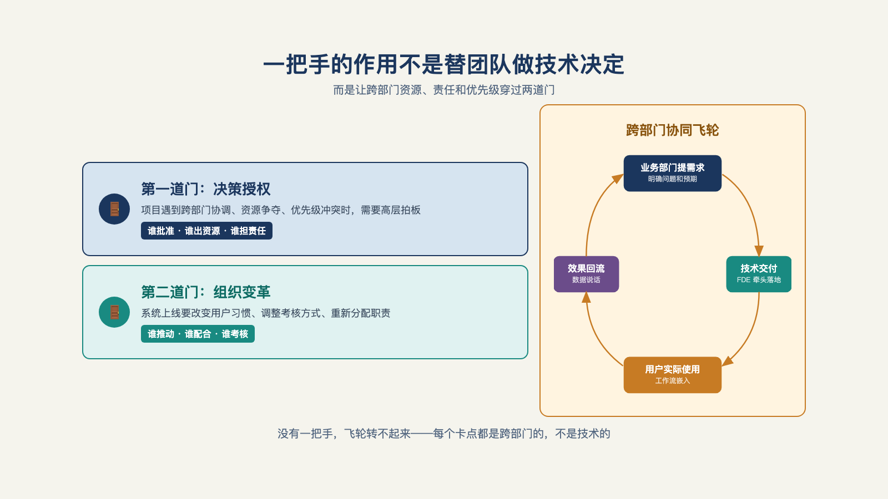

# 第 16 章 · 为什么 AI 落地是一把手工程？

> 上下同欲者胜。
>
> —— 《孙子兵法·谋攻篇》

先看一个对照实验。同一个 AI 落地项目，在两家几乎一样的公司，立项方式不同。

A 公司走技术部门立项：立项书规整、选型合理。项目死在了第 4 个月——回过头复盘，死因是要调用销售部门的数据；销售总监说，这是你们信息部门的项目，凭什么给你开权限。

B 公司走一把手立项：项目启动会上老板讲了十五分钟为什么这件事关乎明年的生意，六个月后系统跑进了三个部门的日常。

两家公司的技术方案是同一套。差别只有一个：A 公司的项目有一个好架构师，B 公司的项目有一个能调动全公司的签字人。

"一把手工程"这四个字，在国内企业软件圈说得快要磨出茧子了，以至于很多从业者听到就本能地反感——它听起来像一句推卸责任的口号，项目黄了，一句"没有一把手支持"就交代了。这一章想把这四个字从口号还原成结构：为什么人工智能落地几乎必然是一把手工程？它的正确含义是什么？错位的形态长什么样？以及它什么时候可以不是。

## 一、跨部门的难题

人工智能落地有一个别的技术项目没有的特点：它天然跨部门。

拆开任何一个真实项目，你会看到一张四散的地图——数据在 A 部门（客户信息在销售系统里，历史记录在运维手里），流程在 B 部门（要改造的审批流归财务管），预算在 C 部门（立项要过信息技术预算，受益却算在业务头上），受益在 D 部门（效率提升的账记在一线团队的报表里）。

一个中层项目负责人，手里能同时调动这四样吗？一项都难。数据权限要 A 部门点头，流程改造要 B 部门让渡权力，预算归属要 C 部门认账，受益确认要 D 部门配合度量——每一项都是跨部门的谈判，而中层手里只有"协商"，没有"裁定"。组织里唯一同时握着四项调度权的位置，就是一把手。

这不是推演，一线已经有实例。

先看一个反例：一家大厂交付团队——客户某个业务部门想做业务智能体，但没有预算；预算在 IT 团队手里，而 IT 与业务分属不同部门——乙方只能把方案设计成"既能满足 IT 的先进性，又要满足业务的效果"，最后发现"IT 要的先进性不一定是业务要的效果，业务要的效果可能不一定是最先进的"，生产关系怎么都摆不平。[^b19]

对照的正面例子来自一家制造业：董事长本人明确要拥抱人工智能，选定销售端、选定区域，自上而下推——财务、IT、销售线全部动了起来；试点从最落后的一个省做起，半年后成了全公司最先进的省，再复制到全国。同一道数学题，一把手在不在等式里，答案完全不同。

还不止于此。推动改变的是惯性和利益，而改变工作方式（惯性）的权力，同样只在一把手手里——考核指标、编制增减、部门职责边界，这些是公司治理层面的东西，不是任何业务或技术部门能单方面动的。所以这不是"请领导重视"的姿态问题，是一道权限的数学题：需要的权限总和，只有在公司管理层的金字塔尖才凑得齐。

## 二、优先级达不到，落地路走不下去

那么，是不是随便什么项目，只要找到一把手就万事大吉？也不是。帕兰提尔早期高管鲍勃·麦格鲁（Bob McGrew）给过一个更锋利的筛选标准：切入点必须是领导层认定的关键问题，最好在首席执行官最关注的五个问题之列。他的理由很现实——只有这个量级的问题，才能帮你碾过企业内部的官僚阻力；不到这个优先级，客户组织没有动力陪你走完落地路上那些艰难的部分。[^l03]

这个标准的反面同样重要。你作为乙方实际能接触到的，常常是信息负责人或者某个赞助人，离首席执行官还隔着几级——而这几级的距离会改变问题的性质：隔层的人有他自己的考核，他宁愿你解决对他容易的问题，也不愿你碰对他危险的问题。于是项目在源头就被"降维"了：本来该解决业务的核心痛点，最后做成了一个安全的、边缘的、谁也不得罪的演示性项目。这正是第 2 章里提到的一种组织层面的失败方式——不是问题不值得解决，是你够不着那个问题。

一条更完整的失败链，来自一位企业软件公司首席执行官的观察：董事会要"更多人工智能"，首席执行官于是找咨询公司做一个集中式大项目——脱离具体的业务部门，做完没人知道它怎么工作、运营没有对齐，"这些项目会失败"。[^c01]注意这条链的讽刺之处：它不是一把手缺位的失败，恰恰是一把手只在开头出现、中间全程缺席的失败。签了字，然后呢？

## 三、"三不懂"：交集是空的

为什么人工智能项目特别依赖一把手把人拉到一张桌子上？因为组织里存在一个结构性的空洞，业内流传的概括是三句话：懂业务的不懂人工智能，懂人工智能的不懂业务，都懂的没有权限。[^c21]

这不是能力问题，是组织内分工的问题。业务专家的知识长在多年现场经验里，人工智能团队的能力长在技术栈里，两套语言、两套考核、两个圈子；而同时跨过两边的人，在多数组织里职级不高——他们太新，还没爬到能调资源的位子上。三者交集为空的结果，就是每一个项目都在做"翻译接力"：业务把需求讲给产品，产品翻译给技术，技术做出来再翻回去——每转一手都会丢上下文（第 6 章的转述层损耗，在组织内部原样重演）。

能把这三类人同时按在一张桌子前的，只有一把手。把这几方拉到一起，是让"业务的不懂"和"技术的不懂"在项目内部互相抵消——业务专家现场纠偏，技术专家现场评估，权限的问题当场定。FDE 之所以被称为"前线部署工程师"，之所以要坐进客户现场，本质上就是把这个翻译接力的中间环节拉到同一张桌子上。

## 四、一把手工程的真实含义

把口号拆开，一把手工程在项目里的实际形态是三种背书，缺一不可。[^b01]

**预算背书**：跨部门项目的成本归属，只有一把手能裁定。人工智能项目的受益部门和出资部门几乎总是分离的——钱从信息技术预算出，效率账记在业务部门头上，这种项目在任何一个部门的账本里都是"亏的"，只有站在公司整体的账本上才算得平。谁看公司整体的账本？一把手。

**激励背书**：第 15 章里讨论的激励问题，在部门层面无解，只有在一把手层面才有答案。考核要不要改、编制要不要动、出错算谁的——这些是公司治理的动作，不是项目经理能承诺的。一把手不公开站台，第 15 章提到的三个死法就会一个一个应验。

**失败背书**：允许第一个项目死得有意义。人工智能项目的第一个交付，很大程度上是一次组织学习——学怎么跟智能体协作、学怎么度量、学怎么定验收口径。第一个项目的学费，需要有人以组织的名义承担：否则每个部门都会学会一件事——别碰，碰了出错算自己的。

三种背书形态，有几个实际例子。

一个是需求方的态度变化：企业一把手对人工智能的态度变了，"天壤之别——以前一直在讲怎么用、能不能用，现在直接跳过进入下一阶段：什么时候开始帮我用上"，拐点出现在能执行任务的智能体出现之后——问题的性质从"要不要"变成了"多快"。[^b19]

另一个背书的姿态则最扎实、最贴近一线：第一节那家制造业的董事长，一年之内亲自给全员和管理干部讲课超过十五场——"我先学会，我再给员工讲，那员工才能去理解我的思想、能用好这些系统"。[^b19]思维转型不是仅仅开一场动员大会就能解决的，是一把手把自己变成第一讲师——这同时覆盖了上面提到的三种背书：真金白银的时间投入（预算）、最高规格的公开站台（激励）、以身试错先交学费（失败）。

陆骁鹏（Ventus AI 联合创始人，服务北美医疗行业）曾分享自己的观察：能真正推动 AI 的老板只有一个共同点——自己得 AI native（自己就是 AI 的重度用户）。他的策略是"先搞定标杆，再向下推"[^b21]。

这不是抽象的态度问题，落到执行上是实打实的摩擦成本。

陆骁鹏对比过两个规模相近的客户：一个老板的推动理由是"别人都推我也想推"，另一个是"我很确信 AI 现在一定要开始推，要投入多少就投入多少"——两边做变更管理的难度完全不一样；有 CEO 层面的坚定支持，推起来会快很多[^b21]。

这给"三种背书"添了一层机制解释：预算背书和失败背书之所以要紧，不是仪式性的表态，是因为老板对"要不要做"这件事的确信程度，会直接传导成组织执行时的摩擦系数——跟风的老板给得出预算，给不出"以身试错先交学费"的那份笃定。

用这三条去检验，"出席动员大会"算不算一把手工程？不算。出席是十五分钟的事，而三种背书要贯穿项目落地的那几个月。

真假背书的判断标准也很朴素：项目在第四个月遇到部门墙时，一把手是出面裁定，还是说"你们自己内部协商解决一下"？

## 五、错位的形态清单

一把手参与不足或参与错位的项目，会长出几种典型的形态，每一种都有识别信号。[^b01]

- **技术部门主导型**：系统是信息部门的业绩，不是业务的工具。识别信号：项目周报里全是技术里程碑，没有一个业务指标。这是三大死法之二，上一章已展开。
- **挂名型**：一把手出席了启动会，此后再未出现。识别信号：项目升级到需要跨部门裁决时，会议纪要里找不到比部门更高的签字。乙方的对应信号：售前阶段能见到的人，交付阶段再也约不到。
- **孤岛型**：项目在单一部门内闭环，数据、权限、流程跨不出去。识别信号：系统很好用，但只在三十个人的团队里好用，扩张计划永远在"下一季度"。孤岛型是四形态里最体面的——它至少活着——但它验证不了规模化的部分。
- **咨询依赖型**：就是那条"董事会→首席执行官→咨询公司→集中式大项目"的失败链。[^c01]识别信号：项目文档越来越厚，一线使用记录越来越薄。

清单不是给别人贴标签，是拿来检查自己手里的项目：如果你是甲方项目负责人，你手里的项目此刻更像哪一种？如果你是乙方，你的合同签在了哪一种上？

## 六、两道门与一个飞轮

一把手工程不是"搞定领导"的一次性动作，它有两道门，过完第一道还有第二道，过完两道之后还能滚出一个飞轮（见图 16-1）。

*图 16-1：一把手的作用不是替团队做技术决定，而是让跨部门资源、责任和优先级穿过两道门。*

第一道门，**校准一把手的预期**。上门要讲清四件事：人工智能能做什么、不能做什么、多久看到效果、要投入什么。预期不对，上线后任何一个环节不达预期，老板的感受都是"被骗了"——三大死法之一在门口就埋下了。一个常见的校准场景：老板开口就是"帮我减员三成"或"替代三千人"，这时候要当场把对话拉回价值——人工智能现在替代的是任务，不是岗位；一个岗位八成以上的核心任务都被接管，才谈得上替代，现在差得远；把"承诺裁三千"换成"交付七个可验证的提效结果"，双方才都活着。[^l02]这道门为什么难跨？因为多数老板对人工智能的判断，来自昨晚刷到的短视频和网上流传的爆款案例，不是系统性认知——有从业者直言，落地过程里最大的隐性成本，就是老板的认知成本。[^b03]校准预期，本质是把这层认知成本花在门槛上，而不是留到验收时才爆。

第二道门，**化解员工的恐惧**。第 15 章专门用一节拆过这层恐惧——它在部门层面无解，员工要看的不是某个负责人怎么说，是组织最高层怎么表态。一把手不出面，这扇门就从里面闩着。三招：别让系统以替代人的姿态出现；让第一批用户成为受益者，再让受益者去影响观望者；以及最关键的一招——一把手必须公开站台，只私下批预算没用，要在公开场合表态"这是为了让大家做更有价值的事"。[^l02]私下支持和公开背书的区别，员工用脚投票时分得很清。

两道门都过了，还有一项实操：把关键人表贴进周报——谁是支持者、谁是对接人、谁是潜在阻力、各自的关切是什么，每周更新，让组织图从静态的名片夹变成活的地图。

过门的功夫会不会每个项目重来一遍？一位从业者的做法把这件事变成了复利：第一次搞定一个不懂人工智能的老板最累，但每搞定一个，手里的材料就厚一层——培训稿、对齐话术、常见误区清单，下次直接复用；一线踩出的真问题还反哺总部产品，让下一个客户更容易接受。所以"老板换了一茬又一茬，手里的框架越来越厚"不是安慰，是滚雪球——个人手感一点点攒成组织资产；这门功夫本身就是前线部署工程师带得走的资产之一。

## 七、两面工具

最后把本章收成两张清单，一张给甲方，一张给乙方。

**甲方项目负责人的向上管理清单**：向一把手要三样——预算归属的明确裁定（谁出钱、怎么分账）、具体授权（书面指定项目负责人及其跨部门调度权）、激励背书（公开站台，最好配一条考核调整）；汇报时用第 8 章的验收口径说话——业务指标、时间窗口、判定方式，而不是技术进展的甘特图；每季度向一把手同步一次进展：这个项目在他的五个优先事项里排第几；排位跌出前五，要么把项目升回去，要么趁早体面收场。

**乙方的售前尽调清单**：合同里的一把手参与信号有哪些——立项会上谁出席？验收标准谁签字？跨部门数据调用的授权路径走不走得通？一个只和技术部门谈的合同，要按"项目大概率死在第四个月"来定价风险（第 20 章收费与第 27 章接单判断会接住这条）。还有一条善意的提醒：如果尽调发现客户的一把手只想在年报里写"人工智能"四个字，最好的生意是不做这门生意。

## 八、什么时候可以不是一把手

回到开头那个本能的反感——"一把手工程"被讲成万灵药时，确实会遮住一个降维的真相：规律的核心不是职级崇拜，是**权限与受益对齐**。[^l02]

当项目能在一个部门内闭环、数据不出部门、流程不碰别人的奶酪时，"一把手"可以降维成"流程负责人"——那个对这条流程的权限和受益同时负责的人。车间主任对车间的排产系统、财务总监对财务的审单智能体，都可以是有效的"部门级一把手"。

所以这一章的结论收在一句话上：人工智能落地的最小组织条件，不是"有一把手"，是"权限的覆盖面不小于问题的跨度"。问题跨了四个部门，权限就得站在四个部门之上；问题只跨一条流程，流程负责人就够。前者是例外还是常态？到目前为止，前者仍是常态——因为值得 FDE 出手的问题，几乎总是跨部门的。

一把手让你进门，也让项目活过了采用。但活的系统总要问最后一个问题：交付的终点在哪里——是验收签字，还是你能放心地走？下一章，我们讨论移交。

---

[^c01]: a16z：Box CEO 谈 AI Agent 与企业为何跟不上
[^b01]: 十字路口 × Rolling AI：FDE 对谈
[^b03]: AI 职觉：别再卷 Agent 了
[^b19]: 硅谷 101 E248：和阿里瓴羊朋新宇聊中国式 FDE
[^b21]: 腾讯研究院 AI 透镜圆桌 06：来自硅谷一线创业者的 FDE 非共识与落地指南
[^c21]: 有在做 FDE 这个工作的佬吗（linux.do 帖）

[^l02]: 《关于 FDE 的 100 个问题》
[^l03]: 范冰《前线部署工程师（FDE）》（XDash 开源书）