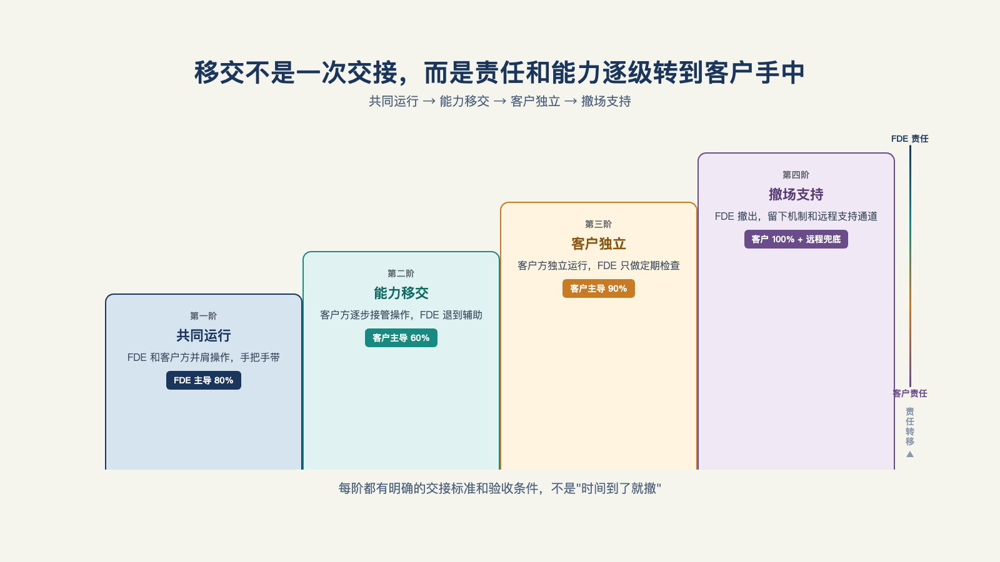

# 第 17 章 · 怎么把系统交给客户自己运行？

> 不幸的国家才需要英雄。
>
> —— 贝托尔特·布莱希特《伽利略传》

FDE 什么时候可以撤？两种撤场，结局天差地别。

第一种，体面地走：验收通过，庆功宴散，工程师撤出。三个月后客户没人提这个系统，监控面板一片绿灯——不是系统在跑，是没人再用。

第二种，也是体面地走：同样的流程，但六个月后客户内部开季度会，讨论的是"下个季度让智能体再接两个环节"，没有人再提"这是人工智能项目"——它已经长成了工作本身的一部分。

两种撤场在撤离当天看起来一模一样。区别要到后面才显形，而决定区别的动作，全部发生在撤之前。这一章回答交付的最后一段：怎么把系统交给客户自己运行，才算交付完成？

## 一、交付是三段，验收单只覆盖一段

传统项目制对"交付完成"的定义是一张验收单。但交付其实是三段：**验收**——系统在约定口径下达标（第 8 章）；**采用**——用户真的在用（第 15 章）；**移交**——客户自己能运行、维护、改进它（本章）。三段全过，能力才算留在了客户组织里；只有第一段，留下的是一套没人负责的软件。

有一位长期观察这个行业的从业者写过一句听起来自相矛盾的话：最好的前线部署组织，致力于消除自身的工作——建模板、造工具、把一次性的客户代码变成可配置的平台能力；目标不是消灭这个角色，而是把它移向更有价值的问题。[^c14]这句话的原意是说产品化（第 21 章展开），但把它挪到移交上同样成立，甚至更贴切：一个不能让自己变得不必要的交付团队，把每个项目都做成了自己的长期饭票——这不是敬业，是没让客户断奶。

判断断没断奶的标准很朴素：撤场六个月后，系统的小变更、小故障、新需求，还要不要回到你手里？要，说明判断力和运行知识没交出去；不要，才算交完。

## 二、撤场三件事

一位从业者把 FDE 撤场的完成条件概括成三件事：业务的融合、知识的治理、系统的对接——"这三件事情都做好了，他才能够离开"。[^b01]

**第一件：业务融合。** 系统要长进业务流程里，不再是"那个人工智能项目"。可核验的动作有三个：流程文档更新——智能体参与的环节写进部门的标准作业流程，替换它就得改流程文件，组织惯性反过来保护系统；嵌进日常——系统的使用发生在用户本来的工作界面里（第 15 章的嵌入原则），而不是一个要专门登录的孤岛；指标归属落地——系统的业务指标记进业务部门的报表，不是记在信息部门的项目总结里。这一件的判据，就是本章开头那句话的反面：六个月后没人说"这是人工智能项目"，它只是工作的一部分。

**第二件：知识治理。** 运行系统的知识，要从 FDE 的脑子里搬进客户的组织。搬什么？三样资产，正好都是前面各章的产出：运行手册（第 14 章的一页纸：告警谁看、出事翻哪页、什么时候按回退按钮）；评测集（第 12 章那套"带得走的复利资产"——以及它的维护责任：谁往里加错例、多久跑一次回归）；故障处置手册（第 13 章的四类失败分诊：每类故障的第一响应动作）。三样资产在移交清单上是实体条目，不是"已沟通"三个字。反面教材第 15 章见过："记忆丢了要重喂"——运行知识不文档化，人一走系统就退化。[^b04]

**第三件：系统对接。** 运维责任接进客户体系：监控告警接进客户自己的运维平台（而不是只有你们公司看得见）；升级路径明确——谁批准变更、谁执行、停机窗口在哪；供应商责任边界写进合同——出什么级别的事故找谁、响应时间多少、什么情况下收费。第三件最容易在"关系好"的时候被跳过，然后在第一次半夜故障时被发现从来没人约定过。

三件事的共同点：它们都不是技术动作，是责任和知识的转移。技术早就交出去了，责任没有。

## 三、交付是下台阶，不是跳悬崖

三件事不可能在撤场日一次完成，交付要走一个阶梯，每一级有时间、有退出条件（见图 17-1）。[^b01]

*图 17-1：移交不是一次交接，而是责任和能力逐级转到客户手中。*

**第一级：陪伴运行。** 客户团队开始操作，FDE 在旁边盯着——出错就修，但修的动作让客户看见。这一级结束时，客户能独立完成日常运行。退出条件：连续若干周无人工干预的常规运行。

**第二级：影子运行。** 客户操作，FDE 旁观——只记录不动手，每周碰一次，把客户自己没发现的问题攒成清单。这一级真正在交付的是判断力：什么情况算正常、什么情况要警觉。退出条件：客户对异常的处置决策，连续若干次与 FDE 的事后判断一致。

**第三级：撤出。** 只留升级支持——约定的响应级别、约定的渠道，其余全归客户。

阶梯的两侧各有一个坑：右侧是"永远撤不了"——每一级都无限延长，影子运行变成常驻保姆，交付失败但没人承认；左侧是"突然消失"——验收完直接跳到第三级，客户第一次独立面对故障时孤立无援，弃用从那天开始倒计时。每一级停多久、什么时候进下一级，这个节奏感，就是新手和老兵的区别。

## 四、三条弯路

移交的失败有几个高频形态，每一个都对应一个正确做法。

**弯路一：移交就是发文档。** 文档打包发过去，签字，撤场——三个月后没人读过第二页。企业文档写完没人读是常态，除非它做到两条：以任务组织而不是以功能组织（"如何处理一笔异常退款"，而不是"退款模块功能说明"），且嵌在使用现场而不是躺在共享盘里（在用户卡住的地方就地出现）。[^l03]配合移交期的小考核更有效：让客户方的接手人当着你的面走一遍故障处置——他讲，你听，讲不下去的地方就是文档的漏洞。

**弯路二：评测集不给客户。** 运行手册可以照抄给客户，评测集却常被留在自己手里——它是资产，也是下一单的议价筹码。这个选择要在合同期就谈定，而不是撤场时博弈：评测集连同维护责任一起移交，客户得到的是持续改进的能力，供应商得到的是"能干净移交"的声誉——这笔交换在第 20 章收费模式里会再算一次账。这里先把立场说清：抱着评测集不撒手的团队，本质上是把"持续收费的权利"看得比"交付完成的义务"重，客户迟早会感觉到。

**弯路三：只移交操作，不移交判断。** 客户会按按钮，但不会改参数：阈值要不要调、新错例怎么归因、要不要触发回退——每个小问题都得回头再买一次服务。这一条最隐蔽，因为它在合同期内看不出来，甚至对营收还很好看。破解它的机制有一个现成样本：某家人工智能公司与一家金融科技公司的合作，把"培训培训师"写成了核心设计——识别客户组织里的积极分子，把他们培养成内部讲师和内部答疑人，给官方认证、给专属支持通道、给在高管面前曝光的机会；合作的总目标一句话："转移知识，让客户能独立构建和扩展自己的智能体。"交付做到最后，是教会客户教自己。[^l03]

## 五、移交之后：五面镜子

撤场不是终点。移交质量的高低，要在撤场后的一两年里照镜子才看得清。企业客户流失的原因，可以归纳为五类，每一类背后都对应着移交时欠的账。

- **价值蒸发**：系统还在跑，但没人记得它解决了什么问题——立项时的价值叙事断了档，新上任的管理者只看见一笔运维费。对冲它的动作在移交清单里：把价值口径和度量责任一起交给客户，让"这系统值多少钱"始终有人回答。
- **支持者离场**：你的内部盟友升职调岗，继任者没亲历过当初的选择，系统成了"前任的政绩"。对冲动作：关系网格化（一个支持者之外至少再发展两条关系线）、价值组织化（把系统写进流程文件和集体记忆）。移交期就是网格化的窗口。
- **质量漂移**：业务在变、数据在变、模型在更新，输出质量缓慢下滑，等管理层注意到时已经晚了。对冲动作：评测集移交的真正意义在这里——回归测试由客户自己跑，质量一漂移，第一时间发现的就是客户自己。
- **成本反噬**：用量越大账单越高，财务的审视越严。对冲动作：第 14 章的成本看板和预算熔断随系统一起移交，让客户自己看得懂、刹得住。
- **供应商戒断反应**：客户对"被绑定"的警惕——咨询行业甚至有预测说，多数企业终将因为成本过高与内部技能不足而放弃这类方案。[^l03]对冲动作恰恰是彻底的移交：客户怕的是"离不开你"，不是"你在这里"。

五面镜子照出的结论是一致的：移交不是交付的尾巴，是交付质量的验收单——你在场时欠的每一笔账，撤场后都要连本带息地还。

## 六、撤不了的场怎么办

诚实地说，总有一些场撤不了：客户没有承接的意愿，或者没有承接的能力。这时候要做的不是硬撤（系统会死），也不是赖着（人天依赖），而是把这种说不清的状态写进合同——托管运行，作为一种明码标价的服务：客户明确知道自己买的是持续托管而不是已完成交付，供应商明确知道自己收的是运维的钱而不是交付的钱，双方对"这个系统归谁"没有错觉。[^b01]

托管与假装移交的区别，商业上是一张合同，伦理上是一句实话。前者客户可以随时决策"自建团队接回去"，后者客户以为已经拥有、实际租用——等他发现真相那天，失去的不止一个系统，还有对你所有承诺的信任。

最后补一个商业视角，为第五部搭桥：移交能力本身就是产品化的前置。能干净移交的团队，才有资格谈规模化复制——因为移交清单上的每一条（模板、手册、评测集、连接器），同时都是下一个客户的启动资产；不能移交的团队，每个项目都在用人天堆人天，堆到团队规模的上限就停。[^c14]这个逻辑第 21 章会展开成"定制量递减"的完整论证。

撤场那天可以开一个很短的会，议程只有三行：三件事逐项过清单，每项有客户方签字人；影子运行期的周报模板定稿；下一次"只谈升级"的会，约在半年后。会开完，人才撤。

本章讲的是理想情况：客户想要这套系统，组织配合移交。但把目光转向中国市场，采购结构、信任结构、定义权都不一样——采用和移交长在另一套土壤里。

下一章，我们聊聊中国的另一套打法。

---

[^c14]: @deployengineer（Bhaulik Patel）系列长文
[^b01]: 十字路口 × Rolling AI：FDE 对谈
[^b04]: 一路瞳行 EP134：从 AI 辅助到数字员工

[^l03]: 范冰《前线部署工程师（FDE）》（XDash 开源书）