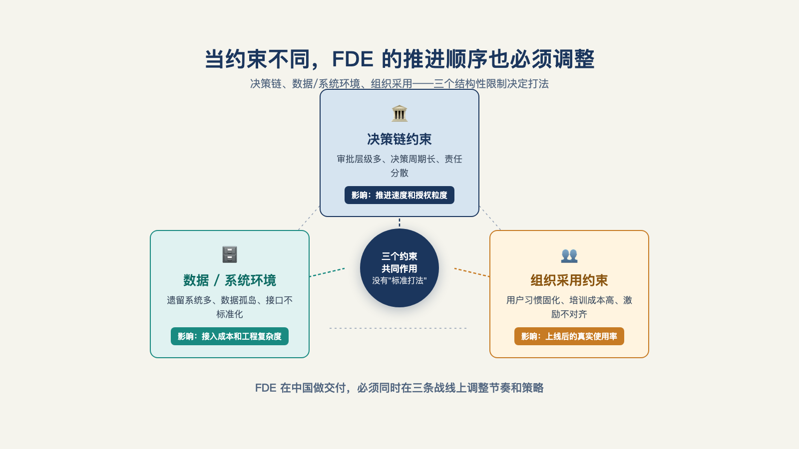

# 第 18 章 · 中国企业的 FDE 落地，为什么是另一套打法？

> 地图不是疆域。
>
> —— 阿尔弗雷德·柯日布斯基

先来看两个同样做 FDE 的人，一天的工作时间都花在哪。

第一份来自硅谷。一家模型平台公司的 FDE 把约七成半的时间花在软件工程与模型优化上，咨询与客户关系分摊其余（时间账细目见第 1 章）。[^b11]

第二份来自中国。一位在国内做企业人工智能落地的顾问同样算过：大约 60% 的时间花在帮客户梳理业务问题，或者干脆在"做人情"——维护关系、聊天、吃饭、挖需求；技术只占剩下的一小截。[^b17]

两份放在一起，讲的不是谁好谁坏，而是想说明：同一个 FDE 岗位名称，在两个市场里干的是两份工作。

硅谷的 FDE 假设了一个已经就位的世界——需求是清晰的、数据是在线的、付费机制是成熟的，他的时间自然可以七成半投在工程上。中国的从业者面对的是另一个世界：需求要在饭桌上挖，数据要从笔记本里誊，付费要按人头算。把硅谷的打法原样搬过来，搬得越像，死得越快。

这一章我们讨论下：差异到底差在哪些结构上，打法要怎么变，以及中国市场长出了哪些自己的形态。

## 一、结构差异，打法变形

差异不在技术——模型是同一个模型。差异在结构，一共有四条（见图 18-1）。[^l02]

*图 18-1：当决策、数据环境和组织采用的约束不同，FDE 的推进顺序也必须变形。*

**第一条，采购与预算。** 美国市场能接受订阅制、按量计费甚至成果分成；中国企业的肌肉记忆是"买断加项目制验收"：年度预算、立项招标、分期验收付款。打法变形：把最小可行部署切进既有验收节点——第 8 章那套验收契约（业务指标、时间窗口、判定方式）恰好长得像项目制的验收单，这反而是顺水推舟；照搬订阅制，先死在采购流程里。

**第二条，数据约束。** "数据不出门"在中国客户那里不是偏好选项，常是硬约束——尤其国资与涉敏行业。打法变形：私有化与本地部署的架构决策要提前到设计期，而不是补救期。一线的例证：有团队因预算所限做本地开源模型加检索的冷启动——成本约束下的本地化不是中国特色插曲，是常态。[^b03]

**第三条，付费习惯。** 为人天付费，市场成熟了一百年；为结果付费，采购科目里没有这一栏。打法变形：按结果计费的教育成本要计入定价（第 20 章展开怎么算），或者用"阶段验收 + 价值指标写进条款"的混合制过渡。

**第四条，人才供给。** 既懂业务又懂人工智能的复合型人才，市场共识是"不是贵就是能力不行，大部分公司只能自己培养"。[^c21]打法变形：转岗加现场练——大厂普遍把产品、前端工程师转岗做前线部署，送去甲方现场收集需求、出原型。

四条再往下挖一层，还有一个共同的地基问题。阿里瓴羊首席执行官朋新宇，其团队服务大几百到上千家中大型客户，他给出的判断是：美国企业在信息化阶段有 Salesforce、SAP 这样的公司，"奠定了很多的工作流，以及奠定了很多的数据标准"；中国缺这一层，"每一家都没有一个比较平稳的地基"——所以中国的交付经常要"从第一天打桩盖楼再到上面装修，一系列事情都要干完"。[^b19]这个判断同时解释了本章的多条观察：数据约束严，是因为数据地基本来就要现打；人情占比高，是因为没有标准工作流可依，需求只能从关系里挖；付费认人天，是因为"中国每个大的企业都有一个 IT 团队"，纯功能集成的交付客户内部也能做，乙方必须做出超出内部团队的价值才收得到钱。

## 二、定义权：这一公里由谁说了算

四条差异之上，还悬着一个更根本的问题：**最后一公里由谁定义？**

同一个项目，有人觉得从演示到上线是一公里，有人觉得到一线员工愿意用起来才算到头——差出好几倍。谁来定义终点，直接决定 FDE 干的是技术活还是扯皮活。硅谷叙事里，这一公里由 FDE 自己定义：他坐在客户现场，看着人干活，亲手把断点接上，再把经验带回总部。而在国内，定义权常常根本不在 FDE 手里。

一个被从业者反馈的真实案例：一家国企，合同是大老板签的，落地的执行人提不出需求，就让 FDE 自己找、自己提、自己做——最后做了七个智能体，结果却没人用。这最后一公里被拖成了泥潭，因为从头到尾没人说清终点在哪里。链路上还常隔着代理商：国内不少项目由云厂商的代理商承接，需求隔了好几层传到现场——每一层都在放大和扭曲承诺。[^l02]

定义权之争的打法不是对抗。是把"定义"这件事从口头变成文件：用第 8 章的验收契约，把"做成什么样才算完成"写成双方共同签署的一页纸——终点由谁说了算的问题，变成终点白纸黑字的问题。签字之前，你是在给别人对不上号的期望打工。

## 三、两种土壤，两套推进逻辑

结构差异落到具体客户身上，中国市场的另一个特点是双轨：私企和国企，是两块完全不同的土壤。

私企的逻辑是"搞定事"。老板只关心一件事：花几百万，增收还是降本？人工智能不人工智能，他不在乎。打法：直通拍板的人，用结果说话，别绕。

国企的逻辑是"搞定人"。组织里的权责博弈比技术方案复杂十倍，怕犯错是底色。打法：先理清谁负责、谁背锅；把项目进展翻译成对接人能拿去向上汇报的语言——给他材料交差，而不是跳上去替老板做决定；同时把这一周能推进的小事列出来，能落一厘是一厘。其中有一条：**推动进程，绝不替人拍板**——权责不清是客户自己的病，你开不了刀；越界担责，项目黄了锅全是你的。

两套逻辑混用就会出问题。而有一个动作对两边都管用：最好能见到签合同的那个人——离源头越近，需求越真。[^l02]

进场前花十分钟判断土壤，比后面花三个月补救划算。

## 四、中国现场的一线观察

前面那位自述"60% 时间做人情"的 FDE 从业者有三条一手观察。[^b17]

**观察一：先建数据，再谈契约。** "很多水下生意，数据是没有的，客户信息记在笔记本上。"第 10 章的数据契约假设"客户有数据可接"——中国现场常常更早一步：先把笔记本里的信息誊进系统，把老师傅脑子里的流程画成图，契约才有的谈。

**观察二：最后一公里卡在最 Low 最土的地方。** 有门店客户还在用装不上新软件的 XP 老电脑；配好的机器人某天"罢工"，查了半天，是被人随手关了机。部署方案的第一个技术决策，常常不是选模型，是适配哪一年的操作系统。

**观察三：人情是基础设施。** 花在人情上的那 60% 时间，要换个角度看：关系不是润滑剂，是承重墙——需求从关系里挖，信任从饭桌上长（这笔时间账要提前算进成本和报价，第 27 章接单定价会用到）。信任从哪来——大厂背书、过往案例，个人 IP，还是熟人转介绍——直接决定了你是哪种从业者。

陆骁鹏是极少数两边一线都做过 FDE 的人——在美国创业做北美医疗 AI 落地（Ventus AI），此前回国工作过两年，接触过国内版本的 FDE。他对国内客户心态的概括很扎心："两三个人捯饬捯饬也能做出来"——客户甚至直接反问："你给我两个人做项目，我为什么不能自己招两个人考核？"[^b21]

这句反问，和本章第三条结构差异（付费习惯）说的是同一件事：中国客户默认外部团队卖的是"人天"，人天买得起，就没道理外包；而"为结果、为持续判断力付费"这件事，本身就要先教育市场——这不是中国客户不理性，是两地对"外部团队到底在卖什么"的认知差还没被填平。

横跨中美两国看同一个问题，反而更容易看清：这不是某个市场的毛病，是"可教性低的复杂度"（很难教给客户自己上手做的复杂问题）这门生意在任何一个信任结构尚未成熟的市场里，都要先过的第一关。

## 五、先行者的答卷

中国市场不是没有答卷。把公开可查的先行者排开，能看到两条清晰的路子：服务商怎么把自己产品化，大厂怎么把这件事建制化。

服务商的产品化，做的是同一件事的两个层面：先立边界，再定阶段。一家不动产与设施管理行业的本土服务商，在官网上用三句话划清了它和驻场外包的界限：按阶段交付、按结果验收，而不是按工时结算；带着成型的产品来做工程，而不是从零现写现改；做完会走、能力沉淀在系统和客户团队里，而不是越驻越久。它还建了劝退机制——场景未验证的不接、数据一张表能导出的不接、只想了解人工智能的不接。这三句话加一套劝退，几乎是把本书第二部和第四部的要点做成了广告语。

边界立住之后，下一步是把方法论做成可复制的阶段：一家金融服务商沉淀出三阶段交付——场景诊断一到两周（识别价值最高的三到五个场景、量化投资回报）→ 嵌入式交付八到十六周（从模型选型到生产集成）→ 生产部署与持续演进（随业务迭代），同时明确"数据不出域"。[^l03]注意它的结构：诊断期就是第 6 章的发现与筛子，交付期就是第 7 章的最小可行部署，演进期就是本章的交付之后——方法论是通的，只是长在了中国的采购节奏上。

大厂走的是另一条路：不靠边界和阶段说服客户，靠建制化本身。火山引擎立专职 FDE 团队；其总裁在公开采访中的表述与本书的定义几乎逐字呼应——"不是销售，也不是售前，必须具备很强的技术落地能力"，且团队成员刻意配置多元行业背景。[^l03]电商公司得物的效率工程负责人则把万人规模的人工智能转型拆成三步：先全员共识、降低门槛让人用起来；再把场景按容错空间分象限，容错大的先交给智能体；最后设知识运营小组，把专家的隐性经验搬进智能体可见的空间——共识、场景、知识，顺序不能反。

建制化走得最深的样本，可能是阿里瓴羊首席执行官朋新宇所在的团队。作为阿里数据中台方法论的创立者，他的团队在"FDE"这个词流行之前就叫 CSM（客户成功），做了五年，先靠数据平台业务服务了大几百到上千家中大型客户——用他自己的话说："没有 FDE 这个词之前，我们干的就是这个事情……我们原来 5 年前就一直有这么一个团队就叫 CSM。"[^b19]他们把这套做法收敛成三条原则：以业务结果为导向（问题必须有业务目标、业务数字和历史记录，能构建评测集与指标体系）、以企业数据为基座、以岗位标杆为预设——AI 客服的起点人设就是"一个工作五到十年的客服坐席"。[^b19]

落到具体案例：一家 3C 数码客户的"催发货"售后环节，被拆出来是 260 多步——少发整机、漏发配件、赠品未达三类催法，内部外部系统混杂、横跨京东天猫多个平台，覆盖 95% 以上的场景；而现状的人工客服回应"以小时或者天为单位"，客户等不起就退单。[^b19]选场景的标准也给了可直接抄的三问：哪里耗人最多（打电话、接电话、处理投诉）、耗钱最多（赔款止损、营销投放）、耗时最多（催货查询）——这三问与第 6 章的价值密度筛子几乎说的是同一件事。组织上，他们的答案是"我们的做法不是一个人，而是一个组织"：以业务结果为导向的 BA（美妆、家电、汽车这些行业专家，负责编排流程、设定评测标准）、AI 架构师（把业务问题翻译成用什么模型、哪个环节人干预哪个环节机器接管）、再从客户方选出最好的客服和销售组成调教团队——与第 24 章能力模型、第 26 章团队建设的讨论直接对话。

这些答卷背后压着一个共同的财务事实：2025 年年报，用友人均营收约 48 万元、金蝶约 62 万元；同一年，帕兰提尔的人均营收约 100 万美元——十倍级的人效差。[^l03]这就是"项目制诅咒"在财务报表上的长相：大公司要定制，厂商做一单赔一单，交付完代码离场作废，最顶尖的工程师消耗在高度定制的非标交付里。也是同一组数字，给出了中国市场对这门生意最大的想象空间：谁能把交付工程师的产出从"人天"定价改写成"结果"定价，谁就同时改写了数十万人的市场价格和这门生意的财务结构。

需求方的声音也值得一听。一份面向企业首席信息官的定向调研给出了三个并排的数字：73.3% 的受访首席信息官认可前线部署模式、愿意试点；同时 60.0% 担心供应商对自己行业理解不足，53.3% 认为市场缺少可量化的投入产出证明。[^l03]翻译成一句话：认可是真的，顾虑也是真的——客户不是在犹豫要不要买一个新岗位，是在评估一整套还没被验证过的价值实现机制。这份顾虑清单（行业理解、可量化的投入产出），恰好就是本书第 6 章和第 8 章提到的。

## 六、两个真实形态

结构约束之下，中国的前线部署长出了两个自己的形态——它们与硅谷原版的责任结构都不同，但都在各自的结构里真实运转。

**形态一：大厂驻场原型工程师。** 社区里的一线从业者描述：公司把产品和前端工程师"二合一"派去甲方现场收集需求，用人工智能现场出原型——纯演示数据的前端页面，根据甲方要求现场改；需求确定后，交回公司内的后端开发做实现和联调。[^c21]按第 2 章的三判据检验，它覆盖的是光谱上"发现 + 原型"那一段，生产和回流在别处。在中国的采购结构（代理商隔层、需求模糊、验收导向）下，这是理性的分工——原型是撬动甲方确认需求的最快杠杆，而且它恰好绕开了定义权的扯皮：原型摆出来，改三轮，需求就自然定义完了。

**形态二：个人 FDE 与独立服务商。** 社区里另一位从业者的自述：做智能体开发定制三年，多数时间线上接单，自建了案例库和可复用模块——但"自己干没背书，打工又苦"。[^c18]这句话戳中了独立形态的两个真实约束：个人背书的信用成本（没有大厂光环替你开第一扇门），和打工形态的激励损耗。它的成熟形态，是那些以顾问与销售能力为主轴、聚焦中型企业、按行业纵深复制案例库的"企业人工智能落地服务"生意——工程能力排在第三位，前面是顾问与销售：不是工程不重要，是在中国市场，挖得出问题、谈得下单子比搭得出系统更稀缺。[^b17]这个形态的完整讨论在第 27 章展开（个人能不能独立做 FDE）。

两个形态放回第 1 章的责任上，结论是：中国样本普遍窄于硅谷原版——但"窄"不等于"错"。形态是约束的函数：采购结构决定你只能收到原型需求，你就把原型做到极致；信任结构要求你先做人情，你就把人情做成方法论。评判形态优劣之前，先看清它回应的是什么约束。

## 七、约束更紧的极限测试

在此前提下，本章的结论是三句话。

第一句：中国市场不是 FDE 的低配版，是另一套约束逼出的另一套活法。采购结构决定了你多半只能先做原型；信任结构决定了没有大厂背书的人只能靠人情和案例一点点攒。驻场原型工程师、个人 FDE，都不是"退而求其次"的将就——是在各自面对的约束下，能站得住的打法。

第二句：中国的约束不是"更多一条"，是"更紧"——本章一路讲下来的采购规则、数据现状、付费习惯、定义权归属、人情投入，加在一起就是一句话：同样一件事，在中国要多花几道工序才能立住。第二部和第四部的那些方法，在约束松的市场是加分项；在这种紧约束下，是不做可能就会死的必答题。

第三句，也是给所有读者的：把中国样本当作极限测试。一套交付方法如果在中国现场的约束下依然成立——依然找得出值得解决的问题、依然收得拢验收口径、依然撤得了场——那它在约束更松的市场里，大概率更能成立。

组织、采用、移交都谈完了。但这一切之上还悬着更根本的一问：这么重的交付背景下，这门生意在商业模式上到底成不成立？第五部，我们来算这笔账。

---

[^b11]: Baseten：我做前线部署工程师学到了什么（Het Trivedi）
[^b17]: 破局点 TURNING POINT 第 31 期：中国式 FDE
[^b19]: 硅谷 101 E248：和阿里瓴羊朋新宇聊中国式 FDE
[^b03]: AI 职觉：别再卷 Agent 了
[^c21]: 有在做 FDE 这个工作的佬吗（linux.do 帖）
[^c18]: 在武汉做 FDE，寻伙伴（linux.do 帖）
[^b21]: 腾讯研究院 AI 透镜圆桌 06：来自硅谷一线创业者的 FDE 非共识与落地指南

[^l02]: 《关于 FDE 的 100 个问题》
[^l03]: 范冰《前线部署工程师（FDE）》（XDash 开源书）